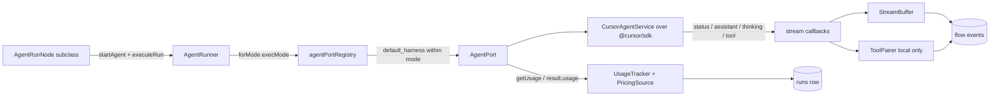

# Agent harness

## Summary

The agent harness is the engine's seam for running coding agents: nodes never talk to a vendor SDK directly. [`AgentPort`](../../lib/engine/ports/agentPort.ts) defines one normalized interface — start, stream, probe, cancel, usage — and each runtime registers an adapter in `agentPortRegistry`. [`AgentRunner`](../../lib/engine/harness/agentRunner.ts) supervises every run end to end: model resolution, run-row persistence, event-stream normalization, usage/cost capture, and late-write fencing. Two ports ship today, both over the shared `@cursor/sdk` runtime in [`lib/integrations/cursorSdk.ts`](../../lib/integrations/cursorSdk.ts): `CursorCloudAgentPort` (durable cloud runs) and `CursorLocalAgentPort` (in-process local runs).

## Architecture

### The `AgentPort` interface

One port per agent runtime ([`lib/engine/ports/agentPort.ts`](../../lib/engine/ports/agentPort.ts)). Identity fields: `kind` (registry key, e.g. `cursor-cloud`), `label`, `execMode` (`"cloud" | "local"`), `harness` (the product surface the port belongs to, e.g. `cursor`), plus the vendor pricing facts `fallbackModels`, `listDiscount`, and `rateOverrides`.

Behavior methods:

| Method | Contract |
|--------|----------|
| `start(spec)` | Start a run from an `AgentStartSpec`; returns durable ids `{ agentId, runId }`. |
| `stream(handle, callbacks)` | Stream a run to completion (re-attaching after a restart when durable); returns `{ result, sessionId? }`. |
| `getRun(handle)` | Probe a durable run: `{ state: "running" }`, `{ state: "terminal", result }`, or `{ state: "unavailable", error }`. |
| `cancel(handle)` | Stop an in-flight run. |
| `hasActiveRun` / `releaseActiveRun` | In-process run ownership (leak guard when `start()` is never streamed). |
| `getUsage(handle)` | Billed per-run usage, or `null` when the runtime doesn't report one. |
| `inspectSession(sessionId, runId, workspace)` | Restart-recovery probe for local runtimes (null when not loadable). |
| `listCatalog()` / `status()` | Model catalog; settings-page configured check. |

Normalized shapes mirror what the SDK emits: `AgentRunResult.status` is `"finished" | "error" | "cancelled"`; `AgentRunUsage` carries token counts plus optional billed `cost`; `AgentStreamCallbacks` are `onStatus`, `onAssistant`, `onThinking`, `onTool(name, status, args?, callId?, extra?)`. `AgentStartSpec` is the union of cloud-shaped inputs (`repos`, `autoCreatePR`, `customSubagents`) and local-shaped inputs (`workspace`, `cwd`, `settingSources`); ports use the fields relevant to them.

### Provider selection (`AgentPortRegistry`)

`agentPortRegistry.forMode(mode)` picks the port for a flow's execution mode. When the `default_harness` setting names a harness that registered a port for the mode, that port wins; otherwise the first registered port for the mode. Unknown or stale setting values fall back the same way, so a bad setting never hard-fails a run. Builtins (`CursorCloudAgentPort`, `CursorLocalAgentPort`) register lazily on first use; adding a runtime is one adapter file plus one `register()` line — the same pattern as `GitHostRegistry`.

### `AgentRunner` — run supervision

[`lib/engine/harness/agentRunner.ts`](../../lib/engine/harness/agentRunner.ts) exposes two methods:

- **`startAgent(ctx, input)`** — resolves the exec mode from the flow row (`flowCtxHelper.execMode`), resolves the model (`resolveAgentRunModel`: per-run override → `default_model` setting → `DEFAULT_MODEL` env), and builds the `AgentStartSpec`. For local runs it sets `workspace`/`cwd` and calls `worktreeManager.ensureForRun` — an unpinned mutating run is ensured into the flow worktree (the node's `input.cwd` pin always wins; `plan`-mode runs stay on the hub) and a worktree setup note is appended to the prompt. For cloud runs it sets `repos` from the flow's `repo_url` and `startingRef`.
- **`executeRun(ctx, nodeId, start, label, options)`** — runs a started agent to completion: persists the run row (`nodeSupport.persistRun`), emits the `started` lifecycle event, streams events (below), captures usage/cost, updates the run row's terminal status (`finished` / `error`), and throws when the result is missing or not `finished`. When `ownsNodeStatus` is not `false` and the run started under a node attempt token, a late-write guard re-reads the node's `attempt_id` and throws `RunSupersededError` if the node has moved on (chat-only turns pass `ownsNodeStatus: false`). The final lifecycle event carries `durationMs`, `tokens`, `cost`/`costCents`, `estimated`, and `model`. The in-process run handle is always released in a `finally`.

### Stream normalization

Provider callbacks become engine events inside `executeRun`:

- `onStatus` → a `status` event per transition.
- `onAssistant` / `onThinking` → [`StreamBuffer`](../../lib/engine/harness/streamBuffer.ts), which batches deltas and flushes on a 1.5s cadence so long streams don't flood the DB. Text is head/tail-capped (`thinking` at 4,000 chars, `assistant` at 20,000) with an `… [N chars omitted] …` marker; `flushBeforeTool()` keeps the feed ordered around tool events.
- `onTool` → direct emit for cloud runs; for local runs, [`ToolPairer`](../../lib/engine/harness/toolPairer.ts) pairs start/end events — by `callId` when present, else FIFO per tool name — synthesizing ids for unpaired ends and computing `durationMs` from the paired start.

### Usage and cost tracking

[`UsageTracker`](../../lib/engine/harness/usageTracker.ts) (`captureRunUsage`) prices every finished run from one of two sources, in order:

1. A real > $0 billed charge from the port's `getUsage` (cloud only; all-zero billed data is treated as "no charge" via `billedCents`).
2. A token-based estimate: the run's token counts × the effective rate card, discounted by the port's `listDiscount` (`estimateCostCents`). The rate card resolves in `resolveRates`: the `pricing` setting's exact model id, then its `"*"` / `"default"` wildcard, then a longest-prefix match over the merged table — [`PricingSource`](../../lib/engine/harness/pricingSource.ts) (LiteLLM's community pricing JSON, 6h TTL cache, 10-minute failure backoff, static wildcard fallback) with the running port's `rateOverrides` merged on top.

Token totals are recomputed with `uncachedInputTokens` ([`lib/usage.ts`](../../lib/usage.ts)) so cache reads aren't double-counted under prompt-total input semantics. Everything persists onto the run row via a COALESCE partial update; estimates are flagged `costSource: "estimate"` in the usage JSON so `backfillCosts()` (one-shot per process) can re-price stored rows after rates change. Cursor's vendor facts live in [`lib/integrations/cursor/pricing.ts`](../../lib/integrations/cursor/pricing.ts): `CURSOR_LIST_DISCOUNT` (7% off list) and `CURSOR_RATE_OVERRIDES` (rates LiteLLM doesn't track, e.g. `composer-2.5`).

### Providers

| Port | `kind` | Runtime | Notes |
|------|--------|---------|-------|
| `CursorCloudAgentPort` ([`lib/integrations/cursor/agentPort.ts`](../../lib/integrations/cursor/agentPort.ts)) | `cursor-cloud` | Cursor cloud VMs | Durable handles (agent id + run id survive restarts; recovery re-attaches via `stream`, so `inspectSession` returns null). Follow-up runs inherit the agent's model. `settingSources` is intentionally not forwarded — cloud agents always load the project/team/plugins layers plus dashboard MCP servers. `status()` = API key stored. |
| `CursorLocalAgentPort` ([`lib/integrations/localAgent/agentPort.ts`](../../lib/integrations/localAgent/agentPort.ts)) | `cursor-local` | In-process agent loop | Requires `cwd`/`workspace` or throws `AgentRunWorkspaceError`. Delegates to `LocalAgentService` ([`lib/integrations/localAgent/agent.ts`](../../lib/integrations/localAgent/agent.ts)) for branch checkout and settings defaults; `settingSources` is re-passed on resume. Runs are in-process: `getRun` reports `unavailable` after a restart and recovery probes the persisted session via `inspectSession`. `getUsage` is null (account-gated). `status()` = Node ≥ 22.13 plus API key. `fallbackModels`: `composer-2.5`, `auto`. |

Both adapters wrap `CursorAgentService` ([`lib/integrations/cursorSdk.ts`](../../lib/integrations/cursorSdk.ts)), which holds in-process run handles keyed by `runId` and caches the model catalog (10-minute TTL); [`lib/integrations/cursor/client.ts`](../../lib/integrations/cursor/client.ts) is the thin cloud adapter over it.

### Credentials and secrets

- **Harness credentials** — [`CursorCredentials`](../../lib/integrations/cursor/credentials.ts): the Cursor API key lives only in the DB (sealed via [`IntegrationSecretStore`](../../lib/db/integrationSecretStore.ts)); there is no env fallback. The settings UI writes it through `PATCH /api/settings` (`cursor_api_key`) → `SettingsService`.
- **Flow secrets** — [`SecretStore`](../../lib/engine/secretStore.ts) is a separate concern: the `{{secrets.NAME}}` map interpolated into http-node configs at execution time (never persisted into rows or events), plus `redact()` for scrubbing secret values out of user-renderable text.

### Model specs

[`lib/modelSpec.ts`](../../lib/modelSpec.ts) defines the wire format `"<model-id>[param=value,…]"` (e.g. fast mode, effort) with `parseModelSpec` / `composeModelSpec` / `normalizeModelSpec` (only unusable `fast` values are stripped). `resolveAgentRunModel` treats `"auto"` as unset; local runs always pin a concrete id — the port's `fallbackModels`, then `LOCAL_DEFAULT_MODEL` from [`constants/models.ts`](../../constants/models.ts).

### Error taxonomy

[`lib/engine/ports/agentErrors.ts`](../../lib/engine/ports/agentErrors.ts):

- `AgentRunLookupError extends UpstreamError` — durable-run probe failed (carries `runId`, optional `agentId`).
- `AgentRunTimeoutError extends UpstreamError` — local run exceeded its wall-clock timeout.
- `AgentRunWorkspaceError extends ValidationError` — local run started without `cwd`/`workspace`.

Engine-side, `RunSupersededError` ([`lib/engine/errors/runSupersededError.ts`](../../lib/engine/errors/runSupersededError.ts)) fences late results when a node's attempt token changed mid-run.

### How nodes consume the port

Nodes never touch `AgentPort` directly. [`AgentRunNode`](../../lib/engine/nodes/shared/agentRunNode.ts) — the middle tier of the node family (plan, build, pipeline, review, resolve, agent kinds) — composes the runner: `execute()` runs the full lifecycle (input persistence, `startAgent` + `executeRun`, outcome application), `converse()` is a chat-only follow-up on the node's existing agent (`ownsNodeStatus: false`), and the default `chat()` re-runs the node with the message mapped into its feedback field. Chat turns (`turn()`) go through the same runner path.

## API surface

The port is not directly HTTP-exposed; runs enter through the flow routes (`POST /api/flows/:id/action`, `POST /api/flows/:id/chat`) into the engine. Harness-adjacent routes:

| Route | Caller | Purpose |
|-------|--------|---------|
| `GET /api/settings` | Settings page | Settings payload including harness status. |
| `PATCH /api/settings` | Settings page | Writes `cursor_api_key` (sealed), `default_harness`, `default_model`, `pricing` via `SettingsService`. |
| `GET /api/models` | Model pickers | Normalized model catalog (`ModelCatalogService` over port `listCatalog`). |

## Data model

- **`runs` row** — one per agent run: `run_ref` (provider run id), `status` (`finished` / `error`), `model`, `input_tokens` / `output_tokens` / `cache_read_tokens` / `cache_write_tokens`, `duration_ms`, `cost_cents`, and the raw `usage` JSON (estimates flagged `costSource: "estimate"`).
- **Settings keys** — `default_harness` (port selection), `default_model`, `pricing` (rate-card overrides keyed by model id, `*` / `default` wildcards).
- **Integration secrets** — the sealed Cursor API key column, readable only through `IntegrationSecretStore`.

## Out of scope

- Git host ports (`lib/engine/ports/git-host.ts`) — a separate registry and doc concern.
- Flow orchestration details (node claims, worktree lifecycle beyond `ensureForRun`, reconciliation) — covered by engine docs.
- Per-node prompt/response contracts — see each node's architecture doc (e.g. [`plan-node.md`](./plan-node.md)).
- Run-feed UI components and the settings page implementation.

## Related code index

| Concern | Location |
|---------|----------|
| Port interface + registry | `lib/engine/ports/agentPort.ts` |
| Error taxonomy | `lib/engine/ports/agentErrors.ts` |
| Run supervision | `lib/engine/harness/agentRunner.ts` |
| Stream buffering | `lib/engine/harness/streamBuffer.ts` |
| Tool-call pairing (local) | `lib/engine/harness/toolPairer.ts` |
| Usage/cost capture | `lib/engine/harness/usageTracker.ts` |
| Rate-card source | `lib/engine/harness/pricingSource.ts` |
| Cloud port | `lib/integrations/cursor/agentPort.ts`, `lib/integrations/cursor/client.ts` |
| Local port | `lib/integrations/localAgent/agentPort.ts`, `lib/integrations/localAgent/agent.ts` |
| Shared SDK runtime | `lib/integrations/cursorSdk.ts` |
| Credentials | `lib/integrations/cursor/credentials.ts`, `lib/db/integrationSecretStore.ts` |
| Vendor pricing facts | `lib/integrations/cursor/pricing.ts` |
| Flow secrets | `lib/engine/secretStore.ts` |
| Model specs + resolution | `lib/modelSpec.ts`, `constants/models.ts` |
| Token semantics | `lib/usage.ts` |
| Node consumption tier | `lib/engine/nodes/shared/agentRunNode.ts` |
