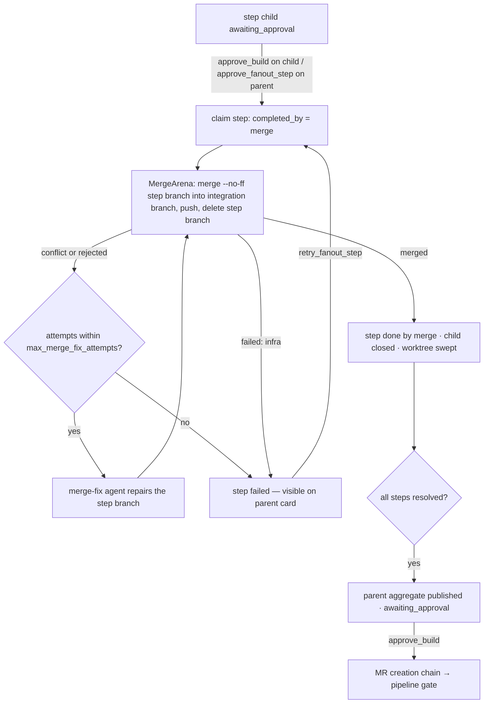

# Build node

## Summary

The build node turns the approved plan into code: it runs a coding agent against the plan, pushes a feature branch (in a local git worktree or a cloud checkout), publishes a `diff` artifact, and gates on developer approval. Approval is a built-in chain action (`approve_build`) that creates the merge request — with a bounded commit-fix agent on push rejection — and hands off to the pipeline gate. Multi-branch plans build as sequential per-branch runs tracked in the `branches` table.

The node is also the SDLC fan-out point: when its `fanout_mode` knob (or the plan's published execution / `splitResolution`) calls for steps, the `StepFlowManager` spawns one child flow per plan step running the sibling `step_build` def, and each approved step merges back onto the parent's integration branch through the `MergeArena`. This doc covers that fan-out runtime; the plan side of split publication is in [`plan-node.md`](./plan-node.md).

## Capabilities contract

| Field | Value | UI / engine effect |
|-------|--------|-------------------|
| `refinable` | `true` | Chat rail is shown; a message reruns the build with the text as `feedback` (the `build_refine` prompt). |
| `chatMode` | — | Generic `NodeChat` rail (refine / converse toggle). |
| `promptNode` | — | Prompt preview reads `previewPrompt` via `GET /prompt?node=build` directly. |
| `panelTitle` | `Code changes` | Panel header title (`Step changes` on the `step_build` child def). |

Engine-only (not serialized to UI):

- `builtinApproval: true` — approval uses `approve_build` (the MR-creation chain), never generic `approve_node`.
- `chainRole: build` — the SDLC chain resolves the build role by key.
- `fanoutOutput: DEFAULT_FANOUT_OUTPUT` — the aggregate shape (`{steps: [{id, title, status, branch?, artifact_id?, output?}]}`) published when the node fans out.
- `mergeBack` — only on `step_build`: `mergeArena.mergeStepBranch(args)`; it marks the def a "code child" for the fan-out manager.
- `childTemplateId()` → `tpl_step_build` — the build def's seeded fallback fan-out child.
- `edges: [[pipeline, "next"]]`, `order: 20` — graph position between plan and pipeline.

## User-visible phases

### Phase 1 — Build running

- **Entry:** Plan approved (`approve_plan` advances into build); the approved plan artifact is the run input.
- **Surface:** Panel running state (`Agent is implementing the plan…`) plus the event feed; the plan checklist turns green as the agent reports progress.
- **Action:** None required; chat can steer (Phase 4).
- **Outcome:** Branch pushed, `diff` artifact saved, node `awaiting_approval`. A multi-branch plan produces sequential per-branch runs (topo-sorted by `dependsOn`); each branch row moves `pending` → `building` → `awaiting_approval`.

### Phase 2 — Diff review and approval

- **Entry:** Node (or a branch row) `awaiting_approval`.
- **Surface:** `BuildView` — latest `diff` artifact, per-branch cards with status chips and MR links.
- **Action:** `Accept & create MR` (single branch, per-branch, or `Accept all & create MRs`) → `approve_build` with optional `branch`.
- **Outcome:** Node `approved`; the chain creates MRs (bounded commit-fix agent on hook rejection, `max_commit_fix_attempts`, default 2). Failure emits `mr_failed` and reverts to `awaiting_approval` — the button becomes a retry. Success advances to the pipeline gate.

### Phase 3 — Fan-out (steps mode)

- **Entry:** `fanout_mode: steps`, or `from-plan` with the plan meta's `execution: "steps"` (or a `split_consume: source`/`per-unit` resolution from the plan's `splitResolution`), with pending plan steps.
- **Surface:** `FanoutStepList` replaces the checklist: one card per step with state chip, branch, cost/duration rollup, and `Approve` / `Retry` / `Skip` / open-sub-flow actions.
- **Action:** Per-step approve → merge-back; skip → step done (`completed_by: 'skipped'`), child cancelled, step branch deleted.
- **Outcome:** Each step child builds its own branch; approval runs merge-back (below). When all steps resolve, the parent publishes the aggregate output plus per-integration-branch `diff` artifacts and returns to `awaiting_approval` — the final `approve_build` creates the MR.

### Phase 4 — Chat refine

- **Entry:** Any time after a build agent exists (or none — see guards).
- **Surface:** Chat rail.
- **Action:** Send a message → rerun with `feedback` (refine mode) or a read-only question (converse mode).
- **Outcome:** Follow-up run on the same branch, new `diff` artifact (meta carries `feedback`), node back to `awaiting_approval`.

### Merge-back lifecycle (step children)



## UI architecture

### Workspace routing

`components/flows/panels/panelFactory.tsx`:

- Panel: `node.type === 'build'` → `BuildView`; `step_build` child flows resolve to the same `BuildView`.
- Chat: `capabilities.refinable` (no `chatMode`) → generic `NodeChat`.

### Panel (`BuildView`)

- Reads `node.artifacts` (kind `diff`), `flow.branches`, `flow.planSteps` from the panel context; no own fetching beyond `ArtifactLoader`.
- Single-branch: latest diff, footer approve button, `mr_failed` error alert derived from the event stream (`mrErrorFor`).
- Multi-branch: per-branch cards (status chip, MR link, per-branch approve), `Accept all & create MRs` when every branch awaits.
- Fanned out: `FanoutStepList` (via `FanoutStepCard`) replaces `PlanSteps`; approve is disabled while the step's `mergeStatus` is `running` / `conflict` / `rejected` / `failed`.
- Busy state: `approved` without `mr_url` renders a "Creating the merge request" spinner until the MR exists.

### Chat rail

Generic `NodeChat`: refine sends rerun the node with the message as `feedback`; converse questions hit the existing agent without state changes. Sends go to `POST /api/flows/:id/chat` with `nodeKey`.

### Async states

- Running: `PanelShell` `runningLabel`; MR creation: inline spinner alert.
- Diff loading: `ArtifactLoader`; empty: `EmptyHint` ("No changes yet.").
- Worktree badges (flows list): `useWorktreeStatus` polls `GET /api/flows/worktree-status` every 5 s with `keepPreviousData` (dirty / ahead / behind per local flow).

### Key files

- `components/flows/panels/views/BuildView.tsx`
- `components/flows/panels/FanoutStepList.tsx`, `components/flows/panels/FanoutStepCard.tsx`
- `components/flows/panels/NodeChat.tsx`, `components/flows/panels/panelFactory.tsx`
- `components/flows/hooks/useWorktreeStatus.ts`

## Backend architecture

### Node class

`BuildNode` (`lib/engine/nodes/kinds/build/buildNode.ts`) extends `AgentRunNode<BuildInput, BuildOutput>`; key `build`. `StepBuildNode` (`stepBuildNode.ts`, key `step_build`) is a sibling def — it extends the same tier and composes the shared machinery instead of subclassing the parent.

### Collaborators

- `BuildRunSupport` — branch naming, worktree binding, result-branch detection, `diff` artifact writes (shared by both defs).
- `BranchStore` (`branchStore`) — `branches` table rows: status/MR updates, run tagging for per-branch cost.
- `StepFlowManager` (`stepFlows`) — fan-out gate, expansion, scheduling, rollup, approvals, merge-back loop.
- `MergeArena` (`mergeArena`) — the serialized git merge/push/delete behind `mergeBack`.
- `SplitManager` (`splitManager`) — `split_consume: per-unit` consumer runtime (split children).
- `planSteps` — checklist reads (`markdown`) and `build-progress` application (`markDone`).
- `prompts` (PromptLibrary), `branchNamer`, `worktreeManager`, `mcpSourcesOf` — prompt assembly, naming, local checkouts, ambient MCP config.

### Run lifecycle (`run`)

1. `triggerRuns(ctx)`: a split child consumes its unit from `trigger_payload` (`triggerInput`); otherwise the latest `plan` artifact is required ("no plan to build — approve the plan first"). Multi-branch plan metas topo-sort into one run per branch with `before`/`after` hooks maintaining branch rows.
2. `run(ctx, input, config)`: `feedback` present → `refine`. Otherwise compose the prompt (instructions + scoped plan + checklist block with the `build-progress` contract; `prompt_body` / `prompt_rules` knobs fold in), bind the worktree, and `execute` the agent on the computed branch.
3. `finalizeBuild`: apply `build-progress` to the checklist, resolve the pushed branch (worktree HEAD locally, agent-reported in cloud), set `flows.mr_branch`, upsert the branch row (`gitBranch`, `tagRun`), save the `diff` artifact, return `awaiting_approval`.
4. Orphaned runs (restart mid-build) recover via `recover` / `recoverBranch`: rebuild the `diff` artifact from the branch and re-gate.

### Chat lifecycle (`chat` / `converse`)

No override: the default `AgentRunNode.chat` reruns the node with the message mapped into `feedback` (`build_refine` prompt, `followUpOn` the recorded agent). With no prior agent, the refine degenerates into a full build of the latest plan plus a "Developer note".

### Approval and advance

`approve_build` → `flowEngine.approveBuild`: on a step child flow it routes to `stepFlows.approveChildStep` (merge-back; approve ≠ MR); on a parent it runs `SdlcChain.approveBuild` — mark `approved`, create MRs via `mergeRequests.createWithFixes` (bounded commit-fix), then `advanceFrom(build)` onto the build → pipeline edge. Fan-out parents reach this only after the aggregate approval.

### Fan-out runtime

- **Gate:** `StepFlowManager.gate` resolves the mode from `fanout_mode` and the plan's published `execution` meta (explicit knob overrides are event-logged); `whole-wrap` wraps native output as a single-entry aggregate.
- **Expand:** one child flow per pending step without `sub_flow_id`; child template = `fanout_child` knob → def fallback `tpl_step_build` → hidden auto-wrap. Trigger payload `{plan, step, siblings, parentNodeKey, workNodeKey}` persists on the child; sibling lists refresh with live states at each start.
- **Scheduling:** `advance` starts children up to `fanout_parallel_max` (default 1, sequential); a slot is held while a child is `running` or `awaiting_approval`; candidates must be file-disjoint from earlier in-flight siblings (empty `files` ⇒ overlap); a failed earlier code sibling stalls overlapping later ones.
- **Branch naming:** built-in `{prefix}/{slug}-{flowIdSuffix}` (`feature`/`bugfix` prefix from the ticket type), `branch_pattern` knob tokens `{prefix} {slug} {ticket} {id} {suffix}`. Integration branches use the parent build's pattern with the plan-branch suffix; step branches are `<integration>-sN` (position within the branch group). Step children inherit their branch pre-assigned on `flows.mr_branch`.
- **Merge-back:** `approveChildStep` claims the step (`completed_by: 'merge'`) and loops `mergeArena.mergeStepBranch`. The arena serializes per parent flow, writes a durable `step_merges` row before any git op, merges `--no-ff` in a dedicated clone under `workspaces/arenas/<parentFlowId>`, pushes with `-o ci.skip` (plain fallback), and deletes the step branch. `MergeBackResult`: `merged` (with `stale` when the base diverged — repaired by merge, never rebase), `conflict` / `rejected` (repairable code states → bounded merge-fix agent via `runNode` feedback, budget `max_merge_fix_attempts`, default 2), `failed` (infra or budget exhausted → failed-visible; `retry_fanout_step` resumes the loop). Restart reconcile resumes `running`/`conflict` rows via `resumePendingMerge`.
- **Rollup:** when every linked child resolves, the parent publishes `{steps, branch?, latestArtifact?, branchArtifacts?}` (validated against `DEFAULT_FANOUT_OUTPUT`), saves per-integration-branch `diff` artifacts (meta `fanout: true`), and finishes at `awaiting_approval`.
- **Split runtime:** `SplitManager` serves `split_consume: per-unit` (and `source` when the plan's `splitResolution` recommends it): one child flow per `SplitUnit` (`{key, title, dependsOn, target?, item}`), scheduled by declared `dependsOn` plus `split_parallel_max`, targets resolved by `flowSplitTargetLookup` (node key vs `node_templates` row; ambiguity throws `SplitTargetError`), cycles detected by `detectUnitCycle`. A build running as a split child reads its unit in `triggerInput` — the same `{name, title, scope, plan}` shape as multi-branch `triggerRuns`.

### Key files

- `lib/engine/nodes/kinds/build/buildNode.ts`, `stepBuildNode.ts`, `buildRunSupport.ts`, `branchStore.ts`, `schema.ts`
- `lib/engine/runtime/fanout/stepFlowManager.ts`, `lib/engine/runtime/fanout/mergeArena.ts`
- `lib/engine/runtime/split/splitManager.ts`, `lib/engine/nodes/shared/split.ts`, `lib/engine/nodes/shared/splitLookup.ts`
- `lib/engine/nodes/shared/capabilities.ts` (`MergeBackResult`), `lib/engine/nodes/chains/sdlcChain.ts` (`approveBuild`)

## API surface

### HTTP

| Route | Caller | Purpose |
|-------|--------|---------|
| `POST /api/flows/:id/action` | `BuildView`, `FanoutStepList` | All actions below. |
| `POST /api/flows/:id/chat` | `NodeChat` | Refine / converse turns → `BuildNode.chat`. |
| `GET /api/flows/:id/prompt?node=build` | Prompt preview (`useFlowPrompt`) | `previewPrompt` assembly (same path as `run`). |
| `GET /api/flows/worktree-status` | `useWorktreeStatus` (flows list) | Per-flow worktree `dirty` / `ahead` / `behind` for local flows. |
| `GET /api/flows/:id` | Flow snapshot | `branches`, `planSteps` with `sub_flow` merge states folded in. |

### Flow actions

| Action | When | Engine |
|--------|------|--------|
| `approve_build` (optional `branch`) | Diff approved | MR-creation chain; on a step child → fan-out merge-back. |
| `approve_fanout_step` (`stepId`) | Step card approve | `stepFlows.approveChildStep` on the child. |
| `retry_fanout_step` (`stepId`) | Step failed | Re-run the child; merge failures resume the merge loop. |
| `skip_fanout_step` (`stepId`) | Step unwanted | Skip, cancel child, delete step branch, advance. |
| `retry` / `cancel` | Failed / stuck run | Standard node lifecycle. |

### Actions not used

- `approve_node` — build approval is always `approve_build` (`builtinApproval: true`).
- `approve_plan`, `update_plan_steps`, `set_plan_step` — plan-node actions; checklist edits still propagate to fan-out guards via the engine.

## Data model

### Input

`BuildInput`: `plan` (nullable; required unless `feedback` or `step`), `prompt`, `branchInfo` (`{name, title?, scope?}`), `feedback`, `model`, `step` (fan-out child payload). The `step_build` trigger payload adds `siblings` (context-pack entries).

### Output / artifacts

`BuildOutput`: `{branch, latestArtifact, branchName?}`; fanned-out parents additionally publish `steps` (the aggregate) and `branchArtifacts`. Artifacts: kind `diff`, meta `{branch, stat, branchName?, feedback?, recovered?, fanout?}`.

### Side effects

- `branches` rows per plan branch / integration branch (status, `git_branch`, `mr_url`/`mr_iid`); `runs.branch_id` tagging.
- `plan_steps`: `sub_flow_id` linkage, `status` + `completed_by` (`child` / `merge` / `approved` / `skipped`).
- `step_merges`: durable merge-back rows (`status`, `attempts`, `error`).
- `flows.mr_branch` set to the result branch; local worktrees under the flow's workspace.

## Agent contracts

### Prompt keys

`build` (run), `build_refine` (chat refine); the step child uses `step_build` + `build_refine`; the merge-fix agent uses `merge_fix` (resolved by the `StepFlowManager`).

### Response shapes

- Whole build: free-form reply plus a terminal ` ```json build-progress ` block `{"completed": ["s1", …]}` — parsed into checklist `done` marks.
- Step build: no self-reporting block; the step goes green only on merge.

### Retries and guards

- Missing plan throws before any run; refine without an agent falls back to a full build with the feedback as a developer note.
- Branch names validated (`rejectInvalidBranchNameShape`, `assertValidBranchName` in the arena).
- Bounded fix loops: `max_commit_fix_attempts` (MR creation), `max_merge_fix_attempts` (merge-back) — exhaustion fails visibly, never loops silently.

## Out of scope

- Plan authoring, branch decomposition, and `splitUnits` / `splitResolution` publication — see `plan-node.md`.
- MR creation internals (`mergeRequests` service, commit-fix), the pipeline gate, review/resolve — separate docs.
- Worktree lifecycle internals (`worktreeManager`) and webhook/poller machinery.

## Related code index

| Concern | Location |
|---------|----------|
| Build def (run / refine / recover) | `lib/engine/nodes/kinds/build/buildNode.ts` |
| Step child def + `mergeBack` capability | `lib/engine/nodes/kinds/build/stepBuildNode.ts` |
| Shared branch/worktree/diff machinery | `lib/engine/nodes/kinds/build/buildRunSupport.ts` |
| Input/output + step payload schemas | `lib/engine/nodes/kinds/build/schema.ts` |
| Branch rows | `lib/engine/nodes/kinds/build/branchStore.ts` |
| Fan-out orchestration | `lib/engine/runtime/fanout/stepFlowManager.ts` |
| Merge arena (git ops, `step_merges`) | `lib/engine/runtime/fanout/mergeArena.ts` |
| Split consumer runtime + contracts | `lib/engine/runtime/split/splitManager.ts`, `lib/engine/nodes/shared/split.ts`, `splitLookup.ts` |
| Merge-back result contract | `lib/engine/nodes/shared/capabilities.ts` |
| MR-creation chain on approval | `lib/engine/nodes/chains/sdlcChain.ts` |
| Panel / step cards / chat rail | `components/flows/panels/views/BuildView.tsx`, `panels/FanoutStepList.tsx`, `panels/NodeChat.tsx` |
| Worktree status route + hook | `app/api/flows/worktree-status/route.ts`, `components/flows/hooks/useWorktreeStatus.ts` |
