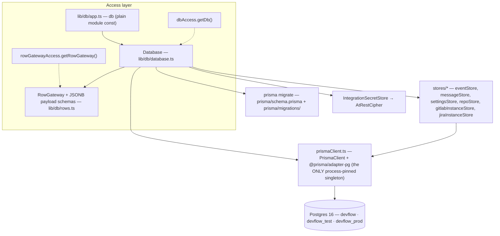

# Database subsystem

## Summary

DevFlow persists all state in **Postgres 16 via Prisma** (driver adapter
`@prisma/adapter-pg`): typed models from `prisma/schema.prisma`, JSONB for
payload columns, real enums for status vocabularies, `timestamptz` timestamps,
and real foreign keys. API routes that touch the DB use the Node runtime
(AGENTS §3.3). The Prisma client is the **only** process-pinned singleton
(`lib/db/prismaClient.ts` — pinned inline on `globalThis`, HMR-safe); the
`Database` facade is a plain module const (`lib/db/app.ts`) composing
per-table store classes on top of it. Integration secrets
(GitLab/Jira tokens, the Cursor API key, the flow-secrets map) are sealed at
rest with AES-256-GCM.

## Architecture

Three layers, top to bottom:

1. **Access layer** — `lib/db/app.ts` exports the shared `db` facade as a
   plain module const (decision Q9 — no process pinning: the facade is
   stateless over the Prisma pool, so `next dev` module-graph splits cannot
   disagree). Importing `db` starts nothing — the web process is pure
   request/response (decision Q10); all time-driven work (poller, reconciler,
   job sweeps) runs in the dedicated worker process (`npm run worker`,
   `worker/main.ts`).
2. **Client + facade layer** — `prismaClient.ts` builds the `PrismaClient`
   with the pg driver adapter at `config.db.url()`. `Database`
   (`lib/db/database.ts`) wraps it: `transaction(fn)` maps to
   `prisma.$transaction` (async callback — never `await` network/agent/git I/O
   inside), `uid()`/`now()` stay app-side, and the raw `get`/`all`/`run`
   helpers (parameterized `$queryRawUnsafe`/`$executeRawUnsafe`) remain for
   the legacy raw-SQL call sites during the step-01→09 migration window — no
   NEW raw SQL is introduced (ORM-first).
3. **Typed row layer** — column types are generated by Prisma. `lib/db/rows.ts`
   keeps Zod validators for the JSONB payloads (`nodes.input/output`,
   `artifacts.meta`, event `data`, …) and the `RowGateway` used by raw-SQL read
   paths; row shapes are camelCase (Q11) — raw queries alias snake_case columns
   to camelCase.

### Singleton and access layering

- `app.ts` is the import entrypoint (`@/lib/db/app`). It re-exports `Database`,
  `RowGateway`, `getDb`, `getRowGateway` and the `db` module const.
- `dbAccess.ts` is a lazy resolution slot (`Symbol.for("devflow.database")`),
  bound by the `Database` constructor, so config helpers and code that cannot
  import the entrypoint still resolve the live facade via `getDb()` without
  forcing construction or creating an import cycle.
  `rowGatewayAccess.ts` does the same for the `RowGateway`
  (`Symbol.for("devflow.rowGateway")`). Both throw when accessed before
  binding.
- `rows.ts` additionally exports a `rows` proxy that forwards to the bound
  gateway for call sites that hold no `Database` reference.
- The `Database` constructor also calls `wireGitHostBuiltins()`
  (`lib/db/wireGitHostBuiltins.ts`), registering the GitLab adapter into
  `gitHostRegistry` once per process.
- The arch test `tests/architecture/noProcessSingletonOutsideDb.test.ts`
  enforces the Q9 boundary: the Prisma client is the only `globalThis`-pinned
  service; everything else is a plain module const or constructor-injected
  from the composition roots (`lib/composition/container.ts`,
  `lib/composition/processServices.ts` for the process-bound exceptions).

### Ids and timestamps

`db.uid(prefix)` generates lexicographically sortable ids (millisecond
base-36 + same-millisecond counter + entropy) with per-domain prefixes —
`ev_`, `msg_`, `repo_`, `gli_`, `jri_`, `wtrem_`. Timestamps are `timestamptz`;
Prisma surfaces them as `Date` objects (call sites convert to ISO strings at
boundaries via `.toISOString()` or the `isoTs` row helper). Writes pass `Date`
objects — never raw-text timestamp bindings (a `Z`-suffixed ISO string bound
as text is reinterpreted in the session timezone).

## Schema and migrations

- `prisma/schema.prisma` is the source of truth: camelCase model fields with
  explicit `@map("snake_case")` columns and `@@map` tables (the DB stays
  snake_case; TypeScript reads `node.nodeKey`), PG enums with lowercase values
  mirroring the vocabularies in `rows.ts` (`node_status`, `run_status`,
  `flow_status`, `artifact_status`, … — including the undocumented
  `skipped` value), `Json` columns for `input/output/config/meta/payloads`,
  and the `UNIQUE(flow_id, node_key)` constraint plus the existing indexes.
  Changes are gated by the `prismaSchemaCasing` arch test; ask before
  changing the schema (AGENTS §1) and keep `rows.ts` in the same PR.
- Migrations live in `prisma/migrations/` and are applied with
  `npm run db:migrate` (`prisma migrate deploy`) against `DATABASE_URL`. The
  builtin node/flow template catalog ships as the
  `builtin_template_seed` migration, so dev/test/prod databases are seeded by
  the same `migrate deploy` that creates the schema. Enum migrations are
  sticky (adding values is easy, removing is not) — get status vocabularies
  right at authoring time.
- Dev/test/prod databases: `docker compose up -d postgres` (`npm run db:up`)
  provisions the `devflow` (app/demo) and `devflow_test` databases; any
  Postgres works via `DATABASE_URL`. Production defaults to `devflow_prod`
  when `DATABASE_URL` is unset (`npm run db:init:prod` creates it).

## Row mapping and validation

- Column types come from Prisma. `lib/db/rows.ts` validates the JSONB payload
  shapes at the boundary: one Zod schema per payload (`FlowRow`, `NodeRow`,
  `EventRow`, `RepoRow`, …). JSONB values arrive already parsed — no
  `JSON.parse`/`JSON.stringify` on those columns. `jsonCol` is strict (a
  corrupt payload fails the row); `jsonColTolerant` decodes to `null` for
  feed-safe reads. Payload keys are camelCase (Q11) — the one-off data
  migration `scripts/migrate-sqlite-to-pg.mjs` converted known payload keys
  from the sqlite era.
- `RowGateway.get` throws `RowDecodeError` (`lib/db/rowDecodeError.ts`) on a
  schema mismatch — the error carries the SQL, the row `id` when present
  (`rowIdFromRaw`), and the Zod issues. `RowGateway.all` logs and skips
  undecodable rows instead of failing the whole list.
- Stores use the Prisma query API; the raw `get`/`all`/`run` +
  `RowGateway` path is the shrinking legacy surface — no NEW raw SQL
  (ORM-first).

## Secrets at rest

- `AtRestCipher` (`lib/db/atRestCipher.ts`) is AES-256-GCM with a 12-byte
  random IV; sealed values are `dfsec1:<iv>:<tag>:<ciphertext>` (base64url).
  `seal` is idempotent (already-sealed and empty values pass through).
- The 32-byte key comes from `config.secrets.masterKeyBytes()`:
  `DEVFLOW_SECRETS_KEY` (base64url) in production (required; a throwaway key
  covers `next build`), or a deterministic `scrypt` key derived from the
  database URL in non-production.
- `IntegrationSecretStore` (`lib/db/integrationSecretStore.ts`) is the only
  module that reads or writes sealed columns: `readGitLabToken` /
  `readJiraToken`, `readCursorApiKey` / `writeCursorApiKey`, and
  `openSecretsMap` / `sealSecretsMap` for the flow-secrets map.
- `GitLabInstanceStore` and `JiraInstanceStore` never return tokens in list
  views: `listMeta()` selects without the `token` column
  (`GitLabInstanceRow.omit({ token: true })`), `get(id)` re-attaches the
  opened token, and `add` / `update` seal before writing.

## Store classes and their tables

| Store | Table(s) | Responsibility |
|-------|----------|----------------|
| `EventStore` | `events` | Append-only flow event log; `listEvents` (id-cursor pagination) and `listEventsTail` feed the live activity view |
| `MessageStore` | `messages` | Chat transcript per flow, with nullable `thread` for branch-scoped conversations |
| `SettingsStore` | `settings` | JSONB key/value settings, Zod-validated on read with a caller-supplied fallback |
| `RepoStore` | `repos` | Repo registry (local path ↔ cloud URL), URL normalization, upsert/delete, per-repo worktree-policy columns |
| `GitLabInstanceStore` | `gitlab_instances` | Self-hosted GitLab instances; tokens sealed via `IntegrationSecretStore` |
| `JiraInstanceStore` | `jira_instances` | Jira sites (cloud + self-hosted); same sealing discipline |

All stores are constructor-injected classes (AGENTS §3.1) composed by
`Database`; `stores/storeExports.ts` is the import surface.

## Template seeding

The builtin catalog is seeded idempotently (deterministic ids,
`ON CONFLICT DO NOTHING`) by the `builtin_template_seed` migration — every
`prisma migrate deploy` (dev, test, prod) leaves the database with:

- `node_templates` rows for the builtin node keys: `start`, `plan`, `build`,
  `step_build`, `pipeline`, `review`, `resolve` — plus the declarative starter
  catalog rows (`docs_summary`, `docs_write`, `release_notes`, `ship_decision`,
  `notify_slack`, `triage_agent`, `worth_fixing`, `open_pr`, `triage_notify`).
- The SDLC loop flow template `tpl_sdlc_loop` (`SDLC_TEMPLATE_ID` in
  `lib/engine/constants/nodeKeys.ts`) with its `flow_template_nodes` (per-node
  triggers) and `flow_template_edges`, including the `resolve → pipeline` loop
  edge conditioned on the JSONata expression
  `nodes.resolve.output.pushed = true`.
- The step-build child template `tpl_step_build` (`STEP_BUILD_TEMPLATE_ID`)
  used by plan fan-out (`hidden` — referenced by id, not the gallery picker).
- The three starter flow templates (`tpl_docs_generation`,
  `tpl_release_notify`, `tpl_sentry_triage`).

`TemplateSeeder` (`lib/db/templateSeeder.ts`) re-seeds the same catalog in
TypeScript for test databases (tests truncate all tables between files); the
two stay in sync by the cross-referenced KEEP-IN-SYNC comments.

## Module surface

The subsystem owns no HTTP routes; consumers import from `@/lib/db/app`.

| Export | Kind | Purpose |
|--------|------|---------|
| `db` | module const | Shared `Database` facade — starts nothing; time-driven work lives in the worker process |
| `prisma` | singleton | The raw PrismaClient (`lib/db/prismaClient.ts`) — composition-root dependency, the only process-pinned service |
| `getDb()` | accessor | Resolve the pinned `Database` without importing the entrypoint |
| `getRowGateway()` / `rows` | accessor | Zod-validated typed queries |
| `Database` | class | Transactions, store facade, app-side `uid`/`now` |
| `TemplateSeeder` | seed | Builtin template catalog (test reset) |
| `DatabaseMigrationError` | error | Migration/bootstrap failure type |

## Data model

`prisma/schema.prisma` is the source of truth. Table inventory by domain:

- **Tasks and flows:** `tasks`, `flows`, `nodes`, `artifacts`, `runs`,
  `branches`, `plan_steps`, `step_merges`.
- **Engine durability:** the `jobs` table (write-ahead journal for
  webhook deliveries, schedule fires, MR creation, cancels — `dedup_key`,
  lease-based claims, attempt counts) plus the correctness columns
  `nodes.attempt_id` / `wait_until` / `lease_until` and
  `runs.attempt_id` / `lease_until` / `api_token` (the per-attempt
  capability token for the agent-tools surface).
- **Collaboration:** `messages`, `events`, `comments`.
- **Integrations and settings:** `repos`, `gitlab_instances`,
  `jira_instances`, `settings`.
- **Template layer:** `node_templates`, `flow_templates`,
  `flow_template_nodes`, `flow_template_edges`.
- **Triggers:** `hooks`, `hook_deliveries`.
- **Worktree safety:** `worktree_removals` (crash-safe removal records; see
  [`git.md`](./git.md)).

### Demo DB boundary

Seed scripts (`scripts/seed-*.mjs`) write mock data only, through Prisma
against the demo database (`config.db.demoUrl()` — `DATABASE_URL` or the
dockerized `devflow`). They refuse any other target — including
`devflow_prod` — unless `--allow-non-demo-db` or `SEED_ALLOW_NON_DEMO_DB=1`
is passed (AGENTS §1). `tests/seedDb.test.ts` keeps the scripts' flow-child
table list in sync with the engine's flow deletion. The one-off sqlite →
Postgres data migration is `scripts/migrate-sqlite-to-pg.mjs` (better-sqlite3
reader, batched Prisma writes, per-table count + JSONB round-trip
verification; demo/dev targets only).

## Out of scope

- Engine semantics of the persisted rows (node lifecycle, run claims,
  fan-out) — covered by the flow-engine code and node docs such as
  [`plan-node.md`](./plan-node.md).
- Integration API clients that consume the unsealed tokens
  (`lib/integrations/**`).
- Client bundle rules for server-only imports — see
  [`client-bundle-boundaries.md`](./client-bundle-boundaries.md).

## Related code index

| Concern | Location |
|---------|----------|
| Prisma client (the only process-pinned singleton) | `lib/db/prismaClient.ts` |
| Facade: transactions, store composition | `lib/db/database.ts` |
| Import entrypoint / `db` module const | `lib/db/app.ts` |
| Lazy resolution slots | `lib/db/dbAccess.ts`, `lib/db/rowGatewayAccess.ts` |
| Composition roots | `lib/composition/container.ts`, `lib/composition/processServices.ts` |
| Schema (source of truth) | `prisma/schema.prisma` |
| Migrations | `prisma/migrations/`, `npm run db:migrate` |
| Migration failure type | `lib/db/databaseMigrationError.ts` |
| Row schemas + JSONB payload validation | `lib/db/rows.ts`, `lib/db/rowDecodeError.ts` |
| Per-table stores | `lib/db/stores/` (`eventStore.ts`, `messageStore.ts`, `settingsStore.ts`, `repoStore.ts`, `gitlabInstanceStore.ts`, `jiraInstanceStore.ts`) |
| At-rest encryption | `lib/db/atRestCipher.ts`, `lib/db/integrationSecretStore.ts` |
| Master key / DB URLs | `lib/config.ts` (`config.secrets`, `config.db`) |
| Builtin template seed | `prisma/migrations/*_builtin_template_seed/`, `lib/db/templateSeeder.ts`, `lib/engine/constants/nodeKeys.ts` |
| Git-host adapter wiring | `lib/db/wireGitHostBuiltins.ts` |
| Demo seed guard | `scripts/lib/seed-db.mjs`, `tests/seedDb.test.ts` |
| One-off sqlite → PG data migration | `scripts/migrate-sqlite-to-pg.mjs` |
| Test database harness | `tests/helpers/testDatabase.ts`, `tests/globalSetup.ts`, `docker-compose.yml` |
