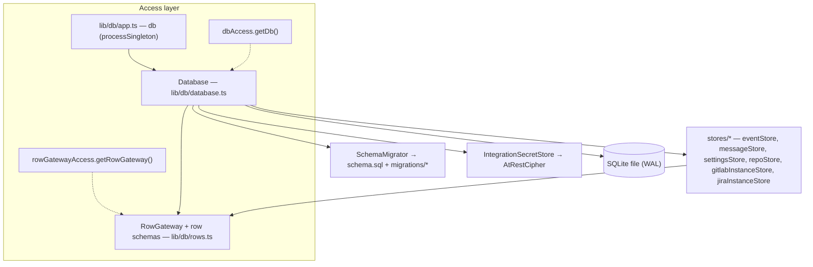

# Database subsystem

## Summary

DevFlow persists all state in one SQLite file through `better-sqlite3` — synchronous and Node-only, so every module under `lib/db/` opens with `import "server-only"` and API routes that touch the DB must use the Node runtime (AGENTS §3.3). The `Database` class owns the connection lifecycle, schema bootstrap, and numbered `PRAGMA user_version` migrations, and composes per-table store classes behind a Zod-validated row gateway. Integration secrets (GitLab/Jira tokens, the Cursor API key, the flow-secrets map) are sealed at rest with AES-256-GCM.

## Architecture

Three layers, top to bottom:

1. **Access layer** — `lib/db/app.ts` creates the process-wide `db` singleton via `processSingleton` (`lib/singleton.ts`), so `next dev` module-graph splits never produce a second connection. Constructing `db` also starts the background workers (`flowPoller`) unless `NODE_ENV=test` or `VITEST=true`.
2. **Connection layer** — `Database` (`lib/db/database.ts`) lazily opens the file at `config.db.path()`, sets `PRAGMA journal_mode = WAL`, executes `lib/db/schema.sql` (idempotent DDL), then runs `SchemaMigrator`. It exposes raw `get` / `all` / `run` / `transaction` plus facade methods that delegate to the stores (`addMessage`, `emitEvent`, `getSetting`, `listRepos`, …).
3. **Typed row layer** — `RowGateway` (`lib/db/rows.ts`) parses every returned row through a Zod schema; the store classes in `lib/db/stores/` hold the per-table SQL.

### Singleton and access layering

- `app.ts` is the import entrypoint (`@/lib/db/app`). It re-exports `Database`, `RowGateway`, `getDb`, `getRowGateway`, and the migration helpers.
- `dbAccess.ts` pins the `Database` instance on `globalThis` (`Symbol.for("devflow.database")`) from the constructor, so config helpers and code that cannot import the entrypoint still resolve the live singleton via `getDb()`. `rowGatewayAccess.ts` does the same for the `RowGateway` (`Symbol.for("devflow.rowGateway")`). Both throw when accessed before construction.
- `rows.ts` additionally exports a `rows` proxy that forwards to the pinned gateway for call sites that hold no `Database` reference.
- The `Database` constructor also calls `wireGitHostBuiltins()` (`lib/db/wireGitHostBuiltins.ts`), registering the GitLab adapter into `gitHostRegistry` once per process.

### Ids and timestamps

`db.uid(prefix)` generates lexicographically sortable ids (millisecond base-36 + same-millisecond counter + entropy) with per-domain prefixes — `ev_`, `msg_`, `repo_`, `gli_`, `jri_`, `wtrem_`. `db.now()` returns the ISO timestamp used in every `created_at` / `updated_at`.

## Schema versioning and migrations

- Bootstrap always runs `lib/db/schema.sql` first (canonical DDL, `CREATE TABLE IF NOT EXISTS`), then `SchemaMigrator.runMigrations` (`lib/db/schemaMigrator.ts`) applies numbered steps gated on `PRAGMA user_version` up to `SCHEMA_USER_VERSION` (`lib/db/schemaVersion.ts`, currently `6`). Each step runs in one transaction; any failure throws `DatabaseMigrationError` (`lib/db/databaseMigrationError.ts`) and aborts bootstrap. `schema.sql` is coordinated with the row schemas — changes follow AGENTS §1 (ask first).
- Migration steps:

| `user_version` | Change |
|---|---|
| 1 | `TemplateSeeder.seed` — builtin node + flow templates (see below) |
| 2 | `nodes.attempt_id` column (run-claim token) |
| 3 | `branches.git_branch` column |
| 4 | `flows.template_graph` column (graph snapshot) |
| 5 | Secondary indexes (`runs`, `flows`, `plan_steps`, `step_merges`, `hook_deliveries`) |
| 6 | `sealIntegrationSecretsAtRest` — one-time sealing of plaintext secrets |

- Migration 6 (`lib/db/migrations/sealIntegrationSecrets.ts`) seals `gitlab_instances.token`, `jira_instances.token`, the `SETTINGS_KEYS.CURSOR_API_KEY` settings value, and every value in the `SETTINGS_KEYS.SECRETS` settings map — skipping values already sealed.

## Row mapping and validation

- `lib/db/rows.ts` is the single boundary where raw rows become typed objects: one Zod schema per table (`FlowRow`, `NodeRow`, `EventRow`, `RepoRow`, …). JSON-encoded TEXT columns decode through `jsonCol` (strict — corrupt JSON fails the row) or `jsonColTolerant` (decodes to `null`, for feed-safe reads). Unknown columns are stripped, so `SELECT *` is the norm.
- `RowGateway.get` throws `RowDecodeError` (`lib/db/rowDecodeError.ts`) on a schema mismatch — the error carries the SQL, the row `id` when present (`rowIdFromRaw`), and the Zod issues. `RowGateway.all` logs and skips undecodable rows instead of failing the whole list.
- Stores never hand-parse JSON; they query through `RowGateway` (e.g. `EventStore.listEvents` parses with `EventRow`) and use `Database.run` for writes.

## Secrets at rest

- `AtRestCipher` (`lib/db/atRestCipher.ts`) is AES-256-GCM with a 12-byte random IV; sealed values are `dfsec1:<iv>:<tag>:<ciphertext>` (base64url). `seal` is idempotent (already-sealed and empty values pass through); `open` passes legacy plaintext through until migration 6 seals it.
- The 32-byte key comes from `config.secrets.masterKeyBytes()`: `DEVFLOW_SECRETS_KEY` (base64url) in production (required; a throwaway key covers `next build`), or a deterministic `scrypt` key derived from the DB path in non-production.
- `IntegrationSecretStore` (`lib/db/integrationSecretStore.ts`) is the only module that reads or writes sealed columns: `readGitLabToken` / `readJiraToken`, `readCursorApiKey` / `writeCursorApiKey`, and `openSecretsMap` / `sealSecretsMap` for the flow-secrets map.
- `GitLabInstanceStore` and `JiraInstanceStore` never return tokens in list views: `listMeta()` selects without the `token` column (`GitLabInstanceRow.omit({ token: true })`), `get(id)` re-attaches the opened token, and `add` / `update` seal before writing.

## Store classes and their tables

| Store | Table(s) | Responsibility |
|-------|----------|----------------|
| `EventStore` | `events` | Append-only flow event log; `listEvents` (id-cursor pagination) and `listEventsTail` feed the live activity view |
| `MessageStore` | `messages` | Chat transcript per flow, with nullable `thread` for branch-scoped conversations |
| `SettingsStore` | `settings` | JSON-encoded key/value settings, Zod-validated on read with a caller-supplied fallback |
| `RepoStore` | `repos` | Repo registry (local path ↔ cloud URL), URL normalization, upsert/delete, per-repo worktree-policy columns |
| `GitLabInstanceStore` | `gitlab_instances` | Self-hosted GitLab instances; tokens sealed via `IntegrationSecretStore` |
| `JiraInstanceStore` | `jira_instances` | Jira sites (cloud + self-hosted); same sealing discipline |

All stores are constructor-injected classes (AGENTS §3.1) composed by `Database`; `stores/storeExports.ts` is the import surface.

## Template seeding

Migration 1 runs `TemplateSeeder` (`lib/db/templateSeeder.ts`), an idempotent seed (`INSERT OR IGNORE`, deterministic ids) of the builtin catalog:

- `node_templates` rows for the builtin node keys: `start`, `plan`, `build`, `step_build`, `pipeline`, `review`, `resolve`.
- The SDLC loop flow template `tpl_sdlc_loop` (`SDLC_TEMPLATE_ID` in `lib/engine/constants/nodeKeys.ts`) with its `flow_template_nodes` (per-node triggers) and `flow_template_edges`, including the `resolve → pipeline` loop edge conditioned on the JSONata expression `nodes.resolve.output.codeChanged = true`.
- The step-build child template `tpl_step_build` (`STEP_BUILD_TEMPLATE_ID`) used by plan fan-out.

## Module surface

The subsystem owns no HTTP routes; consumers import from `@/lib/db/app`.

| Export | Kind | Purpose |
|--------|------|---------|
| `db` | singleton | Shared `Database`; constructing it starts background workers outside tests |
| `getDb()` | accessor | Resolve the pinned `Database` without importing the entrypoint |
| `getRowGateway()` / `rows` | accessor | Zod-validated typed queries |
| `Database` | class | Connection lifecycle, transactions, store facade |
| `SchemaMigrator` / `SCHEMA_USER_VERSION` / `DatabaseMigrationError` | migration | Versioned bootstrap |
| `TemplateSeeder` | seed | Builtin template catalog (migration 1) |

## Data model

`lib/db/schema.sql` is the source of truth. Table inventory by domain:

- **Tasks and flows:** `tasks`, `flows`, `nodes`, `artifacts`, `runs`, `branches`, `plan_steps`, `step_merges`.
- **Collaboration:** `messages`, `events`, `comments`.
- **Integrations and settings:** `repos`, `gitlab_instances`, `jira_instances`, `settings`.
- **Template layer:** `node_templates`, `flow_templates`, `flow_template_nodes`, `flow_template_edges`.
- **Triggers:** `hooks`, `hook_deliveries`.
- **Worktree safety:** `worktree_removals` (crash-safe removal records; see [`git.md`](./git.md)).

### Demo DB boundary

Seed scripts (`scripts/seed-*.mjs`) write mock data only. They resolve their target through `scripts/lib/seed-db.mjs` (`resolveSeedDb`): `DATABASE_PATH` or the demo default `./data/devflow.db`, mirroring `config.db.demoPath()`. The production file (`./data/devflow.prod.db` — the app's production default when `DATABASE_PATH` is unset, `config.db.path()`) is refused, as is any non-demo target unless `--allow-non-demo-db` or `SEED_ALLOW_NON_DEMO_DB=1` is passed. `tests/seedDb.test.ts` keeps the scripts' flow-child table list in sync with the engine's flow deletion.

## Out of scope

- Engine semantics of the persisted rows (node lifecycle, run claims, fan-out) — covered by the flow-engine code and node docs such as [`plan-node.md`](./plan-node.md).
- Integration API clients that consume the unsealed tokens (`lib/integrations/**`).
- Client bundle rules for server-only imports — see [`client-bundle-boundaries.md`](./client-bundle-boundaries.md).

## Related code index

| Concern | Location |
|---------|----------|
| Connection lifecycle + store facade | `lib/db/database.ts` |
| Import entrypoint / `db` singleton | `lib/db/app.ts` |
| `globalThis` pinning | `lib/db/dbAccess.ts`, `lib/db/rowGatewayAccess.ts`, `lib/singleton.ts` |
| Canonical DDL | `lib/db/schema.sql` |
| Versioned migrations | `lib/db/schemaMigrator.ts`, `lib/db/schemaVersion.ts`, `lib/db/migrations/sealIntegrationSecrets.ts` |
| Migration failure type | `lib/db/databaseMigrationError.ts` |
| Row schemas + typed queries | `lib/db/rows.ts`, `lib/db/rowDecodeError.ts` |
| Per-table stores | `lib/db/stores/` (`eventStore.ts`, `messageStore.ts`, `settingsStore.ts`, `repoStore.ts`, `gitlabInstanceStore.ts`, `jiraInstanceStore.ts`) |
| At-rest encryption | `lib/db/atRestCipher.ts`, `lib/db/integrationSecretStore.ts` |
| Master key / DB paths | `lib/config.ts` (`config.secrets`, `config.db`) |
| Builtin template seed | `lib/db/templateSeeder.ts`, `lib/engine/constants/nodeKeys.ts` |
| Git-host adapter wiring | `lib/db/wireGitHostBuiltins.ts` |
| Demo seed guard | `scripts/lib/seed-db.mjs`, `tests/seedDb.test.ts` |
