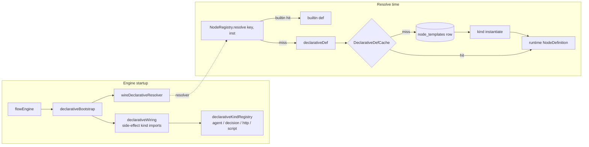

# Declarative nodes

## Summary

Declarative nodes are template-defined node types: a `node_templates` row with kind `agent` | `decision` | `http` | `script` and a JSON `config` becomes a runnable `NodeDefinition` at resolve time through the declarative kind registry. They are authored in the template editor or imported from YAML, and give flows custom agent steps, branch decisions, outbound HTTP and local scripts without new engine code. Each kind has a zod def schema — validated at creation, checked statically at template save/import, and re-validated loudly at run time — and one runtime class that reuses the shared node and agent-run lifecycles.

## Registration pipeline (parse → register → resolve)

Three pieces cooperate:

1. **Kind registration.** Each kind module self-registers on `declarativeKindRegistry` (`lib/engine/nodes/declarativeRegistry.ts`) with its zod schema and an `instantiate(row, inst)` factory. `lib/engine/nodes/declarativeWiring.ts` is the side-effect import list; `lib/engine/nodes/declarativeBootstrap.ts` pulls it in and calls `wireDeclarativeResolver(declarativeDef)` — imported once by `lib/engine/flowEngine.ts` at engine startup.
2. **Row → def hydration.** `declarativeDef(defKey, inst)` (`lib/engine/nodes/declarative.ts`) loads the `node_templates` row (by id, or by `key` for non-builtin rows), parses the config JSON, and instantiates the runtime class. Results memoize in `DeclarativeDefCache` keyed `defKey#inst`; `invalidateDeclarativeDef` drops every instance of a def when its row changes.
3. **Registry resolution.** `NodeRegistry.resolve(key, inst)` (`lib/engine/nodes/registry.ts`) returns builtins by registry key; anything else falls through to the wired declarative resolver, so engine code never branches on builtin vs declarative.

`templateStore.graph()` decides the `defKey`: builtins resolve by their `node_templates.key`, declarative rows by their row `id` (`is_builtin = 0`), with `inst` = the template instance's `node_key` so one catalog def can run as several labeled instances.

## Data model: rows and config layers

- **`node_templates` row:** `id`, `key`, `name`, `kind`, `description`, `icon`, `config` (JSON text), `is_builtin = 0`, optional `template_id` (template-local rows, invisible to other templates' palettes). Creation goes through `TemplateStore.createNodeTemplate` / `ensureNodeTemplate`, which validate the config against the kind schema before insert.
- **Effective config at run time** (`NodeDefinition.nodeConfig`): class defaults (for a declarative def, the catalog row config) ← app-settings layer (`settings["node_config.<defKey>"]`) ← the flow node row's config snapshot. Later layers win per key.
- **Run config validation** (`lib/engine/nodes/shared/declarativeRunConfig.ts`): the merged config is parsed against the kind schema on every run — loud failure naming the first zod issue, no catalog fallback.

## The `DeclarativeNode` base

`lib/engine/nodes/shared/declarativeNode.ts` provides two abstract bases:

- **`DeclarativeNode<Def>`** extends `NodeDefinition` — for kinds whose runs need no agent (http, script).
- **`DeclarativeAgentNode<Def>`** extends `AgentRunNode` — for kinds whose runs go through the agent runner (agent, decision; inherits `execute()`, the default `chat()` rerun recipe, and `converse()`).

Both bind identity from the row (`key` = instance key or row id, `label` = row name, `description`), expose `defaultConfig()` = the parsed def, route config validation through `parseDeclarativeRunConfig`, and share `holdsForApproval(ctx)` — true when the template instance's trigger is `approval`, so any declarative kind can hold its outcome at `awaiting_approval` for the generic `approve_node`.

## Kind contracts

Def schemas live in `lib/engine/nodes/declarativeSchemas.ts`; closed vocabularies in `lib/engine/constants/declarative.ts`.

### `agent` — `AgentTemplateNode`

`lib/engine/nodes/kinds/agent/agentNode.ts`, on the agent-run tier. Def knobs: `prompt`, `mode` (`plan` = read-only judgment, `agent` = repo workspace run), `model` (nullable; may itself be a `{{...}}` ref), `mcp_sources` (ambient MCP setting layers), `output` (`markdown` | `json`), `output_schema`, plus the split knobs (`split`, `split_consume`, `split_parallel_max`).

- **Prompt:** run input's `prompt` (chat-modal rerun) wins over the config prompt; one must be non-empty. Renders `{{vars}}` against the flow context with the inherited upstream output as `{{input.<field>}}` (`inheritsParentInput`). For `output: json`, `composePrompt` appends the output-contract directive (`AgentOutputError.directive`) and, when `split` is declared, the split directive (`splitDirective.ts`). The run record persists the rendered prompt plus its `prompt_source`.
- **Output contract:** `markdown` publishes `{markdown}` and saves the text as an artifact; `json` extracts a JSON object, honors the agent's self-reported error envelope (`agent_reported` — its reason goes to the user, never retried), and validates against `output_schema` with the local `jsonSchemaLite.ts` validator (every violation reported as `{path, message}` issues).
- **Retry:** one bounded feedback retry on the same agent session for `no_json` / `schema_mismatch`; a second miss fails the node loudly for manual retry.
- **Split source:** `splitUnits()` maps the validated output's array at `split.field` into `SplitUnit`s (`key` ← `key_field`, `dependsOn` ← `depends_on_field`, per-item `target` override) — malformed arrays fail like a contract miss. The node never spawns anything; the split runtime consumes the units.
- **Capabilities:** `refinable: true` — chat re-runs the agent as a follow-up on the same session with the same contract directives.

### `decision` — `DecisionTemplateNode`

`lib/engine/nodes/kinds/decision/decisionNode.ts`, agent-run tier. Def knobs: `source`, `question`, `choices[]` (`label`, `description`, `condition`), `pass` (field → JSONata), `mcp_sources`. Output contract is `{chosen: string[], rationale?}` plus the `pass`-mapped fields; each outgoing edge activates exactly when its label ∈ `chosen`.

- **`expression`:** each choice's `condition` is JSONata over the flow context (`lib/jsonata/eval.ts`); every truthy condition picks its branch. No match or a broken expression fails the node — the engine never silently picks a branch.
- **`manual`:** holds at `awaiting_approval`; the decision card collects the pick (`choose_node`, validated against the declared labels, duplicates rejected).
- **`agent`:** the question + flow-state JSON + branch list go to a plan-mode agent; the strict `{"choice","rationale"}` return format is appended automatically. Labels normalize case-insensitively; an invalid or ambiguous answer fails the node.
- **`pass`:** field → JSONata mappings evaluate once per run and merge into the output beside `chosen`/`rationale`, so every branch's downstream inherits them as `{{input.<field>}}`.
- With an `approval` trigger, an agent/expression pick is held for confirmation (`approve_node` confirms the pre-selected pick, `choose_node` overrides). No `refinable` — pushback happens through the decision card; conversational follow-ups ride `converse()`.

### `http` — `HttpTemplateNode`

`lib/engine/nodes/kinds/http/httpNode.ts`, plain `DeclarativeNode`. Def knobs: `url`, `method`, `headers`, `body`, `timeout_ms`, `response_map`.

- `url` / `headers` / `body` interpolate `{{vars}}` and `{{secrets.NAME}}` at execution time; secret values never persist into rows, inputs, or events, and error messages are redacted (`lib/engine/secretStore.ts`). Header values reject CR/LF.
- Every request goes through the SSRF guard (`guardedRequest`, `lib/net/ssrfGuard.ts`): scheme allowlist, hostname allowlist from settings (`settingsService.httpAllowlist()`), pinned public IPs, redirect re-validation.
- Output contract is fixed `{status, ok, body, headers}` (JSON bodies parsed, oversized payloads capped); an optional `response_map` JSONata reshapes it and must yield an object. A JSON digest artifact is saved. Non-2xx is not a failure; transport/guard errors fail the node with a redacted message.
- Recovery always returns `false` — a finished run's response cannot be re-materialized, so the node fails for manual retry.

### `script` — `ScriptTemplateNode`

`lib/engine/nodes/kinds/script/scriptNode.ts`, plain `DeclarativeNode`. Def knobs: `runtime` (`shell` | `node` | `python`), `script`, `cwd` (`repo` | `workspace`), `timeout_ms`, `env` allowlist, `output_schema`.

- Local trust model — deliberately **not** a sandbox: scripts run with the user's own trust, exactly like `npm run`. Execution is via execa (promise API, zombie cleanup, cross-platform).
- Contract: the mapped input JSON arrives on stdin **and** as `$DEVFLOW_INPUT`; the script writes the `$DEVFLOW_OUTPUT` file or its last parseable stdout line is the output JSON (node scripts may top-level `return` the value). Output must be a JSON object and is validated against `output_schema` when declared.
- Env is allowlisted: `PATH`/`HOME` always, plus the declared names and the DevFlow wiring (`extendEnv: false`). `timeout_ms` kills the process; non-zero exit fails the node with the stderr head.
- `cwd: workspace` ensures the per-flow worktree the same way an agent run would; `cwd: repo` requires a registered local path. Recovery returns `false` — stdout is not persisted, retry re-runs.

## Capabilities model and UI surface

- UI capabilities (`NodeUiCapabilities`, `lib/engine/nodes/shared/capabilities.ts`) cross to the client in the flow snapshot. Among declarative kinds only `agent` sets one: `refinable: true`, which mounts the generic `NodeChat` rail — its messages call the def's `chat()`.
- Panels resolve by kind in `components/flows/panels/panelFactory.tsx` (`PANEL_BY_KIND`): `agent` → `AgentView`; `decision` / `http` / `script` → `DeclarativeView`, which dispatches to `DecisionView` (decision card — chosen branch + rationale), `HttpView` (request summary + response artifact), `ScriptView` (script summary + output artifact).
- Approval semantics: a declarative node's hold IS the generic `approve_node` (`builtinApproval` stays `false`); decisions additionally accept `choose_node`. `run_node` manually starts a pending instance; `set_node_config` writes per-flow overrides.
- `outputContract()` on each def feeds the configurator's Contract tab, the `GET /api/contracts` endpoint, and static lint; `choices()` feeds the decision editor and card.
- Authoring forms are data-driven: each def's `configFields` (e.g. `AGENT_CONFIG_FIELDS` under `lib/engine/nodes/kinds/agent/constants/`) describe the configurator drawer, including the shared `mcpSourceConfigFields` and the agent kind's fan-out / split knob groups.

## Static lint rules

`lib/engine/templates/templateLint.ts` runs at template save and import (and via `POST /api/templates/:id/validate`) — pure data, no runtime class instantiation:

- Every `{{nodes.X.output.Y}}` reference resolves statically against the upstream node's output contract (declarative contracts derive straight from the `node_templates` config JSON; builtin outputs stay path-checked only).
- JSONata compiles in `input_map`, decision `condition` / `pass`, http `response_map`, and edge conditions; the `{{task.*}}` universe comes from the template's declared `trigger.task_type` provider fields.
- Known roots: `task`, `repo`, `flow`, `trigger`, `nodes`, `input`, `secrets` (fan-out step-child roots `plan` / `step` / `siblings` free-pass).
- The entry node's start contract lints via `lintStartContract`; node triggers lint against `NODE_TRIGGER_TYPES` / `WAIT_FOR_SOURCES`.
- Fan-out rules: a non-`whole` fan-out node must sit downstream of a plan node, and its aggregate contract is checked as `steps`.

## YAML import/export

`lib/engine/templates/templateYaml.ts` is the config-as-code path: export writes declarative nodes inline with their **effective** definition (catalog defaults ← instance overrides); import resolves `type` back to catalog rows and find-or-creates missing node templates via `TemplateStore.ensureNodeTemplate` — an identical definition reuses its row, a changed definition becomes a new row for the same key.

## MergeRequest service (not a kind)

`lib/engine/nodes/kinds/mergeRequest/mergeRequestService.ts` is an operation on the graph, not a node def — nothing registers it, and it has no `node_templates` row. It sits between build approval and the CI gate: push the built branch (local mode; hook rejections become `CommitError`), then create-or-reuse the host's change request through the git host port (`gitHostRegistry.forRepo` → `listChangeRequestsByBranch` / `createChangeRequest`), persist `mr_url` / `mr_iid` / project id on the flow or branch row, and reset the gate + review nodes to `pending`.

- `createWithFixes` is the bounded commit-fix loop: a hook-rejected push (`isHookRejection` patterns in `errors.ts` — pre-push/pre-receive/hook declined) invokes the caller's fix callback up to `maxAttempts`; infra failures (network/auth/API) throw immediately for manual retry. The SDLC chain owns what "fix" means (a commit-fix agent on the build step).
- `errors.ts` also maps failures to `MrCreationFailed` (`toMrCreationFailure`) so MR-creation failures stay distinguishable from later pipeline/review failures.

## API surface

| Route / action | Caller | Purpose |
|----------------|--------|---------|
| `GET /api/node-templates?templateId=` | Builder palette | Catalog of builtins + declarative rows. |
| `POST /api/node-templates` | Template editor | Create a declarative node template (config validated via `parseDeclarativeConfig`). |
| `GET`/`POST /api/contracts` | Configurator, decision card | Resolve a def/instance's input/output contract (and choices). |
| `POST /api/flows/:id/action` — `run_node`, `approve_node`, `choose_node`, `set_node_config` | Node panels | Manual start, generic approval, branch pick, per-flow config override. |
| `POST /api/flows/:id/chat` | `NodeChat` (agent kind) | Refinement follow-up on the node's agent session. |

## Out of scope

- The template store itself (graph loading/saving, palettes, drafts, triggers) — covered by `docs/architecture/templates.md`.
- Builtin SDLC chain nodes (plan/build/pipeline/review/resolve) — see `docs/architecture/plan-node.md` and its siblings.
- The split runtime's per-unit machinery (`lib/engine/runtime/split/splitManager.ts`) and plan fan-out child flows — this doc covers only the declarative knobs and contracts they consume.
- Git host provider implementations behind `lib/engine/ports/gitHost.ts`.

## Related code index

| Concern | Location |
|---------|----------|
| Kind registry + def cache | `lib/engine/nodes/declarativeRegistry.ts` |
| Row loading + resolution | `lib/engine/nodes/declarative.ts`, `lib/engine/nodes/registry.ts` (`resolve`) |
| Startup wiring | `lib/engine/nodes/declarativeBootstrap.ts`, `lib/engine/nodes/declarativeWiring.ts` |
| Def schemas + vocabularies | `lib/engine/nodes/declarativeSchemas.ts`, `lib/engine/constants/declarative.ts` |
| Config parse (first-issue errors) | `lib/engine/nodes/declarativeConfigParser.ts`, `lib/engine/nodes/shared/declarativeRunConfig.ts` |
| Base classes | `lib/engine/nodes/shared/declarativeNode.ts`, `lib/engine/nodes/shared/agentRunNode.ts` |
| Agent kind | `lib/engine/nodes/kinds/agent/agentNode.ts`, `splitDirective.ts`, `jsonSchemaLite.ts`, `constants/` |
| Decision kind | `lib/engine/nodes/kinds/decision/decisionNode.ts` |
| HTTP kind + SSRF guard | `lib/engine/nodes/kinds/http/httpNode.ts`, `lib/net/ssrfGuard.ts` |
| Script kind | `lib/engine/nodes/kinds/script/scriptNode.ts` |
| MR creation service + errors | `lib/engine/nodes/kinds/mergeRequest/mergeRequestService.ts`, `errors.ts` |
| Static lint | `lib/engine/templates/templateLint.ts` |
| YAML import/export | `lib/engine/templates/templateYaml.ts` |
| Node template CRUD | `app/api/node-templates/route.ts`, `lib/engine/templates/templateStore.ts` |
| Panels | `components/flows/panels/panelFactory.tsx`, `components/flows/panels/views/DeclarativeView.tsx` |
