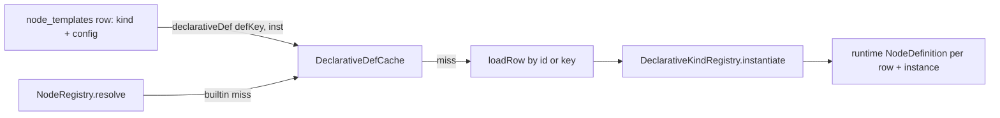

# Declarative nodes

## Summary

Declarative nodes are workflow node types defined by **data** — `node_templates` rows with a `kind` (`agent`, `decision`, `http`, `script`) and a validated config — rather than by registered code. Each row hydrates into a runtime `NodeDefinition` on demand, so teams compose custom flows in the template editor without touching the engine. They reuse the full node infrastructure (status, streaming, artifacts, output validation, config layering) and add no new orchestration concepts.

## Architecture

### Registration and resolution

- `declarativeBootstrap.ts` (imported once by `flowEngine.ts`) wires `declarativeDef` as the `NodeRegistry` declarative resolver and side-effect-imports `declarativeWiring.ts`, which registers each kind's runtime class on the `DeclarativeKindRegistry`.
- `declarative.ts` loads the row (by id, or by `key` for non-builtin rows), instantiates through the kind registry, and caches defs in `DeclarativeDefCache` keyed `defKey#instanceKey`; `invalidateDeclarativeDef` drops entries on template edit.
- Both registries are HMR-safe `processSingleton`s.

### Base classes (`nodes/shared/declarativeNode.ts`)

- `DeclarativeNode` — identity (key = instance key ?? row id, label = row name), config validation via `parseDeclarativeRunConfig` (loud failure, no catalog fallback), and `holdsForApproval` (the instance's trigger type in the flow's template graph).
- `DeclarativeAgentNode` — the same over the `AgentRunNode` tier, for kinds whose runs may start an agent.

Declarative defs declare **no input contract**: the run input is inherited from upstream `next`-edge outputs (`inheritsParentInput: true`), with `input_map` overlays; everything else reaches the run through flow-context variables (`{{task.*}}`, `{{nodes.X.output.*}}`, …).

### Kind contracts (`declarativeSchemas.ts`)

| Kind | Runtime class | Config highlights | Output contract |
|------|---------------|-------------------|-----------------|
| `agent` | `AgentTemplateNode` (`kinds/agent/agentNode.ts`) | `prompt`, `mode` (`plan` read-only / `agent` workspace run), `model`, `mcp_sources`, `output` (`markdown` / `json` + `output_schema`), declarative `split` source and `split_consume` / `split_parallel_max` consumer knobs | markdown → `{markdown}` + artifact; json → schema-validated payload |
| `decision` | `DecisionTemplateNode` (`kinds/decision/decisionNode.ts`) | `source` (`expression` / `manual` / `agent`), `question`, `choices` (label + optional JSONata `condition`), `pass` variables forwarded downstream | `{chosen: string[], rationale?}` + pass-mapped fields |
| `http` | `HttpTemplateNode` (`kinds/http/httpNode.ts`) | `url` / `headers` / `body` with `{{vars}}` and `{{secrets.NAME}}` interpolation, `method`, `timeout_ms`, `response_map` JSONata | `{status, ok, body, headers}` reshaped by `response_map` |
| `script` | `ScriptTemplateNode` (`kinds/script/scriptNode.ts`) | `runtime` (`shell` / `node` / `python`), `script`, `cwd` (`repo` / `workspace`), `timeout_ms`, allowlisted `env`, `output_schema` | JSON object validated against `output_schema` |

### Per-kind behavior

- **Agent** — renders the prompt through `TemplateRenderer` (PromptLibrary-style variables), runs through the standard agent lifecycle, and validates JSON output against `output_schema`. Output-contract failures classified retryable (`no_json`, `schema_MISMATCH`) get bounded feedback turns; `agent_reported` refusals go to the user, not back to the agent. `capabilities: { refinable: true }` — chat reruns with feedback. The declarative `split` block makes the node a split source (units from a schema-enforced array field, per-item key/target/depends-on paths).
- **Decision** — picks the flow's branch among its outgoing labeled edges. `expression`: each truthy JSONata condition picks its branch. `manual`: the user picks via the decision card (`choose_node`). `agent`: the question plus flow state go to a plan-mode agent; the `{"choice","rationale"}` return format is appended automatically, and an invalid or ambiguous answer fails the node — the engine never silently picks. With `trigger: approval` the pick holds at `awaiting_approval` pre-selected on the card. Edges activate exactly when their label ∈ `chosen`; everything else resolves inactive → downstream skips. Chat is declined (no `refinable`) — pushback happens through the card; `converse` still works.
- **HTTP** — every hop goes through the SSRF guard (scheme allowlist, hostname allowlist, pinned public IPs, redirect re-validation — see `platform.md`). `{{secrets.NAME}}` values resolve at execution time only and never persist into rows, inputs, or events.
- **Script** — execa-based local execution (deliberately not a sandbox — the audience is devs running DevFlow locally). Input arrives on stdin and as `DEVFLOW_INPUT`; output comes from `$DEVFLOW_OUTPUT` or the last stdout line (a node runtime top-level `return` is emitted as output JSON). `timeout_ms` kills the process; non-zero exit fails the node with stderr. Env is allowlisted: PATH/HOME + declared names + DevFlow wiring.

The `mergeRequest` kind is **not** declarative — MR creation is the graph-level `MergeRequestService` (`kinds/mergeRequest/mergeRequestService.ts`), driven by the builtin chain; see `gitlab-integration.md`.

## UI architecture

`panelFactory.tsx` maps declarative kinds by `node.kind` (checked after the builtin def key): `agent` → `AgentView`; `decision` / `http` / `script` → `DeclarativeView`. Chat rail: `NodeChat` when `refinable` (agent only). Config editing rides the auto-generated form from `configFields` in the template editor's `NodeConfigurator`; contract tabs read `outputContract()`.

## API surface

| Route | Purpose |
|-------|---------|
| `GET/POST /api/node-templates`, `GET/PUT/DELETE /api/node-templates/:id` | Catalog CRUD; configs validated by the kind schemas at creation |
| `POST /api/flows/:id/action` | `choose_node` (decision), generic `approve_node` (approval-triggered holds), `run_node`, `set_node_config` |
| `POST /api/flows/:id/chat` | Agent-kind refine turns |

## Data model

- **Catalog:** `node_templates` rows (`id`, `key`, `name`, `kind`, `config` JSON, `is_builtin`) — validated by `AgentDefSchema` / `DecisionDefSchema` / `HttpDefSchema` / `ScriptDefSchema` on write.
- **Instances:** `nodes` rows reference the template; instance-level config overrides merge over the row config (class ← app ← snapshot layering, `parseConfigSnapshot`).
- **Static checks:** template lint validates decision label/edge matching, JSONata conditions, `{{refs}}` resolution, and split/fan-out contracts before save — see `templates.md`.

## Out of scope

- Template storage, YAML import/export, and lint rules — see `templates.md`.
- Agent execution internals — see `agent-harness.md`.
- Builtin node kinds — see the per-node docs.

## Related code index

| Concern | Location |
|---------|----------|
| Resolution + cache | `lib/engine/nodes/declarative.ts`, `declarativeRegistry.ts` |
| Bootstrap / wiring | `lib/engine/nodes/declarativeBootstrap.ts`, `declarativeWiring.ts` |
| Kind config schemas | `lib/engine/nodes/declarativeSchemas.ts` |
| Base classes | `lib/engine/nodes/shared/declarativeNode.ts`, `declarativeRunConfig.ts` |
| Agent kind | `lib/engine/nodes/kinds/agent/agentNode.ts` |
| Decision kind | `lib/engine/nodes/kinds/decision/decisionNode.ts` |
| HTTP kind | `lib/engine/nodes/kinds/http/httpNode.ts` |
| Script kind | `lib/engine/nodes/kinds/script/scriptNode.ts` |
| Panels | `components/flows/panels/panelFactory.tsx` |
