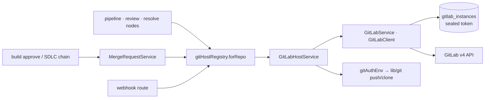

# GitLab integration

## Summary

The GitLab integration is the engine's only registered git host: it opens merge requests for built branches, watches pipelines and review comments, and authenticates local git pushes. Everything host-shaped goes through the **`GitHostService` port** (`lib/engine/ports/gitHost.ts`) and its `GitHostRegistry`, so engine code never imports GitLab modules directly. Credentials are per-instance rows in `gitlab_instances` with tokens sealed at rest; there is no env fallback. The merge-request step itself is a graph-level service (`MergeRequestService`), not a node — it runs between build approval and the pipeline gate.

## Architecture

### The `GitHost` port

`lib/engine/ports/gitHost.ts` defines the seam:

- **`GitHostService`** — one integration: identity (`kind` = `gitlab`, `label`), repo routing (`configured`, `ownsRepo`, `clientForRepo`), local-git auth (`authedCloneUrl`, `gitAuthEnv`, `gitRedactValues`), the instance registry CRUD (`instances`, `addInstance`, `updateInstance`, `removeInstance`, `testInstance`), webhook ingestion (`verifyWebhook`, `parseWebhook`), and a repo-scoped convenience surface (`createChangeRequest`, `listChangeRequestsByBranch`, `getChanges`, pipeline/job/comment methods) that engine and API code calls.
- **`GitHostClient`** — the per-repo API surface, bound by the service to one instance plus the repo's project; every method fails loudly when no instance owns the repo.
- **`GitHostRegistry`** — mirrors `TaskProviderRegistry` (`lib/engine/tasks/registry.ts`): `register` / `get` / `maybe` / `list` / `forRepo`. `forRepo` picks the first registered host whose `ownsRepo` matches and throws "add one on the Settings page" otherwise. The exported `gitHostRegistry` singleton is the engine's only entry point.
- **Normalized vocabulary** — `ChangeRequest` (`number` is the host-native human id, GitLab MR iid), `Pipeline`, `HeadPipelineInfo`, `HostComment` (discussion `threadId`, `resolvable`/`resolved`/`system` flags driving the resolve loop), `HostJob` (`manual` = waiting for play), `HostProject`, `HostInstance` (`tokenMasked` only, never the real token), and `HostWebhookEvent` (`cr_comment` | `pipeline`).
- **Local-git bridge** — `gitRemoteContextFor` / `authedCloneUrlFor` hand `lib/git` a plain clone URL plus `GIT_CONFIG_*` auth env (`gitLabOAuthBasicHeaderEnv`), so tokens never appear in remote URLs and `lib/git` stays free of engine imports.

### Instance configuration and credential storage

- `GitLabInstanceStore` (`lib/db/stores/gitlabInstanceStore.ts`) owns the `gitlab_instances` table: `listMeta` reads rows **without** tokens; `get`/`readToken` decrypt on demand. Writes seal the token via `IntegrationSecretStore` (`lib/db/integrationSecretStore.ts`, the only module touching sealed columns) before insert/update, and strip trailing slashes from `base_url`.
- `GitLabService` (`lib/integrations/gitlab/client.ts`) is the registry-facing service: instance CRUD, `configured()`, and repo-URL → instance routing in `instanceForRepo` — the registered instance whose host matches wins (longest `base_url` first, so `gitlab.company.com/group` subpath setups work); exactly one registered instance also serves SSH-style URLs with no parseable host. No instance → throw pointing at the Settings page.
- `GitLabClient` (same file) is the raw HTTP client for one instance: GitLab v4 API, `PRIVATE-TOKEN` auth, `GITLAB_HTTP_TIMEOUT_MS` (15s) wall-clock timeout, pagination capped at `GITLAB_MAX_LIST_PAGES` (20, surfacing a `truncated` flag), and idempotent GET retries (≤ `GITLAB_MAX_GET_RETRIES`) on `GITLAB_RETRYABLE_STATUSES` (429/502/503/504) honoring `retry-after` (`lib/integrations/gitlab/constants.ts`).
- `testInstance` hits `/api/v4/user` for the settings page's connectivity check; update/test enforce `baseUrlOverrideRequiresToken` (`lib/integrations/instanceCredentialPolicy.ts`) — changing `baseUrl` requires a fresh token.

### Builtin wiring

`wireGitHostBuiltins` (`lib/db/wireGitHostBuiltins.ts`) runs once from the `Database` constructor (`lib/db/database.ts`) and registers `new GitLabHostService(gitLab)` — adding another host is one adapter file plus one `register()` line. The `gitLab` export (`lib/integrations/gitlab/singleton.ts`) is a `processSingleton` holding a lazy proxy that resolves `getDb()` on first use, so importing the registry never forces DB construction. The registry throws if used before wiring (`Git host registry is empty — import @/lib/db first`).

### Repo URL parsing and normalization

`lib/integrations/gitlab/repoUrl.ts` handles HTTPS, `ssh://`, and scp-style (`git@host:path`) URLs: `hostOfRepoUrl` (lowercased host, null when unparseable), `projectPathFromRepoUrl` (`group/sub/repo`, `.git` stripped), `encodedProjectPathFromRepoUrl` (URL-encoded for API paths), and `gitLabRepoCloudUrlSchema` — the Zod refinement used at the repo API boundary (path must include `group/repo` and a parseable host). `normalizeCloneUrl` (port) re-adds the `.git` suffix GitLab's redirect expects for HTTPS clones.

### The merge-request node service

`MergeRequestService` (`lib/engine/nodes/kinds/mergeRequest/mergeRequestService.ts`) creates (or reuses) the change request for a built branch, then resets the pipeline gate and review nodes to `pending`. It is shared by single- and multi-branch flows:

1. Resolve the git branch — `branchStore.gitBranch` / `flowCtxHelper.buildBranch` per branch, or `flow.mr_branch` for single-branch flows.
2. Local exec mode: push the branch first (`localGit.pushBranch` with `gitRemoteContextFor`); push-hook rejections become `CommitError`, network/auth failures rethrow for manual retry.
3. `gitHostRegistry.forRepo(repoUrl)` → reuse an open CR on the source branch, or `createChangeRequest` titled `TASK-KEY: summary` targeting the repo's default branch.
4. Persist: `mr_url` / `mr_iid` / `gitlab_project_id` on the flow row (single-branch) or the branch row via `branchStore.upsert` (multi-branch); emit a `lifecycle` event; `resetGateReview` drops gate/review nodes back to `pending` (never touching `running`).

`createWithFixes` adds the service's own bounded fix loop: on `CommitError` it invokes the caller's `runFix` callback and retries, up to `maxAttempts`; infra errors throw immediately. The SDLC chain (`lib/engine/nodes/chains/sdlcChain.ts`) calls it after build approval with a commit-fix agent as `runFix`; the fan-out merge arena (`lib/engine/runtime/fanout/mergeArena.ts`) reuses the same hook-rejection signatures. Typed errors live in `errors.ts`: `CommitError` (agent-fixable push rejection), `isHookRejection` (the pre-push/pre-receive pattern set), `MrCreationFailed` + `toMrCreationFailure` (mapping approve-build failures).

### Error taxonomy

`lib/engine/ports/gitHostErrors.ts` defines the upstream-error family, all extending `UpstreamError`:

| Class | When | Carries |
|-------|------|---------|
| `GitHostTimeoutError` | 15s wall-clock exceeded | `path`, timeout ms |
| `GitHostAuthError` | HTTP 401/403 | `path`, status, truncated body |
| `GitHostNotFoundError` | HTTP 404 | `path`, status, truncated body |
| `GitHostApiError` | any other non-2xx | `path`, `httpStatus`, `retryAfterMs` |

`gitHostErrorFromResponse` maps responses; upstream bodies are truncated to 500 chars (`truncateUpstreamBody`) and scrubbed of the instance token (`redactSecretsInText`) before they reach logs or error messages. `parseRetryAfterMs` reads both delta-seconds and HTTP-date `retry-after` forms.

## API surface

### HTTP

| Route | Purpose |
|-------|---------|
| `GET /api/git-hosts` | Registered hosts: kind, label, `configured`, instances with masked tokens (settings UI) |
| `GET /api/host-instances/[host]` | Instances for one host kind |
| `POST /api/host-instances/[host]` | Add an instance (`gitHostInstanceCreateBodySchema`; base URL validated by `lib/integrations/instanceRouteValidation.ts`) |
| `PATCH /api/host-instances/[host]/[id]` | Update name/baseUrl/token (blank token keeps the stored one) |
| `DELETE /api/host-instances/[host]/[id]` | Remove an instance |
| `POST /api/host-instances/[host]/[id]` | Test connectivity/auth (`testInstance`; optional baseUrl/token overrides) |
| `POST /api/webhooks/gitlab` | GitLab webhook: verifies `x-gitlab-token` against `GITLAB_WEBHOOK_SECRET` (timing-safe SHA-256 compare; `GITLAB_WEBHOOK_ALLOW_UNSIGNED=1` opts out), normalizes note/pipeline deliveries, hands them to `flowEngine.handleHostEvent` |
| `GET/POST /api/repos`, `GET/PATCH/DELETE /api/repos/[id]` | Repo registry: `cloud_url` links flows to a GitLab project (validated by `gitLabRepoCloudUrlSchema`) |

### UI surface

Settings → Integrations → Git tab (`components/settings/integrations/GitTab.tsx`): provider and hosting selects, a connect modal, instance cards with delete confirm, and per-instance test results — all backed by the `host-instances` routes above.

## Data model

- **`gitlab_instances`** — `id` (`gli_…`), `name`, `base_url` (trailing slashes stripped), `token` (sealed at rest; meta reads omit it, the UI only ever sees a masked form), `created_at`.
- **Flow columns** — `repo_url`, `mr_url`, `mr_iid`, `mr_branch`, `gitlab_project_id` (written by `MergeRequestService`; the project id feeds the webhook/poller correlation).
- **Multi-branch flows** — per-branch `mrUrl` / `mrIid` on branch rows via `branchStore.upsert`; the flow row's `gitlab_project_id` is still ensured.
- **Comments** — ingested `HostComment`s keep the GitLab discussion id as `threadId`; only resolvable, non-system notes count as open in the resolve loop.
- **Config** — `GITLAB_WEBHOOK_SECRET`, `GITLAB_WEBHOOK_ALLOW_UNSIGNED` via `lib/config.ts` only.

## Out of scope

- Other git hosts (GitHub, Bitbucket): the port admits them, but only GitLab is registered today.
- Pipeline-gate, review, and resolve node internals, and the host-event poller — they consume this port but are documented with their nodes.
- Task-provider integrations (Jira et al.) — separate `TaskProviderRegistry` seam.
- Local git/worktree mechanics (`lib/git`) beyond the auth-env bridge.
- Repo registry CRUD details beyond host linking (`lib/repos/repoService.ts`).

## Related code index

| Concern | Location |
|---------|----------|
| Port interfaces + registry | `lib/engine/ports/gitHost.ts` |
| Upstream error taxonomy | `lib/engine/ports/gitHostErrors.ts` |
| GitLab adapter (port impl) | `lib/integrations/gitlab/gitHost.ts` |
| HTTP client + instance routing | `lib/integrations/gitlab/client.ts` |
| Repo URL parsing/validation | `lib/integrations/gitlab/repoUrl.ts` |
| HTTP constants | `lib/integrations/gitlab/constants.ts` |
| Service singleton | `lib/integrations/gitlab/singleton.ts` |
| Instance rows + token sealing | `lib/db/stores/gitlabInstanceStore.ts`, `lib/db/integrationSecretStore.ts` |
| Registry wiring | `lib/db/wireGitHostBuiltins.ts` (called from `lib/db/database.ts`) |
| MR creation service + errors | `lib/engine/nodes/kinds/mergeRequest/mergeRequestService.ts`, `errors.ts` |
| Chain caller (approve-build → MR) | `lib/engine/nodes/chains/sdlcChain.ts` |
| Settings routes | `app/api/git-hosts/route.ts`, `app/api/host-instances/[host]/route.ts`, `app/api/host-instances/[host]/[id]/route.ts` |
| Webhook route | `app/api/webhooks/gitlab/route.ts` |
| Repo linking | `lib/repos/repoService.ts`, `app/api/repos/route.ts` |
| Settings UI | `components/settings/integrations/GitTab.tsx` |
