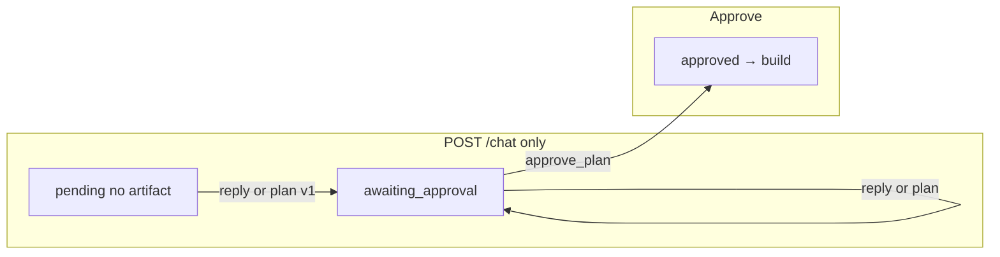

# Plan node

## Summary

The plan node produces an **implementation plan**: a versioned markdown document and a checklist (`plan_steps`). It is the flow’s primary planning step and the only node that uses **`chatMode: 'plan'`**: the chat composer is the single input surface, prefilled with the plan template before v1.

**All agent turns** (first plan and whole-plan changes) go through **`POST /api/flows/:id/chat`**. The engine’s **`PlanNode.turn()`** routes by artifact presence only. Output uses one envelope: **`PlanTurnOutput`** (`reply` + optional `plan`).

See **`docs/architecture/plan-unified-turns.md`** for the full contract.

## Capabilities contract

| Field | Value | UI / engine effect |
|-------|--------|-------------------|
| `refinable` | `true` | Chat rail is shown; messages invoke `PlanNode.turn()`. |
| `chatMode` | `'plan'` | `resolveNodePanel` mounts **`PlanNodeChat`** instead of generic **`NodeChat`**. |
| `promptNode` | `plan` | Prompt preview/read targets the plan template (`GET /prompt?node=plan`). |
| `panelTitle` | `Implementation plan` | Chat rail heading. |

Engine-only (not serialized to UI):

- `builtinApproval: true` — approve uses **`approve_plan`**, not generic `approve_node`.
- `chainRole: plan` — SDLC chain resolves the plan role by key.
- `resourceArtifacts: ['plan']` — plan artifact is the first-class resource for editor/approvals.

## User-visible rules (two send modes)

Routing is **only** artifact presence. Same composer and same HTTP route for both.

### Rule 1 — No plan artifact yet (pre-publish)

- **Condition:** Zero plan artifacts; node **`pending`** until a turn publishes **`plan`**.
- **Send:** Composer opens prefilled from `GET /prompts` / the plan template (`promptIsBody`).
- **Outcome:** Reply-only → transcript only, node stays **`pending`**. **`plan`** present → artifact **v1**, checklist sync, **`awaiting_approval`**.

### Rule 2 — Plan exists (whole-plan refine)

- **Condition:** A plan artifact exists.
- **Send:** **`POST /chat`** on the single conversation.
- **Outcome:** Reply-only → no new version. **`plan`** → new artifact version, **`refinedFrom.source: 'chat'`**, checklist sync, approval re-gates as today.

### Checklist editing (unchanged)

- **`PlanView`** — versions, master plan, **`PlanSteps`** editor.
- Actions: **`update_plan_steps`**, **`set_plan_step`**, version tab selection (local UI).

### Approve

- **`approve_plan`** → **`approved`** → build.

## UI architecture

### Workspace routing

`components/flows/panels/panelFactory.tsx`:

- Panel: `node.type === 'plan'` → **`PlanView`**
- Chat: `capabilities.refinable && capabilities.chatMode === 'plan'` → **`PlanNodeChat`**

### Panel (`PlanView`)

- **`usePlanAction`** — approve, retry, cancel, checklist; **`useReducer`** for version UI.

### Chat rail (`PlanNodeChat` + hooks)

| Piece | Role |
|-------|------|
| **`usePlanComposer`** | Prompt prefill source via **`usePlanChatAction`** (one bulk `GET /prompts`). |
| **`ChatPanel`** | Single feed; **`useChatComposer`** → **`POST /chat`**. |

### Async states

| State | Behavior |
|-------|----------|
| Prompt load | `isPromptsLoading` from bulk `GET /prompts` before showing the rail. |
| Chat sending | `useChatComposer` pending + flow `busy` / `current_node`. |
| Panel plan content | Empty hints when no artifact selected. |

### Key files

- `components/flows/components/plan/PlanView.tsx`
- `components/flows/components/plan/PlanNodeChat.tsx`
- `components/flows/components/plan/hooks/usePlanComposer/`
- `components/chat/feed/ChatPanel.tsx`, `hooks/useFlowChat.ts`

## Backend architecture

### Node class

**`PlanNode.turn(ctx, content, { model?, previousStatus? })`** — single entry from **`sendChat`**. Dispatches pre-publish or whole turns; **`PlanOutputContract.applyTurnResult`** parses **`PlanTurnOutput`**.

Collaborators: **`PlanStore`**, **`PlanContextBlocks`**, **`PlanPromptBuilder`**, **`PlanOutputContract`**.

### Approval

**`flowEngine.approvePlan`** → **`advanceFrom(planKey)`** → build.

### Key files

- `lib/engine/nodes/kinds/plan/planNode.ts`
- `lib/engine/nodes/kinds/plan/planContract.ts`
- `lib/engine/nodes/kinds/plan/schema.ts` — **`PlanTurnOutput`**
- `lib/engine/flowEngine/flowEngine.ts` — **`sendChat`**, **`approvePlan`**

## API surface

### HTTP

| Route | Purpose |
|-------|---------|
| `GET /api/flows/:id/prompt?node=plan` | Plan template body (composer prefill) |
| `GET /api/flows/:id/prompts` | Bulk prompt bodies (`useFetchAllNodePrompt`) |
| **`POST /api/flows/:id/chat`** | **All plan agent turns** — body `{ nodeKey, content, model? }` |
| `POST /api/flows/:id/action` | Checklist, approve, retry/cancel (not plan generation) |

### Flow actions (plan-relevant)

| Action | When |
|--------|------|
| **`approve_plan`** | User approves plan |
| **`update_plan_steps`** / **`set_plan_step`** | Checklist editor |
| **`retry`** / **`cancel`** | Failed/stuck agent |

**`run_node`** on the plan node is **rejected** (`runNodeManual` → use POST /chat). There is no **`refine_plan`** action.

## Data model (high level)

- **Artifacts:** kind `plan`; meta includes `steps`, **`refinedFrom`**, `feedback`.
- **Output JSON:** `latestArtifact`, `version`, optional `steps`, `model`.
- **`plan_steps`** synced on each published plan meta.

## Provenance and review UI

- **`WholeDiffBanner`**: version diffs from `branchDiff.ts` helpers over the artifact meta's `steps`.
- **`refinedFrom.source`**: `start` | `chat`.

## Related docs

- **`docs/architecture/plan-unified-turns.md`** — canonical turn rules and envelope.

## Out of scope

- Template editor / YAML import for plan knobs.
