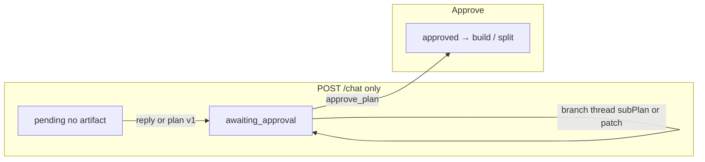

# Plan node

## Summary

The plan node produces an **implementation plan**: a versioned markdown document, a checklist (`plan_steps`), and optional **branches** for per-branch child flows at build time. It is the flow’s primary planning step and the only node that uses **`chatMode: 'plan'`**: the chat composer is the single input surface—prefilled with the plan template before v1, then as a multi-thread conversation (main + one tab per branch).

**All agent turns** (first plan, whole-plan changes, branch sub-plan changes) go through **`POST /api/flows/:id/chat`**. The engine’s **`PlanNode.turn()`** routes by artifact count and optional **`thread`** (branch name). Output uses one envelope: **`PlanTurnOutput`** (`reply` + optional `plan` | `subPlan` | `subPlanPatch`).

See **`docs/architecture/plan-unified-turns.md`** for the full contract.

## Capabilities contract

| Field | Value | UI / engine effect |
|-------|--------|-------------------|
| `refinable` | `true` | Chat rail is shown; messages invoke `PlanNode.turn()`. |
| `chatMode` | `'plan'` | `resolveNodePanel` mounts **`PlanNodeChat`** instead of generic **`NodeChat`**. |
| `promptNode` | `plan` | Prompt preview/read targets the plan template (`GET /prompt?node=plan`). |
| `panelTitle` | `Implementation plan` | Chat rail heading when no thread tab label applies. |

Engine-only (not serialized to UI):

- `builtinApproval: true` — approve uses **`approve_plan`**, not generic `approve_node`.
- `chainRole: plan` — SDLC chain resolves the plan role by key.
- `resourceArtifacts: ['plan']` — plan artifact is the first-class resource for editor/approvals.

## User-visible rules (three send modes)

Routing is **only** artifact presence + **`thread`** on the chat body. Same composer and same HTTP route for all three.

### Rule 1 — No plan artifact yet (pre-publish)

- **Condition:** Zero plan artifacts; node **`pending`** until a turn publishes **`plan`**.
- **Send:** Main thread only (`thread` absent). Composer may open prefilled from `GET /prompts` / plan template; after send, normal per-thread drafts.
- **Outcome:** Reply-only → transcript only, node stays **`pending`**. **`plan`** present → artifact **v1**, checklist sync, **`awaiting_approval`**.

### Rule 2 — Plan exists, main thread

- **Condition:** Artifact exists; main tab (no branch **`thread`**).
- **Send:** **`POST /chat`** on main conversation.
- **Outcome:** Reply-only → no new version. **`plan`** → new artifact version, **`refinedFrom.source: 'chat'`**, checklist sync, approval re-gates as today.

### Rule 3 — Plan exists, branch thread

- **Condition:** Artifact exists; **`thread`** = branch name (must exist on latest plan meta).
- **Send:** **`POST /chat`** from the branch tab (`PlanNodeChat` → **`ChatPanel`** passes **`activeThreadId`** as **`thread`**).
- **Outcome:** Reply-only on that thread. **`subPlan`** or **`subPlanPatch`** → merge into that branch only, new version, **`scopedRefine`** + **`refinedFrom.source: 'branch'`**. Whole **`plan`** on branch turns is rejected by the engine.

Invalid branch name → **400** on send.

### Checklist editing (unchanged)

- **`PlanView`** — versions, master plan, branch cards, **`PlanSteps`** editor.
- Actions: **`update_plan_steps`**, **`set_plan_step`**, version tab selection (local UI).

### Approve and fan-out

- **`approve_plan`** with optional **`executionOverride`** → build / per-branch split per published execution meta.

## UI architecture

### Workspace routing

`components/flows/panels/panel-factory.tsx`:

- Panel: `node.type === 'plan'` → **`PlanView`**
- Chat: `capabilities.refinable && capabilities.chatMode === 'plan'` → **`PlanNodeChat`**

### Panel (`PlanView`)

- **`usePlanAction`** — approve, retry, cancel, checklist; **`useReducer`** for version/branch UI.
- Branch sub-plans are **read-only in the panel**; changes happen on the matching **branch chat tab** (no panel Refine action).

### Chat rail (`PlanNodeChat` + hooks)

| Piece | Role |
|-------|------|
| **`usePlanComposer`** | Thread id, prompt prefill source, per-thread draft stash via **`usePlanChatAction`**. |
| **`ChatPanel`** | Feed filtered by **`activeThreadId`**; **`useChatComposer`** → **`POST /chat`** with **`thread`** when on a branch tab (non-main tab id). |

**Thread tabs:** When `node.output.branches` exists, tabs = main + one per branch name. Branch messages use `messages.thread === branchName`; main thread shows unthreaded messages.

### Async states

| State | Behavior |
|-------|----------|
| Prompt load | `isPromptsLoading` from bulk `GET /prompts` before showing the rail. |
| Chat sending | `useChatComposer` pending + flow `busy` / `current_node`. |
| Panel plan content | **`MasterPlanLoader`** / empty hints when no artifact selected. |

### Key files

- `components/flows/components/plan/PlanView.tsx`
- `components/flows/components/plan/PlanNodeChat.tsx`
- `components/flows/components/plan/hooks/usePlanComposer/`
- `components/chat/ChatPanel.tsx`, `hooks/use-flow-chat.ts`

## Backend architecture (shipped Phase 1+)

### Node class

**`PlanNode.turn(ctx, content, { model?, thread? })`** — single entry from **`sendChat`**. Dispatches pre-publish, whole, or branch turns; **`PlanOutputContract.applyTurnResult`** parses **`PlanTurnOutput`**.

Collaborators: **`PlanStore`**, **`PlanContextBlocks`**, **`PlanPromptBuilder`**, **`PlanOutputContract`**, **`BranchRefinement`** (merge + patch), **`PlanSplitter`**, **`PlanAgentSessions`** (`branchAgents` on node output).

### Approval and fan-out

**`flowEngine.approvePlan`** → **`advanceFrom(planKey)`**; build reads **`splitUnits`** / **`splitResolution`** when execution is per-branch.

### Key files

- `lib/engine/nodes/kinds/plan/plan-node.ts`
- `lib/engine/nodes/kinds/plan/plan-contract.ts`
- `lib/engine/nodes/kinds/plan/schema.ts` — **`PlanTurnOutput`**, **`SubPlanPatch`**
- `lib/engine/flow-engine.ts` — **`sendChat`**, **`approvePlan`**

## API surface

### HTTP

| Route | Purpose |
|-------|---------|
| `GET /api/flows/:id/prompt?node=plan` | Plan template body (composer prefill) |
| `GET /api/flows/:id/prompts` | Bulk prompt bodies (`useFetchAllNodePrompt`) |
| **`POST /api/flows/:id/chat`** | **All plan agent turns** — body `{ nodeKey, content, model?, thread? }` |
| `POST /api/flows/:id/action` | Checklist, approve, retry/cancel (not plan generation) |

### Flow actions (plan-relevant)

| Action | When |
|--------|------|
| **`approve_plan`** | User approves plan |
| **`update_plan_steps`** / **`set_plan_step`** | Checklist editor |
| **`retry`** / **`cancel`** | Failed/stuck agent |

**`run_node`** on the plan node is **rejected** (`runNodeManual` → use POST /chat). There is no **`refine_plan`** action.

## Data model (high level)

- **Artifacts:** kind `plan`; meta includes `steps`, `branches`, **`refinedFrom`**, **`scopedRefine`**, execution fields.
- **Output JSON:** `latestArtifact`, `version`, optional **`branches`**, **`branchAgents`** (per-branch harness ids).
- **`plan_steps`** synced on each published plan meta.

## Provenance and review UI

- **`WholeDiffBanner`** / branch badges: version diffs from `branchDiff` helpers.
- **`refinedFrom.source`**: `start` | `chat` | `branch`.

## Related docs

- **`docs/architecture/plan-unified-turns.md`** — canonical turn rules and envelope.
- Superseded for send routing: `docs/plan-conversation-refine.md`, `docs/branch-scoped-refine.md` (historical).

## Out of scope

- StepFlowManager / per-checklist-step child flows.
- Template editor / YAML import for plan knobs.
