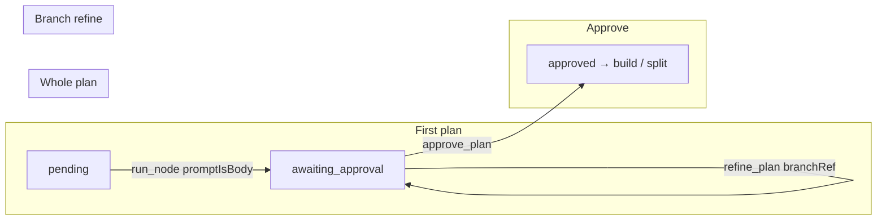

# Plan node

## Summary

The plan node produces an **implementation plan**: a versioned markdown document, a checklist (`plan_steps`), and optional **branches** for per-branch child flows at build time. It is the flow’s primary planning step and the only node that uses **`chatMode: 'plan'`**: the chat composer is the single input surface—first as the editable plan prompt body, then as a conversation whose agent response schema decides whether a message updates the plan or only replies in the transcript.

Whole-plan changes after the first version go through **`POST /chat`** and the **`{ reply, plan? }`** follow-up contract. Branch-scoped sub-plan rewrites use a dedicated **`run()`** path via the **`refine_plan`** action (requires `branchRef`).

## Capabilities contract

| Field | Value | UI / engine effect |
|-------|--------|-------------------|
| `refinable` | `true` | Chat rail is shown; messages can invoke `PlanNode.chat()`. |
| `chatMode` | `'plan'` | `resolveNodePanel` mounts **`PlanNodeChat`** instead of generic **`NodeChat`**. |
| `promptNode` | `plan` | Prompt preview/read targets the plan template (`GET /prompt?node=plan`). |
| `panelTitle` | `Implementation plan` | Chat rail heading when no thread tab label applies. |

Engine-only (not serialized to UI):

- `builtinApproval: true` — approve uses **`approve_plan`**, not generic `approve_node`.
- `chainRole: plan` — SDLC chain resolves the plan role by key.
- `resourceArtifacts: ['plan']` — plan artifact is the first-class resource for editor/approvals.

## User-visible phases

### Phase 1 — Generate the first plan

- **Entry:** Plan node `pending`, zero plan artifacts.
- **Surface:** Chat rail (`PlanNodeChat`); panel shows empty / status hints.
- **Action:** Composer send → **`run_node`** with `{ prompt, promptIsBody: true, model }` (see `usePlanComposer`).
- **Outcome:** Agent run with `plan` template (+ config `prompt_body` / `prompt_rules`, optional `decompose`, optional `execution_default: follow` directive). Valid **`PlanResponse`** → plan artifact v1, checklist sync, node **`awaiting_approval`**.

### Phase 2 — Review and edit checklist

- **Entry:** At least one plan artifact; often `awaiting_approval`.
- **Surface:** **`PlanView`** — versions, master plan, branch cards, **`PlanSteps`** editor.
- **Action:** **`update_plan_steps`**, **`set_plan_step`**, version tab selection (local UI state).
- **Outcome:** Checklist rows update; plan markdown/branches unchanged unless agent runs again.

### Phase 3 — Whole-plan conversation

- **Entry:** Plan exists (`artifactCount > 0` or node past first run).
- **Surface:** Main chat thread (no `thread` param, or main tab id).
- **Action:** Composer send → **`POST /api/flows/:id/chat`** → `flowEngine.sendChat` → **`PlanNode.chat()`**.
- **Outcome:**
  - Response parses to **reply-only** → transcript only; no new artifact.
  - Response includes **`plan`** → validate → new artifact version, checklist sync, **`refinedFrom.source: 'chat'`**, node stays/re-enters **`awaiting_approval`** (subject to §3b status guard).

### Phase 4 — Branch-scoped sub-plan refine

- **Entry:** Plan has `output.branches`; user targets one branch.
- **Surface:** Branch thread tab in chat (transcript filter) and/or panel branch **Refine** (composer prefill — see Future).
- **Action:** **`refine_plan`** with required **`branchRef`**, plus `prompt` / `feedback` / `promptIsBody` / `fresh` / `contextBlocks` → **`PlanNode.run()`** scoped path.
- **Outcome:** **`SubPlanResponse`** merged into one branch via **`BranchRefinement`**; new plan version with **`scopedRefine`** + **`refinedFrom.source: 'branch'`**; user/assistant turns logged on that branch **`thread`**.

### Phase 5 — Approve and fan-out

- **Entry:** Node **`awaiting_approval`**, viewing latest version.
- **Surface:** **`PlanApproveFooter`** — execution summary + override (`whole` vs per-branch **`steps`**).
- **Action:** **`approve_plan`** with optional **`executionOverride`**.
- **Outcome:** Plan artifact **`approved`**, node **`approved`**, engine **`advanceFrom`** into downstream node (typically build). Build with `split_consume: 'source'` reads **`PlanNode.splitUnits`** / **`splitResolution`** (branch child flows when resolution is per-unit).

## UI architecture

### Workspace routing

`components/flows/panels/panel-factory.tsx`:

- Panel: `node.type === 'plan'` → **`PlanView`**
- Chat: `capabilities.refinable && capabilities.chatMode === 'plan'` → **`PlanNodeChat`**

No plan-specific branching inside generic `ChatPanel` beyond props the plan feature passes in.

### Panel (`PlanView`)

- **`usePlanAction`** — mutations: approve, retry, cancel, checklist updates; **`useReducer`** for selected version and expanded branch.
- **`useExecutionPick`** — approve-time execution override vs published meta.
- Sections: header, status, version tabs, whole-plan diff banner, master + sub-plan sections, editable steps, approve footer.

Send targets for plan changes **do not** go through the panel; they go through the chat rail or (branch) `refine_plan`.

### Chat rail (`PlanNodeChat` + hooks)

| Piece | Role |
|-------|------|
| **`usePlanComposer`** | Chooses send target: **`run_node`** while plan pending; otherwise default chat mutation. |
| **`usePlanChatAction`** | Thread id, per-thread draft stash, bulk prompt fetch for future prefill. |
| **`ChatPanel`** | Feed filtered by **`activeThreadId`**; **`useChatComposer`** → `POST /chat` with `thread` when on a branch tab. |

**Thread tabs:** When `node.output.branches` exists, tabs = main + one per branch name. Scoped run messages use `messages.thread === branchName`; main thread shows unthreaded messages.

### Async states

| State | Behavior |
|-------|----------|
| Plan pending + prompt load | `usePlanChatAction` exposes `isPromptsLoading` (prefill source for planned composer states). |
| Chat sending | `useChatComposer` pending + flow `busy` / `current_node`. |
| Panel plan content | **`MasterPlanLoader`** / empty hints when no artifact selected. |

### Key files

- `components/flows/components/plan/PlanView.tsx`
- `components/flows/components/plan/PlanNodeChat.tsx`
- `components/flows/components/plan/hooks/usePlanComposer/`
- `components/flows/components/plan/hooks/usePlanAction.ts`
- `components/flows/components/plan/utils/planExecution.ts` — approve footer resolution labels
- `components/flows/components/plan/utils/branchDiff.ts` — diff banners and tab captions
- `components/chat/ChatPanel.tsx` — generic feed + composer

## Backend architecture

### Node class

**`PlanNode`** extends **`AgentRunNode`**, key **`plan`**. Thin orchestrator; domain logic lives in collaborators (see AGENTS §3).

### Collaborators

| Class | Responsibility |
|-------|----------------|
| **`PlanStore`** | Artifacts, meta, `plan_steps` sync, scoped-refine lookup, execution meta |
| **`PlanContextBlocks`** | Assembles `{{context}}` from block registry |
| **`PlanPromptBuilder`** | `whole()`, `scoped()`, `refineTurn()`, execution directive |
| **`PlanOutputContract`** | Parse, bounded retry, persist, scoped merge |
| **`PlanSplitter`** | Split units + resolution recommendation for build |

### Run lifecycle (`run`)

1. Reject **`feedback`** without **`branchRef`** (whole-plan refinement is chat-only).
2. Merge config **`prompt_body`** into input when no inline prompt.
3. If **`branchRef`**: scoped prompt (`plan_subplan_refine`); else **`whole()`** (first plan or custom prompt body).
4. **`execute`** → agent `mode: 'plan'` → **`applyWithRetry`** → artifact + checklist.

### Chat lifecycle (`chat`)

Overrides **`AgentRunNode.chat()`** (no feedback rerun):

1. **`refineTurn()`** — `plan_refine` conversation contract + context blocks.
2. **`parseFollowUp()`** on agent text.
3. Reply-only → return reply.
4. Plan present → **`applyPlanVersion`** (status guard, validate, **`applyChatPlan`**, **`applyOutcome`**); one bounded retry on schema failure then conversational refusal.

**`converse()`** is not used for plan chat sends (`chatOnly: false`).

### Approval and advance

**`flowEngine.approvePlan`**: optional execution override on artifact meta → mark plan approved → **`advanceFrom(planKey)`** (build trigger / split expansion on consumer node).

### Fan-out source port

- **`splitUnits`**: one unit per branch, item carries branch contract + full plan document.
- **`splitResolution`**: knob `whole` → `whole`; knob `follow` → read published meta `execution` (`steps` ⇒ `per-unit`, else `whole`). Legacy config knob value `"steps"` on the plan node is treated as `whole`.

### Key files

- `lib/engine/nodes/kinds/plan/plan-node.ts`
- `lib/engine/nodes/kinds/plan/plan-prompt.ts`
- `lib/engine/nodes/kinds/plan/plan-contract.ts`
- `lib/engine/nodes/kinds/plan/plan-followup.ts`
- `lib/engine/nodes/kinds/plan/plan-store.ts`
- `lib/engine/nodes/kinds/plan/plan-split.ts`
- `lib/engine/nodes/kinds/plan/schema.ts`
- `lib/engine/flow-engine.ts` — `refineBranchPlan`, `approvePlan`, `sendChat`
- `lib/engine/nodes/shared/node-roles.ts` — `ChatRefiner` routing

## API surface

### HTTP

| Route | Caller | Purpose |
|-------|--------|---------|
| `GET /api/flows/:id/prompt?node=plan` | Prompt reads / composer prefill | Assembled plan body + rules |
| `GET /api/flows/:id/prompt?node=plan&branch=:name` | Branch scoped prefill | `plan_subplan_refine` body |
| `GET /api/flows/:id/prompts` | `useFetchAllNodePrompt` | Bulk prompt bodies for flow |
| `POST /api/flows/:id/chat` | `useSendChatMessage` | Whole-plan conversation (`PlanNode.chat`) |
| `POST /api/flows/:id/action` | `useFlowMutation` | Flow actions below |

### Flow actions

| Action | When | Engine |
|--------|------|--------|
| **`run_node`** | First plan (pending); `{ input: { prompt, promptIsBody, model, decompose? } }` | `runNodeManual` → **`PlanNode.run`** |
| **`refine_plan`** | Branch sub-plan only; **`branchRef` required** | **`refineBranchPlan`** → **`PlanNode.run`** scoped |
| **`approve_plan`** | User approves plan | **`approvePlan`** |
| **`update_plan_steps`** | Checklist editor save | **`updatePlanSteps`** |
| **`set_plan_step`** | Toggle step done/pending | **`setPlanStepStatus`** |
| **`retry`** / **`cancel`** | Failed/stuck agent | Node retry/cancel |

### Actions not used

- **`start_plan`** — removed; use **`run_node`** for the first plan.
- Whole-plan **`refine_plan`** without **`branchRef`** — removed; use **`POST /chat`**.

## Data model

### Input (`PlanInput`)

| Field | Use |
|-------|-----|
| `prompt` / `promptIsBody` | First run or verbatim/scoped body override |
| `decompose` | Sub-agent exploration hint on first run |
| `model` | Per-run model override |
| `branchRef` | Scoped refine target branch name |
| `feedback` | Scoped refine instruction (with `branchRef` only) |
| `fresh` | Scoped: start new agent vs follow-up (default fresh) |
| `contextBlocks` | Scoped: which context blocks to assemble |

### Output (`PlanOutput`)

Latest artifact id, version, optional **`branches`**, **`steps`**, **`scopedRefine`** on branch-scoped versions.

### Artifacts

- **Kind:** `plan`
- **Content:** markdown document
- **Meta:** `steps`, `branches`, `feedback`, **`refinedFrom`**, **`scopedRefine`**, **`execution`**, **`executionSource`**, **`execution_rationale`**

### Side effects

- **`plan_steps`** table synced from each published plan meta (checklist UI + legacy step fan-out linkage).

## Agent contracts

### Prompt keys

`plan`, `plan_refine` (chat turn + conversation contract), `plan_subplan_refine` (branch scoped run).

Config knobs: `prompt_body`, `prompt_rules`, `decompose_default`, `execution_default` (`whole` | `follow`), `mcp_sources`.

### Response shapes

| Path | Schema |
|------|--------|
| First / whole **`run()`** | **`PlanResponse`** (`markdown`, `steps`, optional `branches`, optional planner `execution`) |
| **`chat()`** turn | **`PlanFollowUp`** (`reply`, optional `plan`) then **`PlanResponse`** on apply |
| Scoped **`run()`** | **`SubPlanResponse`** |

### Retries and guards

- Run: one bounded contract retry via **`PlanOutputContract.applyWithRetry`**.
- Chat plan-bearing: one retry with violation feedback; then refusal event + user-visible message.
- Apply allowed only in **`pending`**, **`awaiting_approval`**, **`failed`** (`PLAN_APPLY_ALLOWED`).

## Provenance and review UI

- **`WholeDiffBanner`** / branch **`DiffBanner`**: step-level diff between consecutive versions when refine provenance exists.
- **Version tab captions** from `branchDiff.planTabCaption` (`feedback`, scoped branch, “refined in chat”).
- **`refinedFrom.source`**: `chat` | `branch` | `start` (custom prompt body diverged from default template).

## Future

- Full **`ComposerConfig`** seam: prompt prefill, growing textarea, branch scoped send → **`refine_plan`**, header **Refine plan** focus wiring (spec: `docs/plan-conversation-refine.md` §4d).
- Branch tab sends today use **`chat()`** on the main contract; product direction for branch-dedicated turns is **`refine_plan`** with composer prefill.

## Out of scope

- **StepFlowManager** / per-checklist-step child flows (`step_build`, `approve_fanout_step`) — separate subsystem; not part of the conversational plan model.
- Template editor / YAML import for plan knobs.
- Build node consumption of split units (documented under build architecture when added).

## Related code index

| Concern | Location |
|---------|----------|
| Panel + chat registration | `components/flows/panels/panel-factory.tsx` |
| Plan feature UI | `components/flows/components/plan/` |
| Chat generic rail | `components/chat/ChatPanel.tsx`, `hooks/use-flow-chat.ts` |
| Action dispatch | `app/api/flows/[id]/action/route.ts`, `app/api/flows/[id]/chat/route.ts` |
| Engine triggers | `lib/engine/flow-engine.ts` |
| Plan domain | `lib/engine/nodes/kinds/plan/` |
| Prompt defaults | `lib/engine/prompts/prompt-defaults.ts` |
| Split consumer | `lib/engine/runtime/split/split-manager.ts`, build `split_consume` knob |
