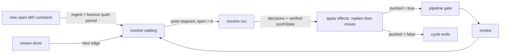

# Resolve node

## Summary

The resolve node consumes the merge request's open review comments and drives a fix agent that commits the requested changes to the MR branch, then applies the agent's per-comment disposition: fix, answer, decline, or skip. It is the SDLC chain's debounced tail: in the seeded `tpl_sdlc_loop` template its trigger is `{ "type": "debounced", "minutes": 10, "wait_for": "comments" }`, so new reviewer comments queue an automatic resolve after a quiet period instead of interrupting in-flight work. Its output decides the review ↔ resolve loop: the template's `resolve → pipeline` loop edge fires only when `pushed = true` — the engine-verified state that the fix is on the remote MR head — sending the cycle back through CI and re-review.

## Capabilities contract

| Field | Value | UI / engine effect |
|-------|--------|-------------------|
| `refinable` | `true` | Chat rail is shown; a message re-runs the resolve with the text as developer `instructions`. |
| `chatMode` | — | Not set; the generic `NodeChat` rail is used. |
| `promptNode` | — | Not set; the prompt modal targets the node by key (`node=resolve`). |
| `panelTitle` | `Comment resolution` | Panel header title. |

Engine-only (not serialized to UI):

- `chainRole: resolve` — the chain and `WaitScheduler.resolveDelayMs` resolve the role by key.
- `edges: [[pipeline, "loop"]]` — re-enters the CI gate when the fix is verified on the remote MR head.
- `order: 50` — builtin graph ordering (last in the chain).
- `quiet_minutes` config knob — engine-consumed quiet period for the debounced wait (default 10).

## User-visible phases

### Phase 1 — Queued (debounced wait)

- **Entry:** A `review` run finished, or a new open MR comment arrived (webhook or poller ingestion), and the resolve node holds at `waiting`.
- **Surface:** Panel — a clock line: "Auto-resolve of open comments starts at 14:32" (`flow.resolveScheduleAt`, rendered by `resolveClockLabel`); the lifecycle event log names the same time.
- **Action:** None required; "Resolve comments" forces a manual run. Each new open comment bounces the quiet-period timer (`WaitScheduler.bounceCommentWaits`).
- **Outcome:** When the quiet period elapses with open comments present and the chain idle, the wait-timer tick fires the run; with zero open comments or a busy chain it re-arms and keeps waiting.

### Phase 2 — Resolve run

- **Entry:** Debounced timer fired, "Resolve comments" (`resolve` action), a chat message, or `retry`.
- **Surface:** Both — "Agent is fixing open comments…" in the panel; run events in the chat rail.
- **Action:** The agent receives every open comment (id-tagged lines, already-replied threads marked) plus optional developer instructions, and answers with one JSON decision per comment: commit fixes to the MR branch (in the flow's worktree in local mode), and write a thread reply for answers/wontfixes.
- **Outcome:** A `resolve` artifact records the agent's summary and the per-comment decision list; output carries the per-action counts plus the engine-verified `codeChanged` and `pushed`.

### Phase 3 — Dispositions applied, loop decided

- **Entry:** Run finished.
- **Surface:** Panel artifact card; the review panel's thread list flips threads to resolved on its next poll and shows the agent's posted replies (`**AI Resolve**…`) inside the discussions.
- **Action:** None automatic beyond the engine.
- **Outcome:** Per decision: replies post into the thread first, then (for `fixed` with resolve authority — the fix verified on the remote MR head) the discussion closes on the host and the local rows are marked `resolved_by = 'agent'`. A `local_only` fix (committed but push failed on infra) never closes: replies post, threads stay open, and the next cycle's pre-run push flushes the backlog. The loop edge re-enters `pipeline` only on `pushed = true`.



## UI architecture

### Workspace routing

`components/flows/panels/panelFactory.tsx`:

- Panel: `node.type === 'resolve'` → `ResolveView`
- Chat: `capabilities.refinable` (no `chatMode`) → `NodeChat`

### Panel (`ResolveView`)

- Reads `useNodePanel()`; no props.
- Queue clock from `flow.resolveScheduleAt` via `resolveClockLabel`; flips to "waiting on the gate" (`pipeline-gated`) once the quiet period has elapsed.
- Run history via `GenericArtifact` (kind `resolve`).
- Footer: "Resolve comments" dispatches the `resolve` action (hidden while running).
- The sibling `ReviewView` footer also dispatches `resolve` ("Resolve N open comments").

### Chat rail

Generic `NodeChat` → `ChatPanel`; sends go to `POST /api/flows/:id/chat` and re-run the resolve with the message as `instructions`. The chat reply is the contract's `summary`.

### Async states

| State | Behavior |
|-------|----------|
| Running | `PanelShell` `runningLabel`; footer actions hidden. |
| Waiting | Clock line with the scheduled start; artifact area keeps prior runs. |
| Empty | `GenericArtifact` empty text — "Nothing resolved yet." |

### Key files

- `components/flows/panels/views/ResolveView.tsx`
- `components/flows/panels/utils/resolveClockLabel.ts`
- `components/flows/panels/shared.tsx` (`PanelShell`, `GenericArtifact`)
- `components/flows/panels/NodeChat.tsx`, `components/chat/promptModal/PromptModal.tsx`

## Backend architecture

### Node class

`ResolveNode` (`lib/engine/nodes/kinds/resolve/resolveNode.ts`) extends `AgentRunNode<ResolveInput, ResolveOutput>`; `key`/`promptKeys` are `resolve`. The `GitHostResolver` is constructor-injected (the `ReviewNode` seam; defaults to `gitHostRegistry`).

### Collaborators

- `resolveContract.ResolveOutputContract` — the parse half of the output contract: `parse` (JSON extraction, the agent error envelope, schema + id coverage + per-action refinements), `presentComments` (the prompt lines), and `retryPrompt`.
- `resolveEffects.ResolveEffects` — the apply half: the per-decision effect plan, bounded host retry, per-discussion dedupe, the artifact ledger, and the posted-reply self-ingestion guard.
- `NodeSupport.openComments` / `resolveComments` / `recordAgentReply` / `agentReplies` — read open comment rows; batch-mark resolved rows (`resolved_by = 'agent'`); insert the posted reply locally; read same-thread agent replies for the already-replied markers.
- `gitHostResolver` (injected) — `getChangeRequest` (MR head SHA), `resolveComment` (closes the MR discussion), `replyToComment` (posts into an existing discussion — the GitLab host implements it); `localGit` — branch state verification and the engine push.
- `mrTargetResolver` — resolves `{ mrIid, mrBranch }`.
- `worktreeManager` — ensures the flow worktree with the MR branch checked out (local mode).
- `WaitScheduler` / `flowPoller` — arm, bounce, and fire the debounced wait.

### Run lifecycle (`run`)

1. Folds `prompt_body` into the prompt (rebuilt through `ResolveInput.parse` — no input mutation); resolves the MR target and reads open comments. With none open and no developer `instructions`, completes immediately: all counts zero, "no open comments".
2. Captures the before-state (MR head SHA via the host, local branch fingerprint).
3. Local mode only: ensures the flow worktree, then a **pre-run push flush** — if the local branch holds commits the remote branch lacks (previous cycle stranded by an infra push failure, detected via `unpushedAhead`), the engine pushes before the agent starts.
4. Builds the prompt: the editable body, the contract block (semantics + the schema-generated directive), the id-tagged comment list, optional setup note and developer instructions — one assembly for the default and prompt-body path. Then runs the agent via `execute` (worktree `cwd` in local mode, `startingRef` in cloud mode).
5. `finalize`:
   - **Contract** — the response is parsed against `ResolveAgentResponse`; a retryable miss gets exactly ONE feedback turn on the same agent session, a second miss fails the node.
   - **Push-state verification** (§6A) — the MR head SHA (moved ⇒ `pushed`), else local commits the remote branch lacks (`local_only`), else `none`; an unreadable MR yields `unknown` (loud error, threads stay open). A crashed run's recorded verify wins over a re-attempt.
   - **Engine push** (local mode, `pushState = local_only`) — see the push-state model below.
   - **Effects** (`resolveEffects`) — per-decision replies then closes, applied deterministically and idempotently against the artifact ledger.
   - Output `{ resolved, replied, wontfix, skipped, hostFailures, codeChanged, pushed, branchName? }`; artifact kind `resolve` with the decision list in content and the markdown ledger in meta.

### Restart recovery (`recover`)

Re-entering `finalize` from the dropped node row and the recorded run result: the artifact's ledger supplies what the host already received (idempotently skipped), the recorded verify supplies the push state, and `pushBranch` is a no-op re-push on an already-pushed branch. The completed outcome is applied through the one persistence path with a `recovered:` note on the event. Returns `false` only when the recorded input/result is missing or unparseable — the reconciler then fails the node for manual retry.

### Approval and advance

No approval gate. A `done` run calls `advanceFrom('resolve')`; the loop edge activates only on `pushed = true` and resets `pipeline` plus its downstream path to `pending` before re-running. Pipeline and review both operate on the remote MR, so looping on a local-only change would re-review a diff without the fix — the loop gate is the verified push state, not the agent's self-report.

### Key files

- `lib/engine/nodes/kinds/resolve/resolveNode.ts`
- `lib/engine/nodes/kinds/resolve/resolveContract.ts`
- `lib/engine/nodes/kinds/resolve/resolveEffects.ts`
- `lib/engine/nodes/kinds/resolve/schema.ts`
- `lib/engine/runtime/waitScheduler.ts`, `lib/engine/runtime/flowPoller.ts`
- `lib/engine/runtime/edgeActivator.ts` (loop-edge re-entry)

## API surface

### HTTP

| Route | Caller | Purpose |
|-------|--------|---------|
| `POST /api/flows/:id/action` (`resolve`) | `ResolveView` / `ReviewView` footers, prompt modal | Manual resolve run via `flowEngine.triggerResolve` (rejects while the chain is busy; claims the node from `pending`/`failed`/`done`/`waiting`). |
| `POST /api/flows/:id/action` (`retry` / `cancel`) | `PanelShell` | Failed-run retry / cancel. |
| `POST /api/flows/:id/chat` | `NodeChat` | Instructed resolve run (`{ nodeKey, content, model? }`). |
| `GET /api/flows/:id/comments` | `useFlowComments` (review panel) | Open/resolved state of the threads this node works on. |
| `GET /api/flows/:id/prompt?node=resolve` | `PromptModal` | Live prompt preview (body + developer instructions; comment blocks are run data). |
| `POST /api/webhooks/gitlab` | GitLab | New MR comments queue the debounced resolve (`CommentIngestor` → `bounceCommentWaits`). |

### Flow actions

| Action | When | Engine |
|--------|------|--------|
| `resolve` | Run the fix agent on open comments | `flowEngine.triggerResolve` → `sdlcChain.triggerResolve` |
| `retry` | Failed resolve run | `flowEngine.retryNode` |
| `cancel` | Stuck run | `flowEngine.cancelNode` |

### Actions not used

- `approve_*` actions — resolve has no approval gate.
- `run_node` — the panels use the dedicated `resolve` action, not the generic manual runner.

## Data model

### Input

`ResolveInput` (`schema.ts`): `instructions` (developer instructions; the chat field), `prompt` + `promptIsBody` (verbatim override / edited body), `branchName` (per-branch MR), `model`.

### Output / artifacts

- `ResolveOutput`: `{ resolved: number, replied: number, wontfix: number, skipped: number, hostFailures: number, codeChanged: boolean, pushed: boolean, branchName? }`. `pushed` is the loop-edge condition value (`nodes.resolve.output.pushed = true` in the seeded template); `codeChanged` stays informational (the agent changed code somewhere, local or remote) for user templates that reference it.
- Artifact kind `resolve`, content = the agent's summary plus a rendered per-comment decision list, meta `{ summary, decisions, codeChanged, pushState, hostFailures, ledger }` — `ledger` (`{ replies: [{hash, noteId}], resolvedDiscussions }`) is the idempotency record restart recovery resumes from.

### Side effects

- Commits fixes to the MR branch (agent) inside the flow worktree (local mode); the engine pushes unpushed local commits before closing anything (see below).
- Posts thread replies with the `**AI Resolve**` prefix (`replyToComment`) and records each posted reply as a locally `resolved`/`resolved_by = 'agent'` comment row, so the poller/webhook cannot re-deliver it as a new open comment.
- Closes MR discussions whose fix is verified on the remote MR head (`resolveComment`, one call per discussion — multi-note threads deduped) and updates all local rows of the thread to `status = 'resolved'`, `resolved_by = 'agent'`.

## Agent contracts

### Prompt keys

`promptKeys: [resolve]`; the template is authored next to the node def (`resolve/promptTemplate.ts`) and registered in `DEFAULT_PROMPT_TEMPLATES` by `promptDefaults.ts` — variables `branch`, `comments`, `dev_instructions`, `contract`, `setup_note`. The editable body carries the role framing; the internal blocks (contract semantics + run data) re-append on every path (default run, `prompt_body` knob, composer first turn).

### Response shapes

One strict JSON contract (`ResolveAgentResponse` in `schema.ts`; the schema generates the advertised directive — preview and run render the identical value):

```json
{
  "summary": "<human run summary>",
  "codeChanged": "<self-report — the engine verifies>",
  "decisions": [
    { "id": "gl_123", "action": "fixed|answered|wontfix|skipped",
      "reply": "<posted to the thread; required for answered/wontfix>",
      "resolve": true, "note": "<internal, never posted>" }
  ]
}
```

Coverage is exact: one decision per presented comment id, no unknown ids, no duplicates. The engine applies the dispositions deterministically — a `fixed` thread closes on the host only with resolve authority (below); `answered`/`wontfix` post the required reply and honor the agent's `resolve` flag; `skipped` does nothing and surfaces the `note`.

### The push-state model

The run's deliverable is code **on the MR**, not code in a worktree, so the verification produces a four-state `pushState`:

| State | Meaning | Loop / resolution effect |
|-------|---------|--------------------------|
| `pushed` | The fix is on the remote MR head (MR-head SHA moved, or the engine's push landed) | Full resolution authority; `pushed = true` |
| `local_only` | Local commits the remote branch lacks | Engine push first; on success → `pushed`. Infra push failure: replies post, threads stay open, `pushed = false`, next cycle's pre-run push flushes the backlog. Hook rejection: one bounded agent fix turn then one re-push; a second rejection fails the node with the hook detail |
| `none` | No code movement anywhere | A `fixed` decision closes only when its posted reply explicitly explains the code's state (agent-taken responsibility); `codeChanged` stays the informational self-report |
| `unknown` | The MR head could not be read at all | Loud error event; nothing resolves on unverifiable facts; `pushed = false` |

Cloud mode has no local path: `pushed` derives solely from MR-head movement — the cloud agent owns pushing (`startingRef` model). Uncommitted worktree changes are invisible by design; the contract prose tells the agent to *commit* its fixes.

### Retries and guards

Four layers, each with exactly one behavior:

1. **Contract retry (in-run).** One bounded feedback turn on the same agent session for `no_json` / `schema_mismatch` (including coverage failures); a second miss throws and fails the node for manual `retry`. `agent_reported` (the agent's error envelope) propagates immediately with the agent's reason.
2. **Host-effect retry (in-finalize).** Each `replyToComment`/`resolveComment` call is retried in a bounded way — 2 extra attempts, backoff `min(1s·2ⁿ, 8s)`, honoring the host's `retryAfterMs`; 401/403/404 are permanent. A permanently failing effect emits an error event, counts one `hostFailure`, and the run moves on with the thread left open.
3. **Verification hardening.** A failed MR-head read is `unknown` — loud, never a silent "no change"; threads stay open until the state can be verified.
4. **Restart recovery.** The dropped run is re-applied through the contract and the artifact ledger (above) instead of being lost.

## Fan-out and downstream

The loop edge is the downstream: seeded in `lib/db/templateSeeder.ts` as `resolve → pipeline`, kind `loop`, condition `nodes.resolve.output.pushed = true`. A truthy condition makes `EdgeActivator.advanceFrom` reset `pipeline` and its success-terminal downstream path to `pending` and re-run the gate; a falsy one leaves the loop edge as display metadata and the cycle terminates. Termination therefore happens when the fix is not verified on the remote MR head: nothing to resolve, an answered-only cycle, a degraded `local_only`, or an unverifiable MR.

## Out of scope

- Review comment generation — see [`review-node.md`](./review-node.md).
- The pipeline gate's own fix loop (failed-job log fixing) — owned by the pipeline node.
- Merge / close lifecycle of the MR itself and flow completion after the loop terminates.
- The `split_consume` knobs declared on the config schema (split runtime documented separately).

## Related code index

| Concern | Location |
|---------|----------|
| Node class / run lifecycle | `lib/engine/nodes/kinds/resolve/resolveNode.ts` |
| Output contract (parse half) | `lib/engine/nodes/kinds/resolve/resolveContract.ts` |
| Effect application (apply half) | `lib/engine/nodes/kinds/resolve/resolveEffects.ts` |
| Input / output schemas | `lib/engine/nodes/kinds/resolve/schema.ts` |
| Resolve prompt template | `lib/engine/nodes/kinds/resolve/promptTemplate.ts` (registered in `lib/engine/prompts/promptDefaults.ts`) |
| Reply-to-discussion host port | `lib/engine/ports/gitHost.ts`, `lib/integrations/gitlab/client.ts` / `gitHost.ts` |
| Debounced wait + quiet period | `lib/engine/runtime/waitScheduler.ts` |
| Comment polling + bounce | `lib/engine/runtime/flowPoller.ts` (`checkDiscussions`) |
| Comment ingestion (webhook) | `lib/engine/runtime/commentIngestor.ts` |
| Loop-edge condition + re-entry | `lib/db/templateSeeder.ts`, `lib/engine/runtime/edgeActivator.ts` |
| Open/resolved comment rows | `lib/engine/nodes/shared/nodeSupport.ts` (`openComments`, `resolveComments`, `recordAgentReply`) |
| Manual trigger | `lib/engine/nodes/chains/sdlcChain.ts` (`triggerResolve`) |
| Panel | `components/flows/panels/views/ResolveView.tsx` |
| Queue clock | `components/flows/panels/utils/resolveClockLabel.ts` |
