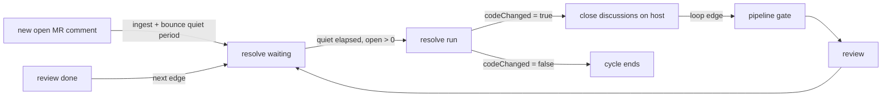

# Resolve node

## Summary

The resolve node consumes the merge request's open review comments and drives a fix agent that commits the requested changes to the MR branch, then closes each discussion on the git host. It is the SDLC chain's debounced tail: in the seeded `tpl_sdlc_loop` template its trigger is `{ "type": "debounced", "minutes": 10, "wait_for": "comments" }`, so new reviewer comments queue an automatic resolve after a quiet period instead of interrupting in-flight work. Its output decides the review ↔ resolve loop: the template's `resolve → pipeline` loop edge fires only when `codeChanged = true`, sending the cycle back through CI and re-review.

## Capabilities contract

| Field | Value | UI / engine effect |
|-------|--------|-------------------|
| `refinable` | `true` | Chat rail is shown; a message re-runs the resolve with the text as developer `instructions`. |
| `chatMode` | — | Not set; the generic `NodeChat` rail is used. |
| `promptNode` | — | Not set; the prompt modal targets the node by key (`node=resolve`). |
| `panelTitle` | `Comment resolution` | Panel header title. |

Engine-only (not serialized to UI):

- `chainRole: resolve` — the chain and `WaitScheduler.resolveDelayMs` resolve the role by key.
- `edges: [[pipeline, "loop"]]` — re-enters the CI gate when the fix agent pushed code.
- `order: 50` — builtin graph ordering (last in the chain).
- `quiet_minutes` config knob — engine-consumed quiet period for the debounced wait (default 10).

## User-visible phases

### Phase 1 — Queued (debounced wait)

- **Entry:** A `review` run finished, or a new open MR comment arrived (webhook or poller ingestion), and the resolve node holds at `waiting`.
- **Surface:** Panel — a clock line: "Auto-resolve of open comments starts at 14:32" (`flow.resolveScheduleAt`, rendered by `resolveClockLabel`); the lifecycle event log names the same time.
- **Action:** None required; "Resolve comments" forces a manual run. Each new open comment bounces the quiet-period timer (`WaitScheduler.bounceCommentWaits`).
- **Outcome:** When the quiet period elapses with open comments present and the chain idle, the wait-timer tick fires the run; with zero open comments or a busy chain it re-arms and keeps waiting.

### Phase 2 — Resolve run

- **Entry:** Debounced timer fired, "Resolve comments" (`resolve` action), a chat message, or `retry`.
- **Surface:** Both — "Agent is fixing open comments…" in the panel; run events in the chat rail.
- **Action:** The fix agent receives every open comment for the MR plus optional developer instructions and commits fixes to the MR branch (in the flow's worktree in local mode).
- **Outcome:** A `resolve` artifact records the agent's summary; output carries `resolved` and `codeChanged`.

### Phase 3 — Threads closed, loop decided

- **Entry:** Run finished.
- **Surface:** Panel artifact card; the review panel's thread list flips threads to resolved on its next poll.
- **Action:** None automatic beyond the engine.
- **Outcome:** If the agent changed code, every open discussion with a `discussion_id` is resolved on the host and marked `resolved_by = 'agent'` locally, and the loop edge re-enters `pipeline` (green → review → resolve). If no code changed, threads stay open and the cycle ends.

## UI architecture

### Workspace routing

`components/flows/panels/panelFactory.tsx`:

- Panel: `node.type === 'resolve'` → `ResolveView`
- Chat: `capabilities.refinable` (no `chatMode`) → `NodeChat`

### Panel (`ResolveView`)

- Reads `useNodePanel()`; no props.
- Queue clock from `flow.resolveScheduleAt` via `resolveClockLabel`; flips to "waiting on the gate" (`pipeline-gated`) once the quiet period has elapsed.
- Run history via `GenericArtifact` (kind `resolve`).
- Footer: "Resolve comments" dispatches the `resolve` action (hidden while running).
- The sibling `ReviewView` footer also dispatches `resolve` ("Resolve N open comments").

### Chat rail

Generic `NodeChat` → `ChatPanel`; sends go to `POST /api/flows/:id/chat` and re-run the resolve with the message as `instructions`.

### Async states

| State | Behavior |
|-------|----------|
| Running | `PanelShell` `runningLabel`; footer actions hidden. |
| Waiting | Clock line with the scheduled start; artifact area keeps prior runs. |
| Empty | `GenericArtifact` empty text — "Nothing resolved yet." |

### Key files

- `components/flows/panels/views/ResolveView.tsx`
- `components/flows/panels/utils/resolveClockLabel.ts`
- `components/flows/panels/shared.tsx` (`PanelShell`, `GenericArtifact`)
- `components/flows/panels/NodeChat.tsx`, `components/chat/promptModal/PromptModal.tsx`

## Backend architecture

### Node class

`ResolveNode` (`lib/engine/nodes/kinds/resolve/resolveNode.ts`) extends `AgentRunNode<ResolveInput, ResolveOutput>`; `key`/`promptKeys` are `resolve`.

### Collaborators

- `NodeSupport.openComments` / `resolveComment` — reads open comment rows; marks them resolved (`resolved_by = 'agent'`).
- `gitHostRegistry` — `resolveComment` on the host (closes the MR discussion), `getChangeRequest` for the MR head SHA.
- `localGit.localBranchState` — local branch diff fingerprint for the code-change check.
- `worktreeManager` — ensures the flow worktree with the MR branch checked out (local mode).
- `mrTargetResolver` — resolves `{ mrIid, mrBranch }`.
- `WaitScheduler` / `flowPoller` — arm, bounce, and fire the debounced wait.

### Run lifecycle (`run`)

1. Folds `prompt_body` / `prompt_rules` into the prompt; resolves the MR target.
2. Reads open comments (`comments` table, `status = 'open'`, filtered by `mr_iid`). With none open and no developer `instructions`, completes immediately: `resolved: 0`, "no open comments".
3. Builds the prompt — header "Address every open merge-request comment below by committing fixes to branch X", the comment list, optional local-mode checkout line and developer instructions.
4. Captures the before-state (MR head SHA + local branch fingerprint), then runs the fix agent via `execute` (worktree `cwd` in local mode).
5. `finalize` (`resolveComments.ts`):
   - `detectCodeChange` — true when the MR head SHA moved or the local branch's diff-vs-base fingerprint changed (one 5 s recheck to catch an in-flight push).
   - `shouldResolveCommentsOnHost(open, codeChanged)` — host threads close only when code changed; each `discussion_id` is resolved on the host and the local row marked resolved. Comments without a `discussion_id` and host failures are logged and counted (`hostFailures`), never fatal.
   - Output `{ resolved, branchName?, codeChanged }`; artifact kind `resolve`, meta `{ resolved, branchName, codeChanged, hostFailures }`.

### Chat lifecycle (`chat` / `converse`)

`chatInput` maps the message onto `{ instructions, model }`; the default `AgentRunNode.chat` re-runs the resolve with those instructions (works even with zero open comments — the header becomes "Make the following change on branch X").

### Approval and advance

No approval gate. A `done` run calls `advanceFrom('resolve')`; the loop edge activates only on `codeChanged = true` and resets `pipeline` plus its downstream path to `pending` before re-running. `recover()` returns `false`: fixes and closed discussions are never replayed after a restart.

### Key files

- `lib/engine/nodes/kinds/resolve/resolveNode.ts`
- `lib/engine/nodes/kinds/resolve/resolveComments.ts`
- `lib/engine/nodes/kinds/resolve/schema.ts`
- `lib/engine/runtime/waitScheduler.ts`, `lib/engine/runtime/flowPoller.ts`
- `lib/engine/runtime/edgeActivator.ts` (loop-edge re-entry)

## API surface

### HTTP

| Route | Caller | Purpose |
|-------|--------|---------|
| `POST /api/flows/:id/action` (`resolve`) | `ResolveView` / `ReviewView` footers, prompt modal | Manual resolve run via `flowEngine.triggerResolve` (rejects while the chain is busy; claims the node from `pending`/`failed`). |
| `POST /api/flows/:id/action` (`retry` / `cancel`) | `PanelShell` | Failed-run retry / cancel. |
| `POST /api/flows/:id/chat` | `NodeChat` | Instructed resolve run (`{ nodeKey, content, model? }`). |
| `GET /api/flows/:id/comments` | `useFlowComments` (review panel) | Open/resolved state of the threads this node works on. |
| `GET /api/flows/:id/prompt?node=resolve` | `PromptModal` | Live prompt preview (body + developer instructions; comment blocks are run data). |
| `POST /api/webhooks/gitlab` | GitLab | New MR comments queue the debounced resolve (`CommentIngestor` → `bounceCommentWaits`). |

### Flow actions

| Action | When | Engine |
|--------|------|--------|
| `resolve` | Run the fix agent on open comments | `flowEngine.triggerResolve` → `sdlcChain.triggerResolve` |
| `retry` | Failed resolve run | `flowEngine.retryNode` |
| `cancel` | Stuck run | `flowEngine.cancelNode` |

### Actions not used

- `approve_*` actions — resolve has no approval gate.
- `run_node` — the panels use the dedicated `resolve` action, not the generic manual runner.

## Data model

### Input

`ResolveInput` (`schema.ts`): `instructions` (developer instructions; the chat field), `prompt` + `promptIsBody` (verbatim override / edited body), `branchName` (per-branch MR), `model`.

### Output / artifacts

- `ResolveOutput`: `{ resolved: number, branchName?, codeChanged: boolean }`. `codeChanged` is the loop-edge condition value (`nodes.resolve.output.codeChanged = true` in the seeded template).
- Artifact kind `resolve`, content = the agent's summary, meta `{ resolved, branchName, codeChanged, hostFailures }`.

### Side effects

- Commits and pushes fixes to the MR branch (agent), optionally inside the flow worktree.
- Closes MR discussions on the git host and updates local `comments` rows to `status = 'resolved'`, `resolved_by = 'agent'`.

## Agent contracts

### Prompt keys

`promptKeys: [resolve]`; template `resolve` in `lib/engine/prompts/promptDefaults.ts` — variables `branch`, `comments`, `instructions`, `mode`, `header`, `subheader`, `dev_instructions`. The engine appends the locked header (branch + "address every open comment" contract) and the comment list after the user-editable body.

### Response shapes

Free-form text: the agent briefly states what it changed per comment; the text becomes the artifact content and run `reply`. There is no JSON response schema — the machine-readable outcome is derived from `detectCodeChange` and host thread resolution, not parsed from the output.

### Retries and guards

- Zero open comments + no instructions → immediate `done` (`resolved: 0`), no agent run.
- `shouldResolveCommentsOnHost` — discussions close only when the agent actually changed code; otherwise threads stay open and the loop stops.
- Per-thread host failures are emitted as error events and counted in `hostFailures`; the run still completes.
- `recover()` returns `false` — no replay of commits or thread closures after a restart.

## Fan-out and downstream

The loop edge is the downstream: seeded in `lib/db/templateSeeder.ts` as `resolve → pipeline`, kind `loop`, condition `nodes.resolve.output.codeChanged = true`. A truthy condition makes `EdgeActivator.advanceFrom` reset `pipeline` and its success-terminal downstream path to `pending` and re-run the gate; a falsy one leaves the loop edge as display metadata and the cycle terminates. Termination therefore happens when the fix agent produces no code change (nothing left to fix, instructions-only no-op, or zero open comments at run time).

## Out of scope

- Review comment generation — see [`review-node.md`](./review-node.md).
- The pipeline gate's own fix loop (failed-job log fixing) — owned by the pipeline node.
- Merge / close lifecycle of the MR itself and flow completion after the loop terminates.
- The `split_consume` knobs declared on the config schema (split runtime documented separately).

## Related code index

| Concern | Location |
|---------|----------|
| Node class / run lifecycle | `lib/engine/nodes/kinds/resolve/resolveNode.ts` |
| Host-resolve gating | `lib/engine/nodes/kinds/resolve/resolveComments.ts` |
| Input / output schemas | `lib/engine/nodes/kinds/resolve/schema.ts` |
| Resolve prompt template | `lib/engine/prompts/promptDefaults.ts` (`resolve`) |
| Debounced wait + quiet period | `lib/engine/runtime/waitScheduler.ts` |
| Comment polling + bounce | `lib/engine/runtime/flowPoller.ts` (`checkDiscussions`) |
| Comment ingestion (webhook) | `lib/engine/runtime/commentIngestor.ts` |
| Loop-edge condition + re-entry | `lib/db/templateSeeder.ts`, `lib/engine/runtime/edgeActivator.ts` |
| Open/resolved comment rows | `lib/engine/nodes/shared/nodeSupport.ts` (`openComments`, `resolveComment`) |
| Manual trigger | `lib/engine/nodes/chains/sdlcChain.ts` (`triggerResolve`) |
| Panel | `components/flows/panels/views/ResolveView.tsx` |
| Queue clock | `components/flows/panels/utils/resolveClockLabel.ts` |
