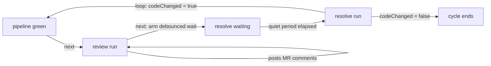

# Review node

## Summary

The review node runs an AI reviewer over the merge request diff and posts the findings as MR comments (`**AI Review**` notes, inline per file or one summary). It sits after the `pipeline` gate in the SDLC chain — review starts only on a green pipeline — and hands off to `resolve` via a `next` edge. The panel doubles as the flow's comment inbox: it polls the ingested MR discussion threads and is where the developer re-runs the review or sends open threads to `resolve`. Posting is idempotent across reruns, keyed by content hashes stored on the latest `review` artifact.

## Capabilities contract

| Field | Value | UI / engine effect |
|-------|--------|-------------------|
| `refinable` | `true` | Chat rail is shown; a message re-runs the review with the text as extra `instructions` focus. |
| `chatMode` | — | Not set; the generic `NodeChat` rail is used. |
| `promptNode` | — | Not set; the prompt modal targets the node by key (`node=review`). |
| `panelTitle` | `AI review` | Panel header title. |

Engine-only (not serialized to UI):

- `chainRole: review` — the SDLC chain resolves the review role by key.
- `edges: [[resolve, "next"]]` — a finished review activates the debounced resolve wait.
- `order: 40` — builtin graph ordering (after `pipeline` at 25, before `resolve` at 50).

## User-visible phases

### Phase 1 — Waiting for a merge request

- **Entry:** The pipeline node has not produced an MR head yet (`flow.mr_iid` is null), or the chain has not reached review.
- **Surface:** Panel only.
- **Action:** None available; the panel shows "Review runs after the merge request is created."
- **Outcome:** No comments query runs (`useFlowComments` is gated on `flow.mr_iid`).

### Phase 2 — Review run

- **Entry:** Pipeline green (auto trigger on the `pipeline → review` edge), the panel's "Run AI review" button, a chat message, or `retry` on a failed run.
- **Surface:** Both — the panel shows "Agent is reviewing the merge request…"; the chat rail streams run events.
- **Action:** `POST /api/flows/:id/action` with action `review` (optional `prompt` / `promptIsBody` / `model` from the prompt modal), or `POST /api/flows/:id/chat` for a focused re-review.
- **Outcome:** The agent reads the MR diff and posts comments to the MR; a `review` artifact records what was posted. Unparseable agent output fails the node with a warning event; `[]` or empty output completes with `comments: 0`.

### Phase 3 — Comments published, awaiting resolution

- **Entry:** Review `done`; the MR has discussion threads (from the AI review or human reviewers, ingested via webhook / poller).
- **Surface:** Panel — thread list grouped by `buildThreads`, open/resolved badges; chat rail for follow-up re-reviews.
- **Action:** "Resolve N open comments" fires the `resolve` action; "Run AI review" re-reviews (already-posted comments are skipped by hash); "Edit prompt" opens `PromptModal` against `GET /api/flows/:id/prompt?node=review`.
- **Outcome:** The `review → resolve` edge arms the debounced resolve wait; each new ingested open comment restarts its quiet period.



## UI architecture

### Workspace routing

`components/flows/panels/panelFactory.tsx`:

- Panel: `node.type === 'review'` → `ReviewView`
- Chat: `capabilities.refinable` (no `chatMode`) → `NodeChat`

### Panel (`ReviewView`)

- Reads `useNodePanel()` for `flow`, `node`, `action`, `model`; no props.
- `useFlowComments(flow.id, Boolean(flow.mr_iid))` polls `GET /api/flows/:id/comments` every 8 s; `buildThreads` groups flat comments into discussion threads (root = earliest note; open = root status `open`).
- Header: "Edit prompt" opens `PromptModal`; its `onRun` dispatches `review` with the edited prompt.
- Footer: open-thread count, "Resolve N open comments" (`resolve` action), "Run AI review" (`review` action, disabled while running).

### Chat rail

Generic `NodeChat` → `ChatPanel` bound to `node.node_key`; sends go to `POST /api/flows/:id/chat` and re-run the review with the message as `instructions`.

### Async states

| State | Behavior |
|-------|----------|
| Comments loading | `ThreadListSkeleton` rows inside `PanelShell`. |
| Comments error | Inline destructive message with a retry button (`commentsQuery.refetch()`). |
| Empty | `EmptyHint` — "No MR comments yet. Run an AI review, or wait for reviewers / the webhook." |
| Running | `PanelShell` `runningLabel`; footer review button shows a spinner. |

### Key files

- `components/flows/panels/views/ReviewView.tsx`
- `components/flows/panels/review/buildThreads.ts` (+ `buildThreads.test.ts`)
- `components/flows/panels/review/ThreadCard.tsx`, `NoteHeader.tsx`, `ThreadListSkeleton.tsx`
- `components/flows/hooks/useFlowComments.ts`
- `components/flows/panels/NodeChat.tsx`, `components/chat/promptModal/PromptModal.tsx`

## Backend architecture

### Node class

`ReviewNode` (`lib/engine/nodes/kinds/review/reviewNode.ts`) extends `AgentRunNode<ReviewInput, ReviewOutput>`; `key`/`promptKeys` are `review`.

### Collaborators

- `gitHostRegistry` — `getChanges` for the MR diff, `createComment` for posting notes.
- `mrTargetResolver` — resolves `{ mrIid, mrBranch }` per branch or flow-level.
- `prompts` (`PromptLibrary`) — assembles the `review` template with ticket context, instructions, and the diff.
- `parseReviewComments` / `reviewCommentPostHash` / `readPostedCommentHashes` (`reviewComments.ts`) — output parsing and idempotency.
- `AgentRunner` via `AgentRunNode.execute` — runs the agent with `startingRef: mrBranch`.

### Run lifecycle (`run`)

1. Folds the `prompt_body` / `prompt_rules` config knobs into the prompt override path.
2. Resolves the MR target and fetches the diff via `host.getChanges` (capped at 60 000 chars; a truncation note is prepended when GitLab cut the change set).
3. Assembles the prompt: template key `review`, ticket variables, optional developer `instructions`, the diff block.
4. `execute` runs the agent; `finalize` parses the output with `parseReviewComments`:
   - No parseable JSON array (non-empty output) → node `failed`, artifact recorded with `posted: 0`, warning event.
   - Otherwise posts each comment not already in `postedHashes` (sha256 over `{ mrIid, style, file, line, body }`), honoring `max_comments` and `comment_style` (`summary` posts one combined note). Progress is persisted to the artifact after every post, so a mid-run failure never double-posts on retry.

### Chat lifecycle (`chat` / `converse`)

`chatInput` maps the message onto `{ instructions, model }`; the default `AgentRunNode.chat` re-runs the review with that extra focus. `converse` answers a question against the last review agent without a run.

### Approval and advance

No approval gate — a `done` review calls `advanceFrom('review')`, which activates the `next` edge to `resolve` (a debounced wait, see the resolve doc). `recover()` returns `false`: posted MR notes are never replayed after a restart.

### Key files

- `lib/engine/nodes/kinds/review/reviewNode.ts`
- `lib/engine/nodes/kinds/review/reviewComments.ts`
- `lib/engine/nodes/kinds/review/schema.ts`
- `lib/engine/nodes/shared/mrTargetResolver.ts`, `lib/engine/nodes/shared/agentRunNode.ts`
- `lib/engine/runtime/commentIngestor.ts`, `lib/engine/runtime/commentStore.ts` (comment ingestion side)

## API surface

### HTTP

| Route | Caller | Purpose |
|-------|--------|---------|
| `POST /api/flows/:id/action` (`review`) | `ReviewView` footer / prompt modal | Manual review run via `flowEngine.triggerReview` (rejects while the chain is busy; claims the node from `pending`/`failed`). |
| `POST /api/flows/:id/action` (`resolve`) | `ReviewView` footer | Sends open threads to the resolve node. |
| `POST /api/flows/:id/action` (`retry` / `cancel`) | `PanelShell` | Failed-run retry / cancel. |
| `POST /api/flows/:id/chat` | `NodeChat` | Focused re-review (`{ nodeKey, content, model? }`). |
| `GET /api/flows/:id/comments` | `useFlowComments` | Ingested MR comments for the thread list (`CommentService.listForFlow`). |
| `GET /api/flows/:id/prompt?node=review` | `PromptModal` | Live prompt preview (contract + rules + ticket context, empty diff slot). |
| `POST /api/webhooks/gitlab` | GitLab | MR comment events → `CommentIngestor.handleHostEvent` → `commentStore.ingest`. |

### Flow actions

| Action | When | Engine |
|--------|------|--------|
| `review` | Run / re-run the AI review | `flowEngine.triggerReview` → `sdlcChain.triggerReview` |
| `retry` | Failed review run | `flowEngine.retryNode` |
| `cancel` | Stuck run | `flowEngine.cancelNode` |

### Actions not used

- `approve_plan` / `approve_node` / `approve_build` — review has no approval gate.
- `run_node` — the panel uses the dedicated `review` action, not the generic manual runner.

## Data model

### Input

`ReviewInput` (`schema.ts`): `instructions` (extra focus, also the chat field), `prompt` + `promptIsBody` (verbatim override / edited body), `branchName` (per-branch MR in multi-branch flows), `model`.

### Output / artifacts

- `ReviewOutput`: `{ comments: number, branchName? }` — count of comments posted this run.
- Artifact kind `review`, content = raw agent output, meta `{ posted, postedHashes, mrIid, branchName }`. `postedHashes` is the idempotency ledger read back on the next run.

### Side effects

- Creates notes on the MR via the git host (`**AI Review**` prefix).
- The `comments` table is written by ingestion (`commentStore.ingest` from webhook + poller), not by this node; the node only reads the previous artifact's hashes.

## Agent contracts

### Prompt keys

`promptKeys: [review]`; template `review` in `lib/engine/prompts/promptDefaults.ts` — variables `ticket_key`, `ticket_type`, `ticket_summary`, `ticket_prd`, `diff`, `instructions`.

### Response shapes

The contract block requires a JSON array only, no prose:

```json
[{"file": "path", "line": 12, "body": "comment"}]
```

Validated by `reviewCommentItemSchema` (`file` / `line` optional, `body` non-empty). "If none, return `[]`."

### Retries and guards

- Empty output → warning log, run completes with `comments: 0`.
- Non-empty unparseable output → node `failed`; the developer retries via `retry` or a chat message.
- Reruns skip any comment whose hash is already in `postedHashes` (covers both duplicate AI findings and retry-after-partial-failure).
- Ingestion never re-opens a thread the agent resolved (`resolved_by = 'agent'` guard in `commentStore.ingest`).

## Out of scope

- Human-review approval semantics (approving the MR itself) — the flow treats comments as data, not gates.
- The resolve-side fix loop and its termination condition — see [`resolve-node.md`](./resolve-node.md).
- Pipeline gating and fix pipelines — owned by the pipeline node.
- Per-branch fan-out review (`split_consume` knobs are declared on the config schema; the split runtime is documented separately).

## Related code index

| Concern | Location |
|---------|----------|
| Node class / run lifecycle | `lib/engine/nodes/kinds/review/reviewNode.ts` |
| Comment parsing + post hashes | `lib/engine/nodes/kinds/review/reviewComments.ts` |
| Input / output schemas | `lib/engine/nodes/kinds/review/schema.ts` |
| Review prompt template | `lib/engine/prompts/promptDefaults.ts` (`review`) |
| MR target resolution | `lib/engine/nodes/shared/mrTargetResolver.ts` |
| Comment ingestion (webhook) | `lib/engine/runtime/commentIngestor.ts` |
| Comment persistence | `lib/engine/runtime/commentStore.ts` |
| Comment read API | `lib/comments/commentService.ts`, `app/api/flows/[id]/comments/route.ts` |
| Manual trigger | `lib/engine/nodes/chains/sdlcChain.ts` (`triggerReview`) |
| Panel | `components/flows/panels/views/ReviewView.tsx` |
| Thread grouping | `components/flows/panels/review/buildThreads.ts` |
| Comments polling hook | `components/flows/hooks/useFlowComments.ts` |
