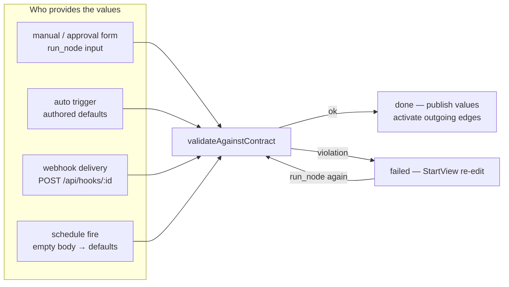

# Start node

## Summary

The start node is a template's designated entry point (`isEntry`): it carries the template's branch trigger, finishes immediately, and publishes the values the flow starts with. Its optional **start contract** declares those values as typed fields — one list serves as both input and output, so whatever the trigger provides is validated against it and published for downstream nodes to map from. Who provides the values follows the trigger type: `auto` publishes the authored field defaults, `manual` / `approval` ask the user in the entry panel, and a webhook delivery must match the contract strictly. With no contract declared the node simply completes and its outgoing edges activate the rest of the template.

## Capabilities contract

| Field | Value | UI / engine effect |
|-------|--------|-------------------|
| `refinable` | — | No chat rail; the node has no agent to converse with. |
| `chatMode` | — | — |
| `promptNode` | — | No prompt template (`promptKeys` is empty). |
| `panelTitle` | `Flow start` | Panel header title in the workspace. |

Engine-only metadata (not serialized to UI):

- `isEntry: true` — engine code locates the entry def via `nodeRegistry.entryKey()`, never the literal key.
- `order: 5` — ahead of the plan node (`10`), so graphs display the flow entry first.
- `retryable: false` — the node completes synchronously in one stage; there is nothing to recover.
- `edges: []` — a start node's outgoing edges are template data, not def constants.
- `configSchema: StartContractConfigSchema` with `configFields: []` — the contract is edited through the template editor's dedicated contract editor, not the generic config form.

## User-visible phases

### Phase 1 — Entry waiting (`pending`)

- **Entry:** The flow exists and the entry node's trigger is `manual` or `approval`. (An approval-triggered entry with a contract is skipped by edge activation — it publishes nothing until the user starts it.)
- **Surface:** `StartView` panel — one form row per contract field, prefilled from the last run's recorded input, then the authored defaults.
- **Action:** "Provide values & start" (or "Start flow" when no contract is declared) sends the `run_node` action with the form values as `input`.
- **Outcome:** Values validate → node `done`, contract values published, outgoing edges activate. Violation → node `failed`.

### Phase 2 — Contract violation (`failed`)

- **Entry:** A provided payload failed the contract (missing required field, wrong type, or fields outside the contract).
- **Surface:** `StartView` with a destructive alert; the form keeps the rejected values editable.
- **Action:** "Start again" re-sends `run_node` — the engine permits re-run from `failed` only for the entry def (`runNodeManual`).
- **Outcome:** Fresh validation; `done` or `failed` again.

### Phase 3 — Published (`done`)

- **Surface:** The panel lists the published variables (key + JSON value), with the hint that downstream nodes map from them.
- **Outcome:** Downstream templates resolve `{{nodes.<key>.output.<field>}}` at run time; the same values are reachable as `{{trigger.payload.*}}` when a trigger delivered them.

### Phase 4 — Trigger-provided starts (no form)

- **Entry:** Trigger `auto`, a webhook delivery, a schedule fire, or fan-out child creation.
- **Surface:** None — the node runs itself; the panel only shows the result.
- **Action:** The payload is validated up front (`FlowFactory.startFromTemplate` / `createStepChild`); a bad webhook delivery is rejected outright before a flow exists.
- **Outcome:** Same as Phase 1 — validated values published, edges activate.

## UI architecture

### Workspace routing

`components/flows/panels/panelFactory.tsx`: `node.type === 'start'` → `StartView`. No chat rail (`capabilities.refinable` is unset).

### Panel (`StartView`)

- Parses the contract off `node.config` with the client-safe `parseStartContract` (`types/startContract.ts` — UI never imports `lib/engine`).
- Prefill order: the node's recorded `input` (minus `prompt`/`model`), then each field's authored `default`.
- Field-type inputs: `boolean` → checkbox, `object` / `array` → JSON textarea, `number` → number input, else text. The engine coerces and validates — the form sends strings.
- The footer explains the contract's role; with no contract it says starting publishes nothing.

### Chat rail

None.

### Async states

| State | Behavior |
|-------|----------|
| Running | `PanelShell` running label "Starting the flow…". |
| Failed | Destructive `Alert` ("values didn't satisfy the start contract") + re-editable form. |
| Empty | No contract declared → hint that the node finishes immediately. |
| Done | Published-variables list; empty output → "No values were published." |

### Key files

- `components/flows/panels/views/StartView.tsx`
- `components/flows/panels/panelFactory.tsx`
- `types/startContract.ts` — client-safe contract schema, parse, validate, lint
- `components/templateEditor/components/configurator/contract/StartContractEditor.tsx` — contract authoring in the template editor

## Backend architecture

### Node class

`StartNode` extends `NodeDefinition<StartPayload, StartPayload>` (`lib/engine/nodes/kinds/start/startNode.ts`) — a record in, record out node; not on the agent-run tier. Registered first in `NodeRegistry.registerBuiltins()`.

### Collaborators

- `types/startContract.ts` (re-exported through `./contract`) — `parseStartContract`, `validateAgainstContract`, `lintStartContract`, `startContractJsonSchema`.
- `FlowFactory` (`lib/engine/runtime/flowFactory.ts`) — validates trigger payloads against the contract at flow creation (`create`, `startFromTemplate`, `createStepChild`).
- `flowEngine.start` / `runNodeManual` (`lib/engine/flowEngine.ts`) — auto-starts and the manual form run.
- `edgeActivator` (`lib/engine/runtime/edgeActivator.ts`) — holds an approval-triggered entry with a contract for the user.

### Run lifecycle (`run`)

- `triggerRuns(ctx)` yields one run whose input is `ctx.flow.trigger_payload ?? {}` (webhook delivery body / schedule fire payload — `null` for manual flows; the form's `input` arrives via `runNodeManual` instead).
- `run()` parses the contract off the merged instance config. No fields → `done`, publishes nothing. Fields → `validateAgainstContract`: defaults fill empty values, light string coercion applies (numeric strings, `"true"`/`"false"`, JSON text), and the shape check is strict — unknown fields and missing required values fail loudly by throwing, and the engine marks the node `failed` with that message.
- On success the validated values become `nodes.output`, status `done`, with a lifecycle event naming the published keys.

### Approval and advance

The start node never holds at `awaiting_approval` — an approval trigger on the entry def means "the user provides the values when starting", which the form covers. On `done` the engine advances the template edges (`runNodeManual` → `advanceFrom`, or the edge activator for auto-starts); downstream nodes start per their own triggers.

### Key files

- `lib/engine/nodes/kinds/start/startNode.ts`
- `lib/engine/nodes/kinds/start/contract.ts`
- `lib/engine/runtime/flowFactory.ts`, `lib/engine/runtime/edgeActivator.ts`
- `lib/engine/runtime/flowPoller.ts` — schedule fires call `startFromTemplate(t.id, {})` so the contract's defaults apply

## API surface

### HTTP

| Route | Caller | Purpose |
|-------|--------|---------|
| `POST /api/flows` | Flow create screen | Creates the flow (`FlowFactory.create`); auto-starts when the entry node's trigger is `auto`. |
| `POST /api/flows/:id/action` | `StartView` | `run_node` with `input` = the contract form values. |
| `POST /api/hooks/:id` | External webhook senders | Delivery becomes `trigger_payload`; `startFromTemplate` validates it against the contract before the flow exists. |
| `GET /api/contracts?def=start&config=…` | Template editor | The contract as JSON Schema (`startContractJsonSchema`) for form rendering. |

### Flow actions

| Action | When | Engine |
|--------|------|--------|
| `run_node` | User starts (or re-starts a failed) entry node | `runNodeManual` — `input` IS the payload; terminal success advances the edges. |

### Actions not used

- `approve_node` — the entry hold collects values through the form; there is no output approval.
- `retry` / `cancel` — `retryable` is `false`; a failed start re-runs via `run_node`.
- `POST /api/flows/:id/chat` — the node is not refinable.

## Data model

### Input

- Auto/webhook/schedule/fan-out-child: `flows.trigger_payload` (validated up front at creation).
- Manual/approval: the `run_node` body's `input` map from the `StartView` form.
- Contract fields: `key`, optional `label`, `type` (`string` | `number` | `boolean` | `object` | `array`), `required`, optional `default`.

### Output / artifacts

- `nodes.output` = the validated contract values (empty object without a contract). No artifacts and no side tables.
- Downstream addressing: `{{nodes.<key>.output.<field>}}` and `{{trigger.payload.*}}` (`lib/engine/context/flowVariables.ts`).

### Side effects

- Lifecycle event ("Flow started — publishing …") on the flow's event trail.

## Agent contracts

None — `promptKeys` is empty and the node never starts an agent run.

## Out of scope

- Task intake: flows bind a provider-imported task at creation (`POST /api/flows` → `taskId`; `lib/engine/tasks/taskService.ts` lists provider tasks). Task fields reach templates through the `{{task.*}}` variable universe, not through the start contract.
- Template editor and YAML import mechanics for the contract editor (covered with the template store docs).
- The seeded SDLC loop template (`tpl_sdlc_loop`) instantiates no start node — the manual-trigger plan node opens those flows. This doc covers the start def wherever a template places it.

## Related code index

| Concern | Location |
|---------|----------|
| Node class / run | `lib/engine/nodes/kinds/start/startNode.ts` |
| Contract schema, validation, lint, JSON Schema | `types/startContract.ts` |
| Entry panel | `components/flows/panels/views/StartView.tsx` |
| Panel routing | `components/flows/panels/panelFactory.tsx` |
| Contract editor (template editor) | `components/templateEditor/components/configurator/contract/StartContractEditor.tsx` |
| Flow creation + payload pre-validation | `lib/engine/runtime/flowFactory.ts` |
| Manual/approval start action | `lib/engine/flowEngine.ts` (`runNodeManual`) |
| Approval-entry hold, edge activation | `lib/engine/runtime/edgeActivator.ts` |
| Webhook delivery entry | `app/api/hooks/[id]/route.ts` |
| Schedule fires | `lib/engine/runtime/flowPoller.ts` |
| Contract JSON-Schema endpoint | `app/api/contracts/route.ts`, `lib/contracts/contractService.ts` |
| Trigger vocabulary | `lib/engine/constants/triggers.ts` |
