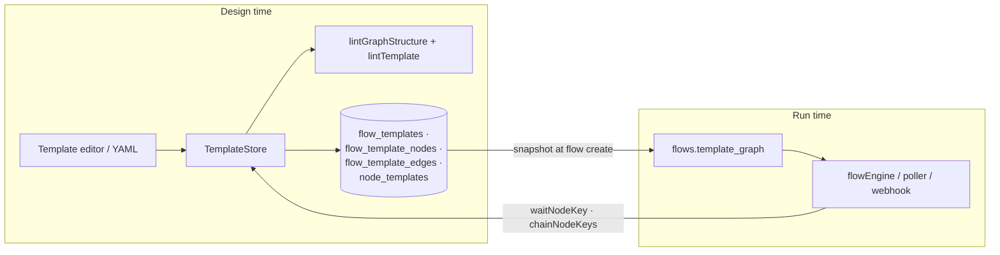

# Flow and node templates

## Summary

Templates are the design-time definition of a flow: a `flow_templates` row plus its node instances (`flow_template_nodes`) and edges (`flow_template_edges`), each instance referencing a `node_templates` catalog row. The catalog holds seven seeded built-ins (`start`, `plan`, `build`, `step_build`, `pipeline`, `review`, `resolve`) and user-authored declarative kinds (`agent`, `decision`, `http`, `script`). Flows run against a JSON snapshot of the graph taken at creation, so editing a template never disturbs running flows. YAML import/export provides config-as-code, and a static lint pass rejects broken graphs, unresolved `{{refs}}`, and invalid fan-out wiring before save.

## Architecture

### Data model and the store

`TemplateStore` (`lib/engine/templates/templateStore.ts`, singleton `templateStore`) is the design-time service:

- **`graph(templateId)`** — assembles the runtime `TemplateGraph` (`lib/engine/types/template.ts`: `TemplateNodeSpec` / `TemplateEdgeSpec` / `TemplateGraph`). A node's `defKey` is the catalog **key** for built-ins and the `node_templates` row **id** for declarative kinds, so the node registry can hydrate one runtime instance per catalog entry.
- **`graphForFlow(flowId)`** — the graph a flow actually runs: the persisted snapshot (`flows.template_graph`) when present, the live template (defaulting to `tpl_sdlc_loop`) for legacy rows.
- **Runtime role lookups** — `waitNodeKey(flowId, eventSource)` finds the node instance whose trigger declares `wait_for` (the role-based replacement for hardcoded `node_key='pipeline'` lookups); `chainNodeKeys(flowId)` derives the post-MR chain (the pipeline wait-node plus everything downstream reachable via automatic `next` edges) from the graph instead of constants.
- **CRUD** — `create` / `duplicate` / `update` / `delete`, plus `saveWithDrafts` (editor saves carrying unsaved `draft:` node templates in one transaction) and `updatePositions` (drag re-layout: display metadata only, no graph rewrite, no running-flow guard). Node/edge arrays replace wholesale; `nodes` and `edges` must be sent together.
- **Edit guards** — built-in templates are read-only (`assertEditable` — duplicate to change); structural edits are refused while flows are active (`assertNotRunning`); delete is blocked while any flow references the template.
- **Trigger normalization** — flow triggers (`manual` / `webhook` / `schedule`, plus `filter`, `repo_id`, `task_type` defaulting to the first registered task provider) and node triggers (`auto` / `manual` / `approval` / `debounced`, `minutes`, `wait_for`). `syncTriggers` keeps the always-provisioned inbound hook and the `schedule_next_at` timer in step with saves.

### The node catalog

`node_templates` rows come in three localities: built-ins (`is_builtin=1`, read-only), the global Library (`template_id IS NULL`), and template-local rows (the canvas creator's private defs, invisible to other templates). `createNodeTemplate` validates declarative configs up front with the same schema the runtime hydrates (`parseDeclarativeConfig`), slugifies keys, and refuses to shadow a built-in key. `createOrReuseNodeTemplate` powers editor save (identical defs stay one row); `addToLibrary` promotes a local row to global (suffixed `…_local` key variants when taken); `ensureNodeTemplate` is YAML import's find-or-create (identical → reuse, changed → new version of the same key). API bodies are validated by `lib/schemas/nodeTemplate.ts`.

### Seeded built-ins

`TemplateSeeder` (`lib/db/templateSeeder.ts`) runs at migration `user_version 1`, idempotently (`INSERT OR IGNORE`, deterministic ids):

- **Catalog built-ins** — `nt_start`, `nt_plan`, `nt_build`, `nt_step_build`, `nt_pipeline`, `nt_review`, `nt_resolve` (kind `builtin`).
- **`tpl_sdlc_loop`** (`SDLC_TEMPLATE_ID`) — the SDLC loop: `plan` (manual) → `build` (approval) → `pipeline` (`auto`, `wait_for: pipeline`) → `review` (`auto`) → `resolve` (`debounced`, 10 min, `wait_for: comments`), with a `loop` edge `resolve → pipeline` conditioned on the JSONata expression `nodes.resolve.output.codeChanged = true` — the cycle re-enters the CI gate only when the resolve agent pushed code.
- **`tpl_step_build`** (`STEP_BUILD_TEMPLATE_ID`) — the hidden one-node child template plan fan-out defaults to: a single `step_build` instance with an `approval` trigger. `hidden=1` keeps it out of the gallery.
- **Starter templates** — `tpl_docs_generation` (agent → script with input mapping), `tpl_release_notify` (agent → manual decision → http), `tpl_sentry_triage` (webhook-triggered agent → agent-proposes/approval-disposes decision → agent + http), plus their declarative catalog rows (`docs_summary`, `triage_agent`, …) as editable examples.

### Static lint

Two layers run before any save or import (and live via `lintDraft` for the editor):

- **`lintGraphStructure`** (`graphStructure.ts`) — pure structural rules: node key format/uniqueness, built-in instances must use their catalog key, edges reference known nodes, no self-edges or duplicates, branch labels only on decision out-edges (and each must match a declared choice), decision branches gate on labels rather than conditions, and no cycles among `next` edges (re-entry is a `loop` edge's job).
- **`lintTemplate`** (`templateLint.ts`) — semantic checks against output contracts (`outputFieldsFor` derives addressable fields per kind: agent `output_schema` keys or `markdown`, decision `chosen`/`rationale` + pass fields, the start node's declared contract):
 - Every `{{ref}}` in prompts/URLs/bodies/questions resolves: roots are `task.*` (checked against the template's `trigger.task_type` provider `contextFields`), `repo.*`, `flow.*`, `trigger.payload.*`, `nodes.<key>.output.*` (checked against the referenced node's contract), `input.*` (the upstream parents' merged contracts plus `input_map` field names), and `secrets.*` (http nodes only — values never persist). Fan-out step-child roots (`plan`, `step`, `siblings`, `input.unit`) free-pass as late-bound.
 - JSONata compiles in `input_map`, decision `pass` maps and expression-sourced choice conditions, http `response_map`, and edge conditions.
 - **Fan-out rules** (`fanoutOf` from `nodeConfig.ts`; modes `whole` / `steps` / `from-plan`): a fan-out node must sit downstream of a plan node; an explicit `child` template must exist and contain exactly one node — never `plan`/`pipeline`/`review`/`resolve` built-ins and never its own fan-out knob (no nesting); upstream of a fan-out, the referenced node's contract collapses to `steps` so downstream mappings stay stable across plan revisions.
 - **Agent split checks** — `split.field` must be a declared array in the agent's `output_schema`; `key_field` / `depends_on_field` / `target_field` must exist on the array's element shape; the default target resolves (node key or node template) and the item shape must satisfy the target template's start contract strictly.

Problems carry machine coordinates (`nodeKey` / `edgeIndex`) so the canvas can badge the offending element; the store throws the joined message on save/import.

### Preview service

`TemplatePreviewService` (`templatePreviewService.ts`) evaluates a JSONata expression for the editor's preview pane in three scopes: `context` (the latest flow on the template via `buildFlowContext`, falling back to a sample context built from the task provider's fields and each node's output contract), `response` (a sample HTTP response for `response_map`), and `delivery` (a sample webhook payload derived from the start node's contract). Results report their `source` (`run` vs `sample`).

### Graph snapshots and the graph API

`flowGraphSnapshot.ts` serializes the `TemplateGraph` to the `flows.template_graph` JSON column at flow creation (`serializeFlowTemplateGraph`) and rehydrates it on read (`hydrateFlowTemplateGraph`, rebuilding the `byKey` map). `GraphService` (`lib/engine/graph/graphService.ts`) backs `GET /api/graph`: with no query it returns the built-in registry's order/meta/edges; with `flowId` or `templateId` it returns the template's node order, per-node meta (label, kind, icon, trigger, `join_mode`, and published `outputs` from the same `outputFieldsFor` the linter uses), edges, and full edge specs.

## API surface

### HTTP

| Route | Purpose |
|-------|---------|
| `GET /api/templates` | Gallery rows with node counts (hidden child templates excluded) |
| `POST /api/templates` | Create a blank template (starts with a `start` node) |
| `GET /api/templates/[id]` | Full editor payload (`editorPayload`: meta, hook, nodes, edges) |
| `PATCH /api/templates/[id]` | Meta patch, wholesale graph save (`saveWithDrafts`), or positions-only drag sync |
| `DELETE /api/templates/[id]` | Delete (built-ins and in-use templates refused) |
| `GET /api/templates/[id]/export` | YAML download; 409 while unsaved `draft:` nodes exist |
| `POST /api/templates/import` | Import YAML (`{ yaml, namePrefix? }`) in one transaction; returns the new id plus created node-template ids |
| `POST /api/templates/[id]/validate` | Live lint of an editor draft (structured `LintProblem[]`) |
| `POST /api/templates/[id]/preview` | JSONata preview (`{ expr, scope }` → value + `run`/`sample` source) |
| `GET /api/node-templates` | Builder palette catalog (`paletteCatalog`: built-ins + Library + template-local) |
| `POST /api/node-templates` | Create a declarative node template (auto-named when omitted) |
| `PATCH /api/node-templates/[id]` | Update, or `add_to_library: true` to promote a template-local row |
| `DELETE /api/node-templates/[id]` | Delete when unreferenced |
| `GET /api/graph` | Graph payload for a flow or template (node order, meta, edges, edge specs) |

### YAML format

`exportTemplateYaml` writes `name` / `description` / `trigger` / `nodes` / `edges`. Each node is `key`, `type` (`builtin/<key>` for built-ins, a declarative kind or existing catalog key otherwise), optional `trigger`, `join_mode`, `input_map`, and `config` — for declarative kinds the config is the **effective definition** (catalog defaults merged with instance overrides) so import recreates the node. Edges serialize as flow pairs `[from, to, {kind|label|condition}?]`. `importTemplateYaml` resolves `type` back to catalog rows (find-or-create via `ensureNodeTemplate`) and validates through the store, so lint errors reject imports exactly like saves; `YamlTemplateError` covers parse/shape failures.

### UI surface

- **Gallery** — `app/(workspace)/templates/page.tsx` → `components/templates/TemplateGallery.tsx` (SSR-prefetched via `loaders/templates.ts`, hydrated into TanStack Query); `app/(workspace)/templates/nodes/page.tsx` → `TemplateNodesCatalog.tsx` for the node catalog.
- **Editor** — `app/templates/[id]/page.tsx` → `components/builder/components/EditorPage.tsx`; the editor island lives under `components/templateEditor/` (builder canvas, palette rail, node configurator, edge editor, webhook card, condition builder with the JSONata preview line). First paint is dehydrated from server-side service calls — the same mappings the API routes wrap.

## Data model

- **`flow_templates`** — `id` (`tpl_…`), `name`, `description`, `version`, `is_builtin`, `trigger` (JSON), `hidden`, `schedule_next_at`, timestamps.
- **`flow_template_nodes`** — node instances: `node_key` (unique per template), `node_template_id` (catalog FK), `label`, `trigger` (JSON), `join_mode` (`all`/`any`), `config` and `input_map` (JSON overrides), `x`/`y` editor positions.
- **`flow_template_edges`** — `from_key` → `to_key`, `kind` (`next` | `loop`), `label` (decision branches), `condition` (JSONata).
- **`node_templates`** — catalog: `key` + `version` (unique pair), `kind` (`builtin` | `agent` | `decision` | `http` | `script`), `config` (the declarative definition), `is_builtin`, `template_id` (null = global Library).
- **`flows.template_graph`** — the creation-time snapshot every runtime read goes through.

## Out of scope

- Runtime node execution (registry hydration, run/chat lifecycles) and the declarative kinds' run semantics — covered per node kind.
- Fan-out runtime machinery (step child flows, the merge arena) — only its static lint contract lives here.
- Inbound webhook delivery handling and schedule firing — the store only provisions the hook and arms `schedule_next_at`.
- The task-provider registry behind `trigger.task_type`.

## Related code index

| Concern | Location |
|---------|----------|
| Design-time store | `lib/engine/templates/templateStore.ts` |
| Shared template types | `lib/engine/types/template.ts` |
| YAML import/export | `lib/engine/templates/templateYaml.ts` |
| Semantic lint + output contracts | `lib/engine/templates/templateLint.ts` |
| Structural graph rules | `lib/engine/templates/graphStructure.ts` |
| Config knobs (`fanoutOf`, MCP sources) | `lib/engine/templates/nodeConfig.ts` |
| Expression preview | `lib/engine/templates/templatePreviewService.ts` |
| Flow graph snapshot | `lib/engine/templates/flowGraphSnapshot.ts` |
| Builtin + starter seeding | `lib/db/templateSeeder.ts` |
| Graph API service | `lib/engine/graph/graphService.ts`, `app/api/graph/route.ts` |
| Request schemas | `lib/schemas/nodeTemplate.ts` |
| Template routes | `app/api/templates/route.ts`, `[id]/route.ts`, `[id]/export/route.ts`, `import/route.ts`, `[id]/validate/route.ts`, `[id]/preview/route.ts` |
| Node-template routes | `app/api/node-templates/route.ts`, `[id]/route.ts` |
| Gallery + catalog UI | `app/(workspace)/templates/page.tsx`, `components/templates/TemplateGallery.tsx` |
| Editor UI | `app/templates/[id]/page.tsx`, `components/builder/components/EditorPage.tsx`, `components/templateEditor/` |
