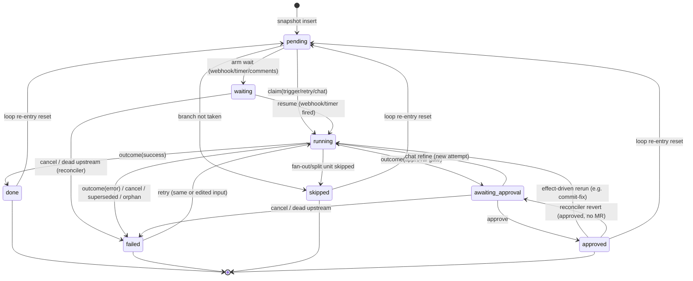

# Target architecture — the flow engine after the overhaul

One mental model: **the database is the only source of truth; one module owns every
status transition; every byte that crosses a boundary is validated; every failure
leaves the system durable-but-unfinished, never durable-but-wrong.**

This document describes the target state. The ordered path to get here is in
[`steps/`](steps/). The 11 invariants from `docs/engine-overhaul-prompt.md` Part 2
are the acceptance criteria; each is annotated with the component that owns it.

---

## 1. Component overview

```mermaid
flowchart TB
    subgraph triggers["Trigger sources"]
        UI["UI action<br/>(approve / retry / run / chat)"]
        WH["GitLab webhook"]
        HOOK["Generic hook delivery"]
        POL["Poller / schedule sweep"]
    end

    subgraph api["API layer (thin routes)"]
        ROUTES["app/api/**/route.ts<br/>parse → call one service → serialize"]
        TOOLAPI["agent-tools route<br/>capability-token auth"]
    end

    subgraph engine["Engine — one mental model"]
        TG["TriggerGateway<br/>every trigger claimed here;<br/>loser emits skipped_duplicate_trigger"]
        TA["TransitionAuthority<br/>SOLE writer of nodes.status + attempt_id<br/>declared transition table, attempt fencing"]
        STAGE["StageRunner<br/>input materialization → consumes check →<br/>run → outcome publish"]
        CONTRACT["ContractPipeline<br/>consumes (in) / outputSchema (out)<br/>fail loud, never publish unvalidated"]
        AGENTOUT["AgentOutputPipeline<br/>extractJson → validate → envelope →<br/>bounded retry → typed events"]
        EFFECTS["EffectRegistry<br/>'what happens after Y finishes'<br/>chains, fan-out/split rollups, loop joins"]
        RECON["Reconciler v2<br/>walks ALL non-terminal states<br/>lease-based, idempotent"]
        RECOV["RecoveryDriver<br/>fixed recover() ABI, never throws"]
    end

    subgraph runtime["Runtime services"]
        WAITS["WaitStore<br/>durable nodes.wait_until"]
        JOBS["JobQueue<br/>claimable job rows (deliveries, schedules)<br/>UPDATE … WHERE status='queued' + lease"]
        LEASES["LeaseHeartbeats<br/>run + node leases"]
        LOCK["ProcessLock<br/>PG advisory lock, single writer"]
    end

    subgraph db[("Postgres (Prisma)<br/>typed rows, JSONB, enums, real FKs")]
        NODES[("nodes<br/>status enum · attempt_id · wait_until<br/>lease columns · output JSONB")]
        JOBSDB[("jobs<br/>kind · payload · status · lease_until<br/>attempts · unique dedup key")]
        RUNS[("runs · artifacts · events · plan_steps")]
    end

    UI --> ROUTES
    WH --> ROUTES
    HOOK --> ROUTES
    POL --> JOBS
    ROUTES --> TG
    TG -->|claim or skip event| TA
    TG --> STAGE
    STAGE --> CONTRACT
    STAGE --> AGENTOUT
    STAGE --> TA
    STAGE --> EFFECTS
    EFFECTS --> STAGE
    WAITS --> JOBS
    JOBS --> TG
    TA --> NODES
    CONTRACT --> NODES
    JOBS --> JOBSDB
    STAGE --> RUNS
    RECON --> TA
    RECON --> RECOV
    RECON --> LEASES
    LOCK -. gates .-> POL
    LOCK -. gates .-> RECON
    TOOLAPI --> TA
```

### Who owns what

| Component | Responsibility | Invariants |
| --- | --- | --- |
| **TransitionAuthority** | The only code that writes `nodes.status` / `attempt_id`. Holds the declared transition table. Every write is a conditional `UPDATE` fenced by `attempt_id`. | 1 |
| **TriggerGateway** | Single entry for run/retry/chat/approve/webhook/timer/schedule/poller triggers. Atomic claim; the loser emits a typed `skipped_duplicate_trigger` event. | 11 |
| **StageRunner** (today's EdgeActivator, renamed) | Materializes input, validates `consumes`, runs the def, publishes the outcome via the authority. Contains **no** chain logic, no fan-out/split special cases. | 5 |
| **ContractPipeline** | Validates stage-start input against the node's `consumes` schema and stage-end output against its `outputSchema`. Failures are typed errors naming the field and the producing node. | 5 |
| **AgentOutputPipeline** | The single agent-output path: `extractJson` → contract validation → `output_error` envelope → per-node bounded retry budget → typed events on every outcome. | 6 |
| **EffectRegistry** | The single mechanism for "what happens after Y finishes". Node kinds and runtimes (SDLC chain, fan-out, split, loop joins) register effects keyed by `(nodeKind, lifecycle)`; the StageRunner consults the registry, nothing else. | 8 |
| **Reconciler v2** | Walks every node in `running | waiting | awaiting_approval | approved` and drives it to a terminal-or-actionable state, using leases and durable rows — never guesses. | 3 |
| **RecoveryDriver** | Owns the fixed `recover()` ABI: a result object, never a throw. A throw is caught once here and mapped to `manual` + event. | 4 |
| **WaitStore / JobQueue / Leases** | Durable scheduling truth in Postgres. In-memory maps are at most caches. | 2, 7, 9 |
| **ProcessLock** | A Postgres advisory lock (`pg_advisory_lock`) held by the single writer process. The poller, reconciler, and job workers refuse to run without it — "keep one server running" becomes code, not a runbook line. | 2, 7 |

---

## 2. The node state machine (declared transition table)

This is the *entire* legal transition set, owned by the TransitionAuthority. Anything
not listed here is a bug the tests reject.



Rules:

- Every edge is one row in the transition table (`from-set → to-set`, who may fire it).
- `attempt_id` is written only by `claim`, cleared only by a terminal transition.
- Terminal writes carry the validated `output` in the **same** conditional `UPDATE`.
- `waiting` is durable: `wait_until` is set on entry, cleared on exit. No restart
  re-arm heuristics from `updated_at` — `updated_at` stops being a correctness column.
- `approved`-without-side-effect is a **reconciler-visible** state (Invariant 3),
  which is why `approved → awaiting_approval` exists.

---

## 3. Data model changes (Postgres + Prisma)

New/changed columns (full Prisma schema lands in step 01; these are the
correctness-bearing additions):

```prisma
model Node {
  // … existing …
  status          NodeStatus            // enum, not TEXT
  attemptId       String?               @map("attempt_id")
  waitUntil       DateTime?             @map("wait_until")        // Invariant 2
  leaseUntil      DateTime?             @map("lease_until")       // node-level lease (pipeline gate)
  input           Json?
  output          Json?
  // current_node on Flow: DELETED (Q5 — UI derives from statuses)
}

enum NodeStatus {
  PENDING @map("pending")
  RUNNING @map("running")
  WAITING @map("waiting")
  AWAITING_APPROVAL @map("awaiting_approval")
  APPROVED @map("approved")
  DONE @map("done")
  FAILED @map("failed")
  SKIPPED @map("skipped")
}

model Run {
  // … existing …
  leaseUntil      DateTime?             @map("lease_until")       // Invariant 2
  attemptId       String?               @map("attempt_id")
  apiToken        String?               @map("api_token")         // Invariant 10 — per-attempt capability
}

model Job {                                                          // Invariant 7
  id          String   @id
  kind        JobKind               // webhook_delivery | schedule_fire | wait_fire | merge_back
  flowId      String?  @map("flow_id")
  payload     Json?
  status      JobStatus @default(QUEUED) // QUEUED | CLAIMED | DONE | FAILED
  leaseUntil  DateTime? @map("lease_until")
  attempts    Int      @default(0)
  dedupKey    String?  @map("dedup_key")  // e.g. hook_id:webhook_id, template_id:fire_at
  runAt       DateTime @map("run_at")
  createdAt   DateTime @default(now()) @map("created_at")
  updatedAt   DateTime @updatedAt @map("updated_at")
  @@unique([dedupKey])
  @@index([status, runAt])
}
```

Why Postgres + Prisma (Q1):

- **Type safety end-to-end.** Prisma generates row types; `rows.ts` mappers shrink to
  validating JSONB payloads at the boundary, which is where Zod still earns its keep.
- **JSONB** for `input`/`output`/`config`/`meta`/payloads — queryable, indexable, no
  more `JSON.parse` on every read.
- **Real enums** for status vocabularies — the DB rejects an out-of-vocabulary status.
- **`FOR UPDATE … SKIP LOCKED`** for the JobQueue claim — correct under concurrency,
  no hand-rolled fencing.
- **Advisory locks** for the single-writer ProcessLock.
- **Real timestamps** (`timestamptz`) instead of `TEXT` ISO strings.

The `updated_at`-as-heartbeat trick dies: liveness is `lease_until > now()` on the
run/node row, heartbeated explicitly by the owning loop.

---

## 4. The contracts layer (Invariant 5)

Every node kind declares two schemas:

```ts
abstract class NodeDefinition<I, O> {
  abstract readonly outputSchema: ZodType<O>;
  /** What this node needs from upstream. Validated at stage start. */
  readonly consumes: ZodType<Record<string, unknown>> = z.object({});
  // …
}
```

- **Stage start:** the StageRunner materializes the input map and validates it against
  `consumes`. Failure ⇒ node `failed` with a typed `input_contract_violation` naming
  the missing field and the producing node. **Default is refuse-to-proceed.**
- **Stage end:** the TransitionAuthority validates the outcome against `outputSchema`
  in the terminal write. No "publishing it unvalidated" escape — a contract failure
  is a `failed` node with a precise `output_contract_violation` event (retriable).
- **Declarative nodes** (agent/http/script/decision) author contracts in **Zod**;
  `z.toJSONSchema()` produces the agent-facing JSON Schema directive.
  `jsonSchemaLite.ts` is deleted. Configs that carry raw JSON Schema (node templates)
  are converted at the boundary via `zod-from-json-schema`.
- **Edge conditions** are lint-checked at template save/validate: every
  `nodes.<key>.output.<field>` referenced by an edge condition must exist in the
  producing node's `outputSchema`. The seeded `nodes.resolve.output.pushed = true`
  loop condition becomes a checked reference, not a string floating across a DB row.

## 5. The prompt layer (from the Phase-1 audit)

Prompts are half of the agent contract — what the agent is told determines whether
the output contract is even reachable. The audit found the infra *mostly* sound
(block model, locked contract/data blocks, one assembly path) with six seams to fix,
all folded into step 05:

1. **One directive, not three.** `AgentOutputError.directive(schema)` (schema-generated,
   used by resolve + agent-json) is the only "return JSON" text. The hand-authored
   variants (plan×3, review, decision) are replaced so the advertised schema and the
   validator can never drift — including first-turn vs retry prompts, which today
   describe the plan contract in different words.
2. **Retry boilerplate deduplicated** (planContract / resolveContract / agentNode
   carry three copies of the same "re-emit your ENTIRE response" text) — one shared
   builder in the agent-output pipeline.
3. **Consistent data-block hygiene.** Every untrusted interpolation (task PRD, plan
   markdown, MR comments, sibling packs, job logs, chat feedback, declarative
   `{{input.*}}`) goes through `untrustedData()` with a **loud cap** (truncation
   emits an in-prompt note + a `log` event; today's silent `.slice()`s are banned).
   Existing caps (review diff 60k, PRD 4k, resolve 2k/40k, pipeline logs 3×8k) keep
   their values but gain the loud-note behavior.
4. **Retry/preview coherence.** One rule: a retry rebuilds the prompt from the
   current template + recorded vars (plan already does this), instead of
   build/review/resolve/pipeline replaying the frozen `input.prompt` verbatim —
   recorded prompts stay for audit/preview-diff only. The `diverges` flag learns to
   say *why* (template edit vs run data) instead of being always-true after any run
   with data. Declarative agent/decision nodes get `previewPrompt` (they have none).
5. **Dead prompt code deleted**: `nodes.prompt_override` column (nothing reads or
   writes it), the `commit_fix` template (never resolved), the global
   `prompt_templates` settings overlay remnants.
6. **One "block" vocabulary**: the plan-local `ContextBlockId` set and the
   `PromptBlock` kinds stay separate in code but are documented as distinct layers
   (context selection vs prompt composition) so future nodes don't copy the wrong one.

Agent-identity for sessions also gets one source of truth (the runs table via the
transition authority), closing the `planNode.ts` `// Todo: only one source of truth
for main agent id`.

## 6. The agent-output pipeline (Invariant 6)

One component, used by every agent-emitting node (agent, plan, build progress, review,
decision, resolve, fix agents):

```
agent text → extractJson → validate against the node's contract
           ├─ ok            → typed success event → outcome
           ├─ no_json / schema_mismatch
           │     → output_error envelope → bounded feedback retry (per-node budget)
           │     → exhausted → typed output_contract_violation event → failed
           └─ agent_reported → typed event → failed (never retried)
```

- Missing/malformed output is a **first-class, distinguishable state** — never a
  default. Banned by test: `(empty response)` fabrication, `markDone` title salvage,
  review empty-pass, script stdout scavenging, `?? {}`/`?? []` fallbacks,
  case-insensitive label salvage.
- Node kinds differ only in **output shape**, never in fallback language.

## 7. The effect layer (Invariant 8)

```ts
interface NodeEffects {
  afterSuccess?(ctx: EffectCtx): Promise<void>;   // e.g. gate green → review
  afterFailure?(ctx: EffectCtx): Promise<void>;   // e.g. CI fail → fix agent
  afterApproval?(ctx: EffectCtx): Promise<void>;  // e.g. build approve → MR create
  onChildTerminal?(ctx: EffectCtx): Promise<void>; // fan-out/split rollups
  loopReentry?(ctx: EffectCtx): Promise<void>;    // resolve → gate re-gate
}
```

- The StageRunner finishes a stage, then asks the registry: nothing else decides
  sequencing. The SDLC chain (`sdlcChain.ts`), fan-out rollup, split join, and loop
  reset are all **registrations**, not call-site special cases.
- `isStepChild()` sprinkles and the fictional "advance interceptor" comment are
  replaced by `onChildTerminal` registrations. The CR-before-gate ordering is a
  declared `afterApproval` effect, not call-ordering luck.
- Both runtimes (fan-out, split) register into the same layer — they are **not**
  merged (Q7), only their completion semantics are unified.

## 8. Durability, concurrency, half-apply (Invariants 2, 7, 9, 11)

- **Every multi-row write is one Prisma transaction** (`$transaction`). Async I/O
  happens before or after, never inside (better-sqlite3's sync-transaction rule
  carries over; Prisma's interactive transactions keep the same discipline).
- **External-I/O sequences are journaled** through the `jobs` table: insert the job
  (write-ahead), claim atomically (`UPDATE … SET status='claimed', lease_until=…
  WHERE id=? AND status='queued'`), do the work, mark done/failed. A crash leaves a
  `claimed` job whose lease expires → the reconciler re-claims or flags it. Applies
  to webhook deliveries, schedule fires, MR creation, merge-backs.
- **Duplicate triggers** lose at the TriggerGateway's atomic claim and always emit
  `skipped_duplicate_trigger` (debug). One convention everywhere — no silent return
  vs throw split.
- **Deep progress is durable**: the pipeline gate's `fixes`/`manualPlays`/attempt
  counters persist on the node row / artifact meta (schema-validated), so a restart
  resumes the wait instead of discarding it.

## 9. Reconciler v2 (Invariant 3)

One pass, idempotent, safe under repeated invocation:

| State | Check | Action |
| --- | --- | --- |
| `running` | lease current? | leave alone |
| `running` | lease expired | RecoveryDriver → `recovered` / `manual` (+event) |
| `waiting` | `wait_until` past? | fire the wait (via JobQueue) |
| `waiting` | upstream dead? | `failed` + event |
| `awaiting_approval` | upstream dead? | `failed` + event |
| `approved` (build) | MR missing? | re-create/adopt MR **or** revert to `awaiting_approval` + event |
| any | flow deleted/cancelled | terminal cleanup |

No guessing: every branch verifies durable state first (the `resolve` node's
`PUSH_STATE.UNKNOWN` pattern, generalized).

## 10. Agent self-repair surface (Invariant 10, Q2)

- Each node kind declares its tools: `agentTools(): ToolDescriptor[]`. Built-ins:
  - `read_flow_state` — node statuses, open checklist steps, open comments, pipeline
    state (the prompt-snapshot facts, queryable at T+5min).
  - `claim_checklist_progress` (build/step-build) — **authoritative** progress path,
    replacing the prose fence (the fence stays as a logged fallback).
  - `report_failure` (all agent kinds) — bounded, marks the node failed with the
    agent's reason. Capability-gated; cannot touch unrelated nodes.
- Auth: a per-attempt **capability token** minted by the TransitionAuthority at claim
  time (`runs.api_token`), expired on terminal transition. Transport: REST now; an
  MCP adapter can ride the same service later.
- Prompt-injection hygiene (Q3): untrusted content (MR comments, task text) is wrapped
  by a shared `untrustedData()` block so the agent can distinguish data from
  instructions.

## 11. Composition and process model (decision Q9)

`processSingleton` (39 call sites today) is removed. Two composition roots replace it:

```ts
// lib/composition/container.ts — request-scoped, cheap, stateless
export const createContainer = (prisma: PrismaClient): Container => {
  const stores = createStores(prisma);            // nodeStore, planStepStore, …
  const transitions = new TransitionAuthority(stores.nodes, events);
  const contracts = new ContractPipeline();
  const effects = createEffectRegistry();          // SDLC + fan-out + split register here
  const agentOutput = new AgentOutputPipeline();
  const stageRunner = new StageRunner(stores, transitions, contracts, effects, agentOutput);
  const triggers = new TriggerGateway(transitions, stageRunner);
  const waits = new WaitStore(stores.nodes, transitions);
  const jobs = new JobQueue(prisma);
  return { stores, transitions, stageRunner, triggers, waits, jobs, effects, … };
};
```

- **DB client is the only singleton** (user decision): `lib/db/prismaClient.ts`
  keeps the `globalThis` pattern for Prisma's connection pool (HMR-safe). This is
  the sole surviving use of `lib/singleton.ts`; an arch test enforces it.
- **Request-scoped container**: routes, loaders, and server components call
  `createContainer(prisma)` (or a per-request cached variant). Construction is
  cheap — classes hold only constructor-injected deps; all truth is in Postgres
  (Invariant 2), so two instances of the same service can never disagree.
- **Worker process (decision Q10)** — `instrumentation.ts` is deleted (telemetry's
  home, not code logic), and with it the lazy "background-workers" side effect in
  `lib/db/app.ts`. All time-driven work runs in a dedicated process,
  `worker/main.ts` (`npm run worker`): the poller, reconciler loop, job sweeps
  and `ProcessLock`. The PG advisory lock makes it idempotent — a second worker
  (duplicate deploy, dev accident) simply doesn't acquire and idles. The web
  process is pure request/response; user-initiated actions (approve, retry, run,
  chat) claim synchronously in-request through the same DB-fenced paths, so the
  UI never depends on the worker being up — only time-driven behavior (poll
  ticks, wait fires, schedule fires, reconcile passes) does.
- **Local-agent run handles** (the one genuinely process-bound map,
  `CursorAgentService.runs`) live in the process that started the run — the web
  process for UI-triggered runs. The worker's reconciler never trusts handles
  anyway: liveness is lease + SDK persisted store (`Agent.getRun`), verified in
  step 03.
- The two real duties of the deleted `instrumentation.node.mjs` find honest
  homes: local-API token bootstrap → the existing lazy initializer in
  `lib/localApi/token.ts` (minus its `processSingleton`); webhook-config startup
  warnings → `lib/config.ts` validation, logged on first use by web and worker
  alike.
- **AGENTS.md §3.3 flips**: "dev singletons must survive HMR via `lib/singleton.ts`"
  becomes "services are constructor-injected from the composition root; the DB
  client is the only singleton". `docs/coding-patterns.md` §3.8 (process state) is
  rewritten to match. Review task 48 (constructor injection, marked done) is
  completed for real.

## 12. Code quality and module design

Reliability is the goal; readability is how it survives the next rewrite. Every
module this plan creates or rewrites follows one standard, so the engine reads as
one system instead of ten personal styles. These rules are arch-tested where
possible, not just prose.

### The engine reads as one system

Target layout (applies to new/edited modules; legacy files migrate as their step
touches them):

```
lib/engine/
  composition/       container.ts — the only place that knows the wiring
  runtime/
    transitions/     TransitionAuthority, transitionTable, transitionEvents
    staging/         StageRunner, InputMaterializer, ConditionEvaluator, LoopJoin
    triggers/        TriggerGateway
    waits/           WaitStore
    jobs/            JobQueue
    reconcile/       Reconciler, RecoveryDriver, per-status handlers
    effects/         EffectRegistry + NodeEffects types
    locks/           ProcessLock
    stores/          SQL-only stores (NodeStore, PlanStepStore, …)
  flow/              FlowEngine facade + focused services (approvals, chat, retry)
  agentTools/        registry, service, tools/
  prompts/           library, untrustedData, caps
```

- **One class per file**, file named after the class (existing AGENTS.md rule —
  now enforced by an arch test).
- **~400 lines is a hard ceiling for engine classes** — coding-patterns §1.6's
  "about 400" becomes a test: `lib/engine/**` files over 450 lines fail, with a
  frozen allowlist of the legacy giants that only ever shrinks.
- A class does one thing: if its doc comment needs "and" twice, split it.

### Every class explains itself

- **Header doc on every class**: its role in the mental model (which §1 component
  it is), the invariant(s) it upholds, and what it must never do. Example:
  *"TransitionAuthority — the ONLY writer of `nodes.status`/`attempt_id`
  (Invariant 1). Never add a status write outside this module; the arch test
  fails the build."*
- **Constraint comments on the intricate parts** (per AGENTS.md — constraints the
  code can't show, never narration): why a claim is one conditional `UPDATE`, why
  lease comparisons use DB-server time, why a job dedup key includes the fire
  time, why effects trigger through the gateway.
- Public method docs state the contract (preconditions, what failure means), not
  the mechanics.

### Class files are pure

A file that exports a class exports **only that class**. No module-scope
functions, constants, schemas, or types parked at the top or bottom of the file —
they live in their own folders with relevant names:

```
runtime/transitions/
  nodeTransitions.ts            # TransitionAuthority — class only
  transitionEvents.ts           # TransitionEvents — class only
  constants/transitionTable.ts  # the declared from→to table (data)
  constants/statusSets.ts       # predicate sets (moved from nodeStatus.ts)
  types/transitions.ts          # TransitionKey, TransitionActor, Outcome

nodes/kinds/pipeline/
  pipelineNode.ts               # PipelineNode — class only
  gateWaitLoop.ts               # GateWaitLoop — class only
  gateProgressStore.ts          # GateProgressStore — class only
  schema.ts                     # every Zod schema for the kind
  constants/waiting.ts          # poll ms, timeout defaults, caps
  types/gateProgress.ts         # persisted-progress shape
  utils/jobLogTail.ts           # pure helpers (stateless only)
```

- **Constants** → `constants/` with named files per domain
  (`constants/waiting.ts`, never an `index.ts` barrel — AGENTS §2.3).
- **Zod schemas** → `schema.ts` (single) or `schemas/` when the kind has several.
- **Types/interfaces** → `types/` with named files (`types/gateProgress.ts`).
- **Pure stateless helpers** → `utils/` or their own module — never the bottom of
  a class file.
- **Exception:** `private static readonly` tuning values inside the class are
  class members and may stay; anything exported or shared moves.
- Known offenders this retires: `sdlcChain.ts` `MANUAL_*` consts, `hookStore.ts`
  TTL consts, `buildNode.ts` `splitUnitItemOf`, inline schemas in
  decision/http/script/agent nodes, `plan/schema.ts`'s `withStepIds` function.

### The god classes are decomposed as they are migrated

Decomposition rides the step that already rewrites the file — no separate
"cleanup pass" that re-touches everything:

| Legacy class (~lines) | Split into | Owning step(s) |
| --- | --- | --- |
| `flowEngine.ts` (~1320) | facade + `FlowApprovalService`, `FlowChatService`, `FlowRetryService` | 02 → 05 → 07 (carved per concern; facade collapses in 07) |
| `edgeActivator.ts` (~450) | `StageRunner`, `InputMaterializer`, `ConditionEvaluator`, `LoopJoin` | 07 |
| `waitScheduler.ts` (~190) | `WaitStore` (replaced outright) | 03 |
| `flowReconciler.ts` (~390) | `Reconciler` + per-status handlers + `RecoveryDriver` | 03 + 05 |
| `pipelineNode.ts` (~690) | `PipelineNode` (thin def) + `GateWaitLoop` + `GateFixRunner` + `GateProgressStore` | 05 |
| `stepFlowManager.ts` (~1350) | `StepFlowExpander`, `StepScheduler`, `StepRollup`, `MergeBackCoordinator` | 07 |
| `splitManager.ts` (~700) | `SplitExpander`, `SplitJoin`, `SplitLinkageStore` | 07 |
| `buildNode` / `resolveNode` / `planNode` (~550–720) | thin def + collaborators per coding-patterns §3.11 | 05 (as the output pipeline migrates them) |

### Naming conventions (decision Q11)

One casing rule everywhere, enforced by lint (step 09), not taste:

- **camelCase** for every variable, function, method, class field — **and every
  Prisma model field and JSONB payload key**. Prisma fields are declared
  camelCase with explicit `@map("snake_case")` for the column (and `@@map` for
  tables), so the DB stays snake_case while all TypeScript reads
  `node.nodeKey`, never `node.node_key`. The step-01 call-site conversion makes
  this mechanical; the data-migration script camelCases known payload keys
  (typed mappers define them) so persisted data matches the new Zod schemas.
- **SCREAMING_SNAKE_CASE** is reserved for constants — the `as const` domain
  objects (`NODE_STATUS`, `EVENT_KIND`, `AGENT_OUTPUT_ERROR`) and module
  constants. If it's not a compile-time constant, it's not SCREAMING.
- **PascalCase** for classes, types, interfaces, React components (unchanged).
- **kebab-case** for non-component file names per existing repo convention
  (unchanged).
- Enforced: `@typescript-eslint/naming-convention` (variables/functions
  camelCase, const-only UPPER_CASE allowed, type-likes PascalCase,
  object-literal properties camelCase for engine-owned payloads) plus a
  Prisma-schema arch test (fields camelCase, every non-camelCase column behind
  `@map`).

### Quality gates

- `tests/architecture/oneClassPerFile.test.ts` and `engineClassSize.test.ts`
  (scaffolded in step 00 with the frozen-giants allowlist; every step's
  acceptance criteria shrinks the list — it never grows).
- Per-step DoD addition: no new file over ~400 lines, every new class carries its
  header doc, every new class has a co-located test.

## 13. What explicitly does NOT change

- The ports/adapters boundary (`lib/engine/ports/`, `lib/integrations/`) — untouched.
- The template system surface (builder, YAML import/export, entry contracts) — the
  lint grows checks (edge-condition output keys), the shape stays.
- Fan-out and split runtimes — unified at the effect layer only (Q7).
- The UI panel model — except `current_node` removal (Q5) and new typed events, which
  the UI reads from the same payloads it already polls.
- Seed scripts keep working — re-pointed at Postgres (step 01) and refreshed for the
  real plan turn-envelope contract (step 09).
