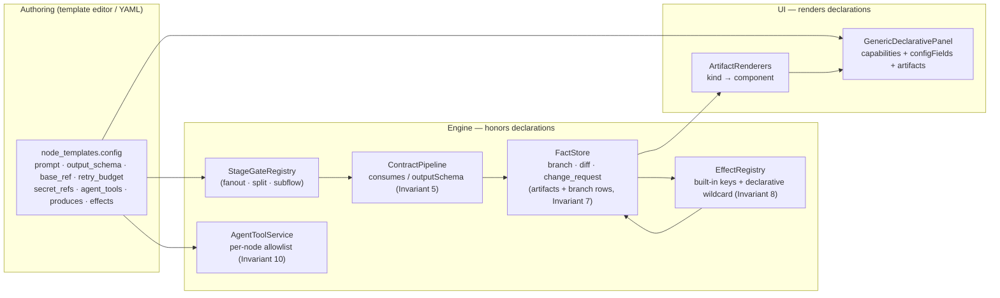

# Declarative node extensibility — design

One mental model: **a node's behavior is data — facts it produces, effects it declares,
knobs it sets — and the engine's job is to honor declarations, not to know kinds.**
Built-ins and declarative nodes run on the same mechanisms; built-ins are just the
nodes whose declarations are compiled into classes.

Today the product promises "configure in UI" but the engine implements "register in
code": backend extensibility is real (ports, registries, declarative def hydration),
while side effects, UI, and runtime controls are wired per built-in kind. This doc
is the design for closing that gap — verified against the tree at `orm-12`
(2026-11-21), organized as five generic layers, each one the completion of a
mechanism that already exists.

Relationship to other docs: extends
[`../engine-overhaul/target-architecture.md`](../engine-overhaul/target-architecture.md)
(its invariants are inherited — every new mechanism below names the invariant it
upholds) and follows the recipe style of
[`../coding-patterns.md`](../coding-patterns.md). The chat-unification plan
([`../make-agentic-node-consitent.md`](../make-agentic-node-consitent.md)) is the
same philosophy applied to the chat surface; this doc applies it to facts, effects,
config, panels, and runtime policy.

---

## 1. The problem, verified

The unifying pattern: **the product promises "configure in UI," but the engine
implements "register in code."** Every claim below was re-verified against the
current tree; each names its evidence.

### A. Git side effects are built-in-only

| # | Finding | Evidence |
| --- | --- | --- |
| A1 | Agent code changes are invisible. The agent port already reports pushed branches (`AgentRunResult.git.branches`, `lib/engine/ports/agentPort/types/agentPort.ts:45-46`), but `AgentTemplateNode.finalizeOutput` passes only `result.result` (text) to `applyOutput` — git facts are dropped. Artifacts are only `json`/`markdown` (`agentOutcome.ts:66,89`); `AgentView.tsx:38` filters to those kinds; `DiffView` renders only inside `BuildView.tsx:193`. | `agentTemplateNode.ts:311-349`, `agentOutcome.ts` |
| A2 | Base ref is hardcoded: `startingRef: ctx.flow.mrBranch ?? undefined` in both `run()` and `chat()`. No `base_ref` knob exists in `AGENT_CONFIG_FIELDS`. A custom codegen node can't branch off `develop`, a tag, or a chosen branch. | `agentTemplateNode.ts:242,275`, `constants/agentConstantsExports.ts:19-46` |
| A3 | MR resolution is flow-level only: `MrTargetResolver` resolves from a plan branch row or `ctx.flow.mrIid`, else throws *"approve the build to create one first"*. `flowVariables.ts:73-76` exposes only `mr_url`/`mr_branch` — not even `mr_iid`, and none of the per-branch MRs `branchStore` already tracks. | `shared/mrTargetResolver/mrTargetResolver.ts:16-37`, `context/flowVariables.ts` |
| A4 | The capability is 80% built and unexposed: `MergeRequestService.create(ctx, branchName?)` already does generic branch→CR (resolve branch, push in local mode, create/reuse on host, persist to flow or branch row, bounded fix loop via `createWithFixes`). Only the SDLC chain calls it — via the build-only `afterApproval` registration (`sdlcEffects.ts:49-54`). | `kinds/mergeRequest/mergeRequestService/mergeRequestService.ts` |

### B. Extensibility stops at the backend

| # | Finding | Evidence |
| --- | --- | --- |
| B1 | UI panels aren't pluggable: two hardcoded tables (`PANEL_BY_TYPE`, `PANEL_BY_KIND`) and a fallback that tells the user their node *"isn't supported yet — it can't run, even though you can configure it in the template editor"* — directly contradicting README:3's *"one adapter file + one register() line."* | `panels/panelFactory.tsx:33-62`, `panels/NodePanel.tsx:88-93` |
| B2 | Config vocabulary is code, not data: `AGENT_CONFIG_FIELDS` is a static array; `ConfigField.type` is a closed 10-value union; the renderer is an if-chain (`ConfigFieldRow.tsx`). Adding one knob means editing the Zod def schema, the field array, the renderer, and the execution path. | `templates/nodeConfig.ts:43-66`, `kinds/agent/constants/agentConstantsExports.ts` |
| B3 | Custom nodes can't declare effects: `EffectRegistry.register(defKey, effects)` is boot-time registration keyed by defKey (`flowEngine.ts:99-101`), but declarative def keys are `instanceKey ?? tmpl.id` — a DB id unknowable at boot. | `runtime/effects/effectRegistry.ts:42-53`, `shared/declarativeNode.ts:44,93` |
| B4 | No sub-workflow / composite node: `FlowKind` is `sdlc \| step \| split`; fan-out/split are the only child-flow runtimes, and the stage-ownership decision is a hardcoded two-branch chain in the StageRunner. | `schema.prisma:29-35`, `runtime/staging/stageRunner.ts:190-195` |

### C. Runtime controls aren't exposed to custom nodes

| # | Finding | Evidence |
| --- | --- | --- |
| C1 | Agent prompts can't use secrets: `TemplateRenderer` supports `{{secrets.NAME}}` only where a `resolveSecret` callback is supplied — exactly one call site (`httpNode.ts:117`). Worse: with no resolver, a secret ref silently renders `""` (`templateRenderer.ts:56`); it only throws when a resolver exists but the value is missing. `flowVariables.ts:21-23` deliberately excludes secrets from the context map. | `shared/templateRenderer.ts:52-63` |
| C2 | Tool surface varies by execution mode, by design and invisibly: `mcp_sources` selects ambient setting layers, but the cloud adapter intentionally drops `settingSources` (`cursor/agentPort.ts:37-39` — *"local-runtime only"*). There is no per-node tool allow/deny policy; the same node behaves differently cloud vs local with no record of why. | `templates/schemas/mcpSources.ts`, `ports/agentPort/types/agentPort.ts:87-93` |
| C3 | Retry budget is class-level: `NodeDefinition.retryBudget = 1`, overridden per built-in (review/build = 0); the agent-output pipeline spends it (`agentTemplateNode.ts:326`), but a declarative node has no knob. | `shared/nodeDefinition.ts:160-164` |
| C4 | The engine tool surface is read/report-only: `AGENT_TOOL` is a closed 3-name union (`read_flow_state`, `claim_checklist_progress`, `report_failure`); allowlists are tier-based (`AgentRunNode.agentTools()` → `readAndReport`). Adding a tool means touching the constant, the descriptors, the Zod payload schema, the registry, and every allowlist. | `agentTools/constants/agentTools.ts`, `composition/container.ts:97-99` |

### D. Iteration and observability gaps

| # | Finding | Evidence |
| --- | --- | --- |
| D1 | No whole-template dry run: `/api/templates/[id]/preview` evaluates a single JSONata expression against a sampled context. The `fakeAgentPort`/`fakeGitHost` harnesses exist only in tests — and can't become a service cheaply, because ports resolve through **registry singletons at call time** (`agentPortRegistry.forMode`, `gitHostRegistry.forRepo`), never through the composition roots. `seed-custom-flow.mjs` hand-writes completed node rows precisely because the engine can't simulate a run. | `templates/templatePreviewService.ts`, `tests/helpers/fakeAgentPort.ts` |
| D2 | No in-flow reconfiguration: template snapshotting is deliberate (README:152; `flowFactory.ts:95-107`), but the panel's answer to a wrong prompt is *"Configure the node and re-run in a new flow"* — even though `nodeConfig()` already re-reads `nodes.config` at run time, so a config-version bump for not-yet-started nodes is nearly free. | `shared/nodeDefinition.ts:260-271`, `panels/views/AgentView.tsx:51` |

### Similar seams found in this audit (same kind, not in the original list)

| # | Finding | Evidence |
| --- | --- | --- |
| E1 | **Stage ownership is hardcoded**, even though post-terminal effects were generalized: `stageRunner.ts:190-195` literally chains `stepFlows.gate()` then `splitManager.stageGate()`. A third runtime edits engine code. | `runtime/staging/stageRunner.ts` |
| E2 | **The contract retry loses the base ref**: the agent-output pipeline's `executeRetry` doesn't pass `startingRef`, so a retried run starts from a different base than the first run. The class of bug per-kind wiring produces. | `agentTemplateNode.ts:336-343` |
| E3 | **Engine-dispatch metadata flags exist but are built-in-only**: `chainRole`, `builtinApproval`, `resourceArtifacts`, `waitForKind` — *"call sites key off these flags, never a literal built-in def key"* — but declarative defs can't declare any of them. | `shared/nodeDefinition.ts:76-107` |
| E4 | **`NodeCapabilities` is a serialization-safe extension vocabulary nobody extends**: `refinable`, `chatMode`, `panelTitle`, `startLabel`, `mergeBack`, `fanoutOutput`, `splitOutput` already cross the RSC boundary. A generic panel can be ~100% driven by `(capabilities, artifacts, configFields)` — the infrastructure exists, unused, on every declarative node. | `shared/capabilities.ts:60-138` |

---

## 2. The pattern: the mechanisms exist, the wiring is per-kind

Every "too specific to a node" seam sits next to a generic mechanism that was only
wired for built-ins. The design below is five completions, not five inventions:

1. **Wildcard effects** (fan-out/split register under `EFFECT_KEY_ANY` and decide
   relevance by linkage lookup — `coding-patterns.md §3.12`) → declarative effect
   *declarations* can dispatch the same way. (→ §4, L2)
2. **Shared config field sets** (`fanoutConfigFields`, `mcpSourceConfigFields`,
   `splitConsumerConfigFields` + defensive readers like `fanoutOf`) made fan-out
   available to any agent node without touching its class → the same pattern adds
   `base_ref`, `retry_budget`, `secret_refs`, `agent_tools`, `produces`, `effects`.
   (→ §5, L3)
3. **`MergeRequestService`** is already a generic branch→CR service → it becomes
   the body of the first effect verb and agent tool. (→ §4)
4. **Metadata flags + capabilities** (E3/E4) already let engine and UI key off
   declarations instead of kinds → declarative defs start declaring them. (→ §6)
5. **The `AgentStartSpec.env` channel** (step 08's capability-token transport)
   already injects per-run env into agent processes → per-node secrets ride it.
   (→ §7)

---

## 3. Design overview



### Who owns what

| Component | Responsibility | Invariants |
| --- | --- | --- |
| **FactStore** (new, thin) | The typed fact vocabulary (`branch`, `diff`, `change_request`): persists facts into the existing homes (artifacts, branch rows, flow MR columns), resolves fact lookups for resolvers and the flow context. Never creates a parallel storage layer. | 7 (journaled writes) |
| **Declarative effect verbs** | The closed verb vocabulary (`create_change_request`, `publish_diff`, …): each verb wraps an existing service and runs under the node's attempt claim. | 7, 8, 11 |
| **Declarative wildcard effects** | One `EFFECT_KEY_ANY` registration per lifecycle that reads the node's config `effects` map and dispatches to verbs. Relevance is decided from config, never from a def key. | 8 |
| **StageGateRegistry** | The stage-ownership axis the EffectRegistry never had: registered gates (`fanout`, `split`, `subflow`) that may own a stage before the def runs. | 8 |
| **ArtifactRendererRegistry** (UI) | `artifact.kind → component`, with `json`/`markdown`/`diff`/`plan` built in and a `<pre>` fallback. | — |
| **GenericDeclarativePanel** (UI) | The default panel for any declarative node: driven entirely by `capabilities` + `configFields` + artifacts. Built-in panels remain as richer overrides. | — |

---

## 4. L1+L2 — Facts and declarative effects

These two land together: facts are what effects and resolvers consume; effects are
how declarative nodes produce world-changing facts.

### 4.1 The fact vocabulary (L1)

A **fact** is a typed, node-scoped claim about the world a node established.
Facts persist in the homes that already exist — the vocabulary is a formalization,
not a new storage layer:

```ts
// lib/engine/facts/types/facts.ts
export const FACT_KIND = {
  BRANCH: "branch",                  // → branchStore row (exists)
  DIFF: "diff",                      // → artifact kind "diff", meta {branch, stat} (exists in stepRollup.ts:170)
  CHANGE_REQUEST: "change_request",  // → branch row mrIid/mrUrl or flows.mrIid (exists)
} as const;
export type FactKind = (typeof FACT_KIND)[keyof typeof FACT_KIND];
```

- **`produces` on the agent def** declares which facts the node's run may
  establish and how they map from the run result:

  ```ts
  // AgentDefSchema addition
  produces: z.array(z.enum(["branch", "diff"])).default([]),
  ```

  `AgentTemplateNode.finalizeOutput` (which today drops `result.git`) maps:
  `result.git.branches[]` → a `branch` fact per branch (branchStore row, status
  `pushed`); each branch → `ctxHelper.makeDiff(ctx, branch)` → a `diff` artifact
  (`meta {branch, stat}` — the exact shape `stepRollup` already writes). Facts are
  written in the same transaction discipline as `applyOutcome` (Invariant 7); git
  I/O happens before the batch (the `stepRollup.ts:42` precedent).

- **Resolvers consume facts, not flow columns.** `MrTargetResolver` gains its
  third source: flow MR → branch MR → **change_request fact produced upstream**
  (the most recent branch row with an `mrIid`, or the row for the flow's
  integration branch). The flow context exposes what it already knows:
  `flow.mr_iid`, plus `branches.<name>.{mr_iid, mr_url, status}` from
  `branchStore` — today it exposes only `mr_url`/`mr_branch`
  (`flowVariables.ts:73-76`).

- **The ContractPipeline stays the output gate.** `produces` governs *side-effect
  facts*; the `outputSchema` still governs the published `nodes.<key>.output`.
  Edge-condition lint (`lintExpressions.ts`) is unchanged — but it now also
  covers `change_request` consumers statically, because a node whose config
  declares `needs: ["change_request"]` (see 4.2) fails lint when no upstream node
  declares `produces`/`effects` that can establish one.

### 4.2 Declarative effect declarations (L2)

- **Config surface** (all declarative kinds, loose schemas tolerate it today):

  ```ts
  effects: z.object({
    afterApproval: z.array(z.enum(["create_change_request"])).default([]),
    afterSuccess: z.array(z.enum(["publish_diff"])).default([]),
  }).default({}),
  ```

- **Dispatch** rides the wildcard precedent: one registration per lifecycle that
  decides relevance from config, never from a def key:

  ```ts
  // lib/engine/nodes/declarativeEffects.ts — registered in the FlowEngine
  // constructor beside registerSdlcEffects/registerFanoutEffects
  registry.register(EFFECT_KEY_ANY, {
    afterApproval: async (ctx) => {
      const verbs = await declarativeEffectVerbs(ctx, "afterApproval"); // reads the node's config
      for (const verb of verbs) await verbRegistry.run(verb, ctx);      // claims through the gateway
    },
  });
  ```

  Registry ordering (exact defKey first, wildcard second — `effectRegistry.ts:59-64`)
  means built-ins keep their compiled effects untouched; declarative nodes get
  theirs from data. `run()` returning `true` when a verb ran preserves the
  "an effect owns the follow-on" rule (Invariant 8).

- **Verbs are capability-gated and journaled.** `create_change_request` wraps
  `MergeRequestService.create` — which already persists to branch/flow rows and
  already has the `onPersist` hook for journal completion (Invariant 7). The verb
  declares its required facts (`branch`); a node without a `branch` fact fails
  loudly with a typed event naming the missing fact and the verb — the effect-layer
  analogue of `input_contract_violation`.

- **The agent-tool verb** (`create_change_request` in `AGENT_TOOL`) is the same
  verb exposed to a running agent: `AgentToolService.dispatch` already
  authenticates the attempt and authorizes against the kind's allowlist
  (Invariant 10); §7 makes the allowlist per-node. The agent can then *ask* for
  the MR instead of the flow hardcoding when it happens — the difference between
  "agent prose claims success" and "the engine authoritatively establishes facts."

### Invariants (acceptance criteria, arch-tested where possible)

- **F1.** No engine call site compares against a literal declarative def key —
  relevance comes from config or linkage (the existing `EFFECT_KEY_ANY` rule,
  extended). Test: registry snapshot pins built-in keys + the wildcard only.
- **F2.** Every fact write lands in the terminal write's transaction or journals
  through `jobs` (Invariant 7). No half-established facts after a crash.
- **F3.** A declarative effect can never run for a built-in node, and vice versa
  (config-absent ⇒ wildcard no-ops ⇒ default edge walk, byte-for-byte today).
- **F4.** `result.git` is consumed iff the def declares `produces: ["branch"|"diff"]`
  — undeclared git facts stay dropped (least surprise, least privilege).

---

## 5. L3 — Config vocabulary as data

Follow the `fanoutConfigFields` recipe (field set + defensive reader + lint +
one consuming seam) for each new knob. New shared field sets in
`lib/engine/templates/nodeConfig.ts` (or the kind's `constants/` when
kind-specific), spread into `AGENT_CONFIG_FIELDS` and any other agent-running
def's fields:

| Knob | Schema addition (def) | Consumed at | Field type |
| --- | --- | --- | --- |
| `base_ref` | `z.string().nullable().default(null)` — `{{...}}` allowed, rendered at run time | `AgentTemplateNode.run`/`chat`/retry: `startingRef: cfg.base_ref ?? ctx.flow.mrBranch ?? undefined` (fixes E2 — one resolver, used in all three) | `string` (nullable) |
| `retry_budget` | `z.number().int().min(0).max(5).default(1)` | `finalizeOutput`: `budget: retryBudgetOf(cfg, this.retryBudget)` — config wins, class default is the floor's fallback | `number` |
| `secret_refs` | `z.array(z.string()).default([])` | run start: resolve via `SecretStore` → `AgentStartSpec.env` (never persisted, never in the recorded input); prompt-level `{{secrets.NAME}}` gets a resolver scoped to the declared refs (fixes the silent-`""` hole, C1) | `multi` (options from the secrets list API) |
| `agent_tools` | `z.array(z.enum(AGENT_TOOL_NAMES)).default(["read_flow_state","report_failure"])` | `AgentToolService.authorize`: `def.agentTools()` ∩ node's declared set (one seam) | `multi` |
| `produces` | see §4.1 | `finalizeOutput` fact mapping | `multi` |
| `effects` | see §4.2 | declarative wildcard | `json` initially; a bespoke editor later |

- **The `ConfigFieldRow` if-chain becomes a registry**: `type → renderer`, with
  the existing ten renderers as entries and `ConfigPlainField` as the fallback —
  same shape as the artifact renderer registry (§6). Adding a field type stops
  requiring an edit to a shared component.
- **Unknown keys stay tolerated** (`z.looseObject` on agent/script defs) so a
  declarative extension handler can read them; the def schemas gain explicit
  keys for anything the engine itself consumes.
- **`SET_NODE_CONFIG` for not-yet-started nodes** (D2): the node row's config
  snapshot is already re-read at run time (`nodeConfig()`); allow editing it
  while `status ∈ {pending, failed}` with a typed `config_updated` event, and
  the generic panel's Configure dialog works in-flow. The deliberate snapshot
  semantics (README:152) are unchanged — you're editing *this flow's* snapshot,
  not the template.

---

## 6. L4 — Panels and artifact renderers

- **Artifact renderer registry** (`components/flows/panels/artifacts/`):
  `Record<string, ComponentType<{artifact}>>` with `markdown`, `json`, `diff`
  (the existing `DiffView`, promoted out of `BuildView`), `plan` entries and the
  `<pre>` `GenericArtifact` as fallback. Panels stop hardcoding kind filters.
- **GenericDeclarativePanel** becomes the `PANEL_BY_KIND` fallback instead of
  the "isn't supported yet" message: header (`capabilities.panelTitle ?? label`),
  prompt/config summary (from `configFields` + the config snapshot), artifacts
  rendered by kind, the approval affordance for approval-triggered nodes, and
  the chat rail via `capabilities.refinable` (already resolved generically).
  Built-in panels remain as overrides in `PANEL_BY_TYPE`; unknown declarative
  kinds get a fully functional panel for free.
- **Declarative defs start declaring UI metadata**: `panelTitle` (E4) and, where
  useful, `resourceArtifacts`/`waitForKind` (E3) become declarable on the def —
  the engine already keys off the flags; this just lets data set them.

---

## 7. L5 — Runtime policy and the remaining runtimes

- **Per-node tool policy** (C2): `agent_tools` (§5) governs engine tools; MCP
  policy rides the existing `settingSources` plumbing — the cloud adapter's
  *"local-runtime only"* behavior becomes an explicit, recorded policy decision
  instead of a silent one: the effective tool/MCP set is written to the run row
  (the `env` channel's sibling), so a run's trail shows exactly what the agent
  could call. Cloud-vs-local divergence stops being folklore.
- **StageGateRegistry** (E1): the two-branch chain in `stageRunner.ts:190-195`
  becomes a registered axis, mirroring the effects wildcard:

  ```ts
  interface StageGate {
    /** "own" = the gate ran the stage (expansion/wait) — skip the def run;
     *  "run" = not mine; { run, afterRun } = run the def, then let the gate
     *  post-process (fan-out's whole-wrap). */
    gate(flowId: string, nodeKey: string): Promise<"own" | "run" | { run: true; afterRun(): Promise<void> }>;
  }
  ```

  `stepFlows` and `splitManager` register instead of being called; the
  StageRunner keeps zero fan-out/split knowledge (target-architecture §1's
  promise, completed).
- **Subflow** (B4) is then a small addition, not a new runtime: a declarative
  `subflow` kind whose config is `{ child: templateId, parallel_max }`, a
  registered gate that expands **one** child via the existing
  `createStepChild`-style path (start-contract-validated payload from the node's
  `input_map` — the same validation `flowFactory.ts:131-139` already runs), and
  a wildcard `onChildTerminal` rollup that publishes the child's terminal output
  (or a declared `pass` mapping) as the parent node's aggregate. Child FlowKind
  reuses `step` — enum values are sticky (AGENTS §1), and a subflow child *is*
  mechanically a step child; add a distinct kind only if the reconciler or UX
  ever needs to tell them apart (see §10, open questions).
- **Dry-run** (D1): `flows.executionMode` is a plain string column
  (`schema.prisma:186`), and ports already resolve per mode
  (`agentPortRegistry.forMode(flow.executionMode)`). A `"dry-run"` mode whose
  registered ports are the test-harness fakes (`fakeAgentPort`/`fakeGitHost`
  promoted into `lib/`) gives whole-template simulated execution: real graph,
  real snapshots, real contracts and effects, fake side effects. The registries
  forbid duplicate kinds, so the fake ports register under a distinct harness
  key selected by the mode — no resolution-context surgery. The template editor
  gets "Dry run" beside "Run": it creates a flow with `execution_mode =
  "dry-run"`, streams the same events, and the run is deleted or kept as a
  trace. Policy note: dry-run flows must be excluded from reconciler/poller MR
  duties by the mode check already present at those seams.

---

## 8. The UX, end to end (worked example)

**Scenario.** A team wants a *Release changelog* pipeline: on a schedule, an
agent branches off `develop`, summarizes the merged MRs into
`CHANGELOG.md`, pushes, and — after a human approves the diff — opens a real
MR against `develop`. None of the built-in kinds does this; today it is
impossible without writing a node class.

**Before (today).** The user authors an `agent` node template. In the template
editor they can set a prompt, a model, MCP sources, output format — nothing
else. The agent starts from `flow.mrBranch` (A2) — wrong base. If it commits
and pushes, the run finishes `done` with the text as a markdown artifact; the
pushed branch vanishes (A1). The node holds at approval (approval trigger), but
approving does nothing — `afterApproval` is registered only for the built-in
`build` key (B3). The panel shows the "isn't supported yet" fallback if the
kind were anything but the hardcoded four (B1). When the agent returns malformed
JSON, it gets one retry — unchangeable (C3). The user then opens the MR by
hand. The feature they configured does not exist.

**After (this design).**

1. **Authoring.** New node template → kind *Agent*. The configurator shows the
   new sections alongside today's: **Git** (`base_ref: "develop"`, `produces:
   [branch, diff]`), **Effects** (`afterApproval: [create_change_request]`),
   **Runtime** (`retry_budget: 2`), **Access** (`secret_refs: []`, `agent_tools:
   [read_flow_state, report_failure]`). The prompt references
   `{{trigger.payload.since}}` — the template's start contract declares
   `since: string`.
2. **Lint.** They wire `changelog → gate`. `lintEdgeConditions` already checks
   output refs; the new fact lint confirms the gate's `change_request` need is
   satisfiable (`effects.afterApproval` declares it). Save.
3. **Dry run.** They click **Dry run**: a flow with `execution_mode="dry-run"`
   runs the whole graph on fake ports. The panel shows the fake branch, the
   fake diff, the approval hold; approving fires the verb against the fake
   host. They iterate on the prompt three times without touching the repo.
4. **Real run.** The schedule fires. The agent node runs from `develop`, pushes
   `changelog/2026-47`: the FactStore records the `branch` fact and a `diff`
   artifact. The node's panel — the *generic* panel — renders the diff in the
   same `DiffView` build uses, because rendering is by artifact kind, not node
   kind (B1 fixed). The user inspects the diff in the panel and clicks Approve.
5. **Approval.** The declarative wildcard `afterApproval` reads the node's
   config, runs `create_change_request` under the node's attempt claim:
   `MergeRequestService` creates the MR against `develop`, journals through
   `jobs`, persists the branch row. The gate downstream resolves the MR through
   the fact fallback in `MrTargetResolver` — no `flow.mrIid` required (A3
   fixed) — and waits on the real pipeline. Template expressions can reference
   `{{flow.mr_iid}}` and `{{branches.changelog/2026-47.mr_url}}`.
6. **Failure path.** A later run returns malformed JSON: the agent-output
   pipeline spends the declared `retry_budget: 2` (C3 fixed), then fails with
   the typed `output_contract_violation` event. The user edits the prompt **in
   the flow's own node config** (D2 fixed — pending/failed nodes accept config
   edits) and retries in place.

The user never filed a ticket to engineering; engineering never wrote a node
class. That is the acceptance test of the whole design.

---

## 9. What this fixes

| Issue | Layer | Outcome |
| --- | --- | --- |
| A1 git facts dropped | L1 | `produces: [branch, diff]` maps `result.git` → facts; diff renders anywhere via the renderer registry (Fixed: Task 07) |
| A2 hardcoded base ref | L3 | `base_ref` knob, one resolver used by run/chat/retry (also fixes E2) (Fixed: Task 03) |
| A3 flow-level MR resolution | L1 | fact fallback in `MrTargetResolver`; `mr_iid` + per-branch MRs in the flow context (Fixed: Task 04) |
| B1 panels hardcoded | L4 | generic declarative panel + artifact renderer registry; fallback message deleted (Fixed: Task 01) |
| B2 config is code | L3 | shared field sets + renderer registry; unknown keys tolerated by loose schemas (Fixed: Task 02) |
| B3 no declarative effects | L2 | config `effects` map → wildcard dispatch → verb registry (Fixed: Task 10) |
| B4 no subflow | L5 | `subflow` kind on the StageGateRegistry + existing child-creation path (Fixed: Task 26 — declarative-shaped built-in, `FlowKind.step` reuse; `NodeTemplateKind` enum is sticky) |
| C1 secrets in prompts | L3/L5 | `secret_refs` → `AgentStartSpec.env`; scoped resolver; no silent `""` (Fixed: Task 15) |
| C2 mode-dependent tools | L5 | per-node `agent_tools` + recorded effective policy (Fixed: Task 16) |
| C3 class-level retry | L3 | `retry_budget` knob (Fixed: Task 03) |
| C4 read-only tools | L2 | effect verbs double as capability-gated tools (`create_change_request` first) (Fixed: Task 13) |
| D1 no dry run | L5 | `"dry-run"` execution mode + promoted fake ports (Fixed: Task 27) |
| D2 no in-flow reconfig | L3 | config edit for `pending`/`failed` nodes (snapshot semantics preserved) (Fixed: Task 05) |
| E1 hardcoded stage gates | L5 | StageGateRegistry (Fixed: Task 24) |
| E2 retry loses base ref | L3 | single `base_ref` resolver on all paths (Fixed: Task 03) |
| E3/E4 flags/capabilities built-in-only | L4 | declarable on defs (E4 Fixed: Task 01) |

---

## 10. Sequencing

Ordered by leverage-per-risk; each tier is independently shippable and leaves no
dangling half-mechanism. The ORM migration is done (orm-12), so no contention.

**Tier S — declarations the engine already half-knows (days):**

1. `base_ref` + `retry_budget` field sets, readers, and consumption (one
   resolver each; fix the retry path's missing `startingRef`).
2. Fact/context exposure: `flow.mr_iid`, `branches.*` in `flowVariables`;
   `MrTargetResolver` fact fallback (reads existing branch rows — no new
   storage).
3. Artifact renderer registry + `GenericDeclarativePanel` fallback (UI-only;
   built-ins untouched).
4. `SET_NODE_CONFIG` allowed for `pending`/`failed` nodes + `config_updated`
   event.

**Tier M — the facts/effects core (the keystone, ~weeks):**

5. `produces` on the agent def + `result.git` mapping + fact persistence in the
   `applyOutcome` batch.
6. Declarative wildcard effects + the verb registry; `create_change_request`
   verb over `MergeRequestService` (journaled); `create_change_request` agent
   tool + per-node `agent_tools` allowlist.
7. `secret_refs` → `AgentStartSpec.env` + scoped prompt resolver.

**Tier M–L — structural completions:**

8. StageGateRegistry (fan-out/split re-register; StageRunner slims).
9. `subflow` declarative kind on the new gate + child-creation reuse.
10. `"dry-run"` execution mode: promote fake ports into `lib/`, register under
    a dry-run harness key, wire the template editor's Dry run button.

**Definition of Done per tier:** AGENTS §0 (`typecheck`, `lint`, `test`,
`build`), plus the §4 invariants as arch tests (registry snapshot, fact-write
transactions, wildcard no-op on built-ins), plus co-located tests for every new
service/reader/verb.

---

## 11. What explicitly does NOT change

- **The built-in node classes.** Their compiled declarations (effects, tools,
  retry budgets) stay exactly as compiled; declarative declarations are
  additive data. The registry snapshot test pins this.
- **Template snapshotting** (README:152): flows still snapshot at creation;
  Tier S item 4 edits only *the flow's own snapshot* for not-yet-started nodes.
- **The ports/adapters boundary** and the agent-output pipeline's contract
  discipline (Invariants 5, 6): `produces` governs side-effect facts, never the
  published output; an undeclared git fact stays dropped (F4).
- **The transition table, TriggerGateway claims, and effect-driven claim
  fencing** (Invariants 1, 8, 11): verbs and gates claim through the same
  gateway; no new dispatch path skips a claim.
- **`FlowKind`/`NodeTemplateKind` enums**: subflow reuses `step` children (see
  below). Enum values are sticky — add only when forced.

## 12. Risks and open questions

1. **Subflow FlowKind**: reusing `step` is least invasive (the child-creation
   path already validates start contracts), but if the reconciler or the UX
   needs to distinguish "one delegated child" from "fan-out sibling", a
   distinct kind is cleaner. Decide at Tier M–L with evidence from Tier M.
2. **Fact/query fan-out**: `branches.*` in the flow context reads branch rows
   per render; acceptable at current scale (flows have ≤ dozens of branches)
   but worth a `rows.ts`-validated read model if templates start looping over
   it heavily.
3. **Dry-run isolation**: the fake ports are today registered process-globally
   in tests; in production they register only under the `dry-run` harness key,
   and mode checks at the reconciler/poller seams must exclude dry-run flows
   from real MR duties. The alternative (an isolated worker process) stays
   available if mode-keyed selection proves leaky.
4. **Verb vocabulary growth**: verbs and tools are deliberately closed unions
   (the `AGENT_TOOL` precedent). New verbs are code — that's the safety
   boundary: *declarations are data, capabilities are code.* A user composes;
   only engineering grants.
