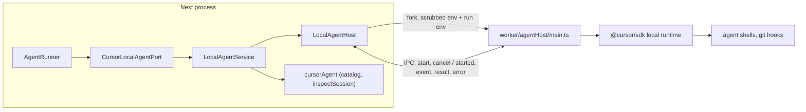

---

name: Local agents in worker
overview: Run each local Cursor agent in its own forked child process with a scrubbed environment plus the run's env vars, so agent shells (and git hooks) no longer inherit the DevFlow server's NODE_ENV and secrets. The engine and AgentPort interface stay unchanged; only the local port's plumbing moves behind an IPC boundary.
todos: - id: env-builder
content: Add buildAgentHostEnv + scrub-list constants; reuse in worktreeSetup.runCommand
status: pending - id: protocol
content: Define IPC protocol types, message-kind constants and Zod schemas
status: pending - id: dispatch-helper
content: Extract SDK message dispatch into a pure shared helper; expose resolveModel/apiKey on CursorAgentService
status: pending - id: child-entry
content: Write worker/agentHost/main.ts (start/cancel/disconnect handling, streams events, posts result)
status: pending - id: host-class
content: Implement LocalAgentHost (fork, buffering, stream, cancel, exit error) pinned via pinnedProcessService
status: pending - id: rewire
content: Delegate LocalAgentService run lifecycle to LocalAgentHost; remove local branch from CursorAgentService.createRun; forward spec.env in the local port
status: pending - id: token-env
content: Switch the tools prompt block to reference DEVFLOW_AGENT_TOKEN for local runs; update AgentStartSpec.env docs
status: pending - id: tests
content: Add/update tests (env builder, protocol, host with fixture child incl. NODE_ENV=production case, existing suites)
status: pending - id: docs-verify
content: Update agent-harness.md; run npm run check + build; manual husky-hook check under npm run start
status: pending
isProject: false

---

# Run local agents in a per-run child process

## Why this shape

Today `CursorLocalAgentPort` calls `cursorAgent.createRun({ cloud: false })` inside the Next process ([lib/integrations/cursorSdk.ts](lib/integrations/cursorSdk.ts) lines 251-260). The SDK runs the agent loop in-process, so every shell the agent spawns inherits the server's `process.env`. That env includes `NODE_ENV=production` (the husky bug), and also `DEVFLOW_LOCAL_API_TOKEN`, `DEVFLOW_SECRETS_KEY`, `DATABASE_URL` and `GITLAB_WEBHOOK_SECRET` loaded from `.env`.

Forking one child per run fixes this and gives local runs a real env channel. The capability token can then go into `DEVFLOW_AGENT_TOKEN` instead of being inlined in the prompt.

What stays the same: `AgentPort`, `AgentRunner`, `BgRunner` and the recovery driver. The web process still owns the run handle, so `hasActiveRun` and the "restart means the run is gone, probe `inspectSession`" path keep working. `inspectSession` and `listCatalog` stay in-process because they spawn no shells.

## Changes

**1. Env builder (pure helper + constants)**

- `lib/integrations/localAgent/host/constants/agentHostEnv.ts` holds two lists:
  - `SCRUBBED_ENV_KEYS`: `NODE_ENV`, `NEXT_RUNTIME`, `NEXT_PHASE`, `DEVFLOW_LOCAL_API_TOKEN`, `DEVFLOW_SECRETS_KEY`, `DATABASE_URL`, `TEST_DATABASE_URL`, `GITLAB_WEBHOOK_SECRET`, `GITLAB_WEBHOOK_ALLOW_UNSIGNED`
  - `SCRUBBED_ENV_PREFIXES`: `__NEXT`, `NEXT_PRIVATE_`
- `lib/integrations/localAgent/host/agentHostEnv.ts` exports `buildAgentHostEnv(base, runEnv)`. It copies `base`, drops the scrubbed keys and prefixes, then merges `runEnv` on top.
- Reuse it in `runCommand` in [lib/git/worktreeSetup.ts](lib/git/worktreeSetup.ts) (line 625, currently `env: process.env`). Otherwise `yarn install` during worktree setup still runs with `NODE_ENV=production` and skips devDependencies.

**2. IPC protocol (validated at the boundary)**

- `lib/integrations/localAgent/host/types/agentHostProtocol.ts`:
  - Parent to child: `start` carries `apiKey`, `cwd`, `prompt`, `mode`, `name`, the already-resolved `ModelSelection`, `sandbox`, `force`, `resumeAgentId` and `settingSources`. `cancel` has no payload.
  - Child to parent: `started { agentId, runId }`, `event` (status, assistant, thinking or tool), `result { result }`, and `error { message }`.
- `lib/integrations/localAgent/host/agentHostMessages.ts` holds Zod schemas. The parent validates every child message.
- Message kinds go in `constants/agentHostMessageKinds.ts`.

**3. Child entry: `worker/agentHost/main.ts`**

- It runs under the existing `tsx` + `worker/tsconfig.json` setup, which maps `server-only` to the stub.
- At boot it deletes its own loader-only var (`TSX_TSCONFIG_PATH`) so it doesn't reach agent shells.
- On `start`, it calls `Agent.create` or `Agent.resume` with `local: { cwd, sandboxOptions, settingSources }`, then `agent.send`, then posts `started`.
- It maps each SDK message to an `event` using the dispatch helper from step 5, then posts `result`, closes the agent, and exits 0.
- On `cancel` it calls `run.cancel()`. On `disconnect` (the parent died) it cancels and exits, so no orphaned agent keeps editing files.

**4. Parent: `LocalAgentHost` class**

- File: `lib/integrations/localAgent/host/localAgentHost.ts`. It is pinned through `pinnedProcessService("localAgentHost")` because it holds live child handles.
- `createRun(input, runEnv)` forks with `execArgv: ["--import", "tsx"]`. The env is `buildAgentHostEnv(process.env, runEnv)` plus `TSX_TSCONFIG_PATH`. It sends `start` and resolves on `started`.
- Events that arrive before `streamRun` attaches are buffered per run, since start and stream are separate `AgentPort` calls.
- `streamRun(runId, cb)` replays the buffer, forwards live events, and resolves on `result`. It rejects on `error`, or with a new typed `AgentHostExitError` (in `lib/engine/ports/agentErrors.ts`) if the child exits without a result.
- `cancelRun` sends `cancel`, then kills the child after a grace period. `hasActiveRun` and `releaseRun` work on the handle map, and `releaseRun` kills the child.

**5. Rewire the local path, and delete the in-process one**

- [lib/integrations/cursorSdk.ts](lib/integrations/cursorSdk.ts):
  - Remove the local branch of `createRun` and the local resume options; the class becomes cloud-only for runs. No fallback is kept (AGENTS.md section 4.6).
  - Make `pinFastOff` reachable as a public `resolveModel()`, and expose `apiKey()` so the parent can pass both to the child.
  - Extract `dispatch` into a pure `lib/integrations/utils/sdkMessageDispatch.ts`, shared by `pumpRun` and the child.
- [lib/integrations/localAgent/agent.ts](lib/integrations/localAgent/agent.ts): `createRun`, `streamRun`, `cancelRun`, `hasActiveRun` and `releaseRun` delegate to `localAgentHost`. Branch checkout, defaults and the timeout race stay as they are. `createRun` gains a `runEnv` input.
- [lib/integrations/localAgent/agentPort.ts](lib/integrations/localAgent/agentPort.ts): `start` forwards `spec.env`.

**6. Use the new env channel for the capability token**

- [lib/engine/ports/agentPort/types/agentPort.ts](lib/engine/ports/agentPort/types/agentPort.ts): update the `env` doc comment, since local runs now receive env too.
- [lib/engine/agentTools/utils/toolsPromptBlock.ts](lib/engine/agentTools/utils/toolsPromptBlock.ts): drop the `execMode === "local"` inline-token branch. Every mode then references `$DEVFLOW_AGENT_TOKEN`, so the token never enters prompt text. `redactCapabilityToken` stays as a safety net.

**7. Docs**

- Update the "Cursor local" section of [docs/architecture/agent-harness.md](docs/architecture/agent-harness.md): one child process per run, the scrubbed env, the IPC protocol, and the fact that the child dies with the web process.

## Tests

- `agentHostEnv.test.ts`: strips `NODE_ENV`, the secrets and the Next prefixes; the run env wins; `base` is not mutated.
- `agentHostMessages.test.ts`: valid messages parse and malformed ones are rejected.
- `localAgentHost.test.ts`: forks a small fixture child that speaks the protocol. It covers start then stream, events buffered before attach, cancel, and a child crash surfacing as `AgentHostExitError`. One case runs the parent with `NODE_ENV=production` and checks that the child reports no `NODE_ENV` but does have `DEVFLOW_AGENT_TOKEN`.
- Update `lib/integrations/localAgent/agent.test.ts`, `cursorSdk.test.ts` and the `toolsPromptBlock` tests to match.
- Finish with `npm run check` and `npm run build`. Then do a manual local run under `npm run start` against the sprinklr-ui-hub repo and confirm the husky prettier hook checks the staged files.

## Risks and flags for the PR description

- Production `next start` now needs `tsx` at runtime. It is a devDependency, and the worker already depends on it the same way. A precompiled child entry is the alternative if that's unacceptable.
- Verify the SDK's persisted local run store is keyed only on cwd and HOME. The parent's `inspectSession` must read what the child wrote, so restart recovery depends on this.
- Each run now costs one extra Node process (SDK load). That's acceptable for local runs, but worth noting.
- The `prettier.sh` fail-open (exit 0 with no base SHA, and `NODE_ENV` used as the CI signal) still needs fixing upstream in `sprinklrjs-scripts`.
